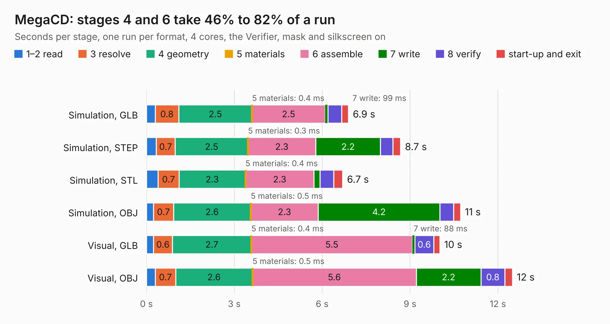

# 649. MegaCD

Board 649 of the 3,104 of [Corpus Testing](../Corpus-Testing.md), on [Corpus Page 7](../CorpusTestingPages/Corpus-Testing-07.md#649-megacd).

| Mode and format | 1–2 read | 3 resolve | 4 geometry | 5 materials | 6 assemble | 7 write | 8 verify | start-up and exit | Total |
|---|---:|---:|---:|---:|---:|---:|---:|---:|---:|
| Simulation, GLB | 0.3 | 0.8 | 2.5 | 0.4&nbsp;ms | 2.5 | 99&nbsp;ms | 0.5 | 0.2 | 6.9 |
| Simulation, STEP | 0.3 | 0.7 | 2.5 | 0.3&nbsp;ms | 2.3 | 2.2 | 0.4 | 0.3 | 8.7 |
| Simulation, STL | 0.4 | 0.7 | 2.3 | 0.4&nbsp;ms | 2.3 | 0.2 | 0.5 | 0.3 | 6.7 |
| Simulation, OBJ | 0.2 | 0.7 | 2.6 | 0.5&nbsp;ms | 2.3 | 4.2 | 0.5 | 0.2 | 10.7 |
| Visual, GLB | 0.2 | 0.6 | 2.7 | 0.4&nbsp;ms | 5.5 | 88&nbsp;ms | 0.6 | 0.2 | 10.0 |
| Visual, OBJ | 0.3 | 0.7 | 2.6 | 0.5&nbsp;ms | 5.6 | 2.2 | 0.8 | 0.3 | 12.5 |

<table align="center"><tr><td valign="top">

| Board | Repo: [Board-Folk/MegaCD-Main-BD](https://github.com/Board-Folk/MegaCD-Main-BD) Board: `MegaCD.kicad_pcb` |
|---|---|
| Folder | RAM-Adapter-837-8015-01 |
| Complexity | 251&nbsp;/&nbsp;1000 (size&nbsp;156, features&nbsp;95) |
| KESE&nbsp;features | through vias, rounded, trapezoid or chamfered pads, filled zones, copper text, curved board outline, stack-up, dielectric εr and tanδ |
| Tested | 9th November 2026 |
| Copper&nbsp;layers | 4 |
| File&nbsp;format | KiCad 7 (20221018) |
| Parts,&nbsp;tracks,&nbsp;vias | 7, 359, 27 |
| Triangles,&nbsp;simulation | 814,600 in 54 parts |
| Verifier | PASS in all six runs |

</td><td valign="top">

<table>
<tr><th>File type</th><th>File size</th><th>Peak memory used</th></tr>
<tr><th colspan="3" align="left">Simulation</th></tr>
<tr><td>GLB</td><td align="right">28&nbsp;MB</td><td align="right">396&nbsp;MB</td></tr>
<tr><td>STEP</td><td align="right">115&nbsp;MB</td><td align="right">407&nbsp;MB</td></tr>
<tr><td>STL</td><td align="right">41&nbsp;MB</td><td align="right">415&nbsp;MB</td></tr>
<tr><td>OBJ</td><td align="right">82&nbsp;MB</td><td align="right">557&nbsp;MB</td></tr>
<tr><th colspan="3" align="left">Visual</th></tr>
<tr><td>GLB</td><td align="right">16&nbsp;MB</td><td align="right">460&nbsp;MB</td></tr>
<tr><td>OBJ</td><td align="right">48&nbsp;MB</td><td align="right">442&nbsp;MB</td></tr>
</table>

</td></tr></table>

| Previous | Next |
|:---|---:|
| [648. MegaCD](b0648b_MegaCD-Main-BD_MegaCD-837-8952-Export_MegaCD.md) | [650. MegaCD](b0650b_MegaCD-Main-BD_RAM-Adapter-837-8015_MegaCD.md) |
