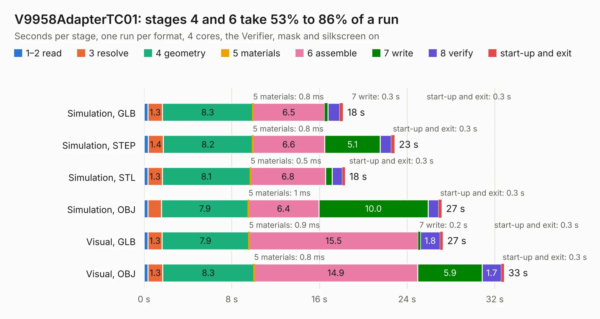

# 651. V9958AdapterTC01

Board 651 of the 3,125 of [Corpus Testing](../Corpus-Testing.md), on [Corpus Page 7](../CorpusTestingPages/Corpus-Testing-07.md#651-v9958adaptertc01).

| Mode and format | 1–2 read | 3 resolve | 4 geometry | 5 materials | 6 assemble | 7 write | 8 verify | start-up and exit | Total |
|---|---:|---:|---:|---:|---:|---:|---:|---:|---:|
| Simulation, GLB | 0.4 | 1.3 | 8.3 | 0.8&nbsp;ms | 6.5 | 0.3 | 1.1 | 0.3 | 18.2 |
| Simulation, STEP | 0.4 | 1.4 | 8.2 | 0.8&nbsp;ms | 6.6 | 5.1 | 1.0 | 0.3 | 22.9 |
| Simulation, STL | 0.4 | 1.3 | 8.1 | 0.5&nbsp;ms | 6.8 | 0.6 | 0.9 | 0.3 | 18.3 |
| Simulation, OBJ | 0.4 | 1.2 | 7.9 | 1&nbsp;ms | 6.4 | 10.0 | 1.0 | 0.3 | 27.2 |
| Visual, GLB | 0.4 | 1.3 | 7.9 | 0.9&nbsp;ms | 15.5 | 0.2 | 1.8 | 0.3 | 27.3 |
| Visual, OBJ | 0.4 | 1.3 | 8.3 | 0.8&nbsp;ms | 14.9 | 5.9 | 1.7 | 0.3 | 32.8 |

<table align="center"><tr><td valign="top">

| Board | Repo: [Board-Folk/Einstein-TC-01](https://github.com/Board-Folk/Einstein-TC-01) Board: `V9958AdapterTC01.kicad_pcb` |
|---|---|
| Folder | Expansions / V9958AdapterTC01 / Kicad |
| Complexity | 276&nbsp;/&nbsp;1000 (size&nbsp;176, features&nbsp;100) |
| KESE&nbsp;features | through vias, custom pads, filled zones, copper drawings, curved board outline, stack-up, dielectric εr and tanδ |
| Tested | 9th November 2026 |
| Copper&nbsp;layers | 2 |
| File&nbsp;format | KiCad 9 (20241229) |
| Parts,&nbsp;tracks,&nbsp;vias | 46, 1,132, 49 |
| Triangles,&nbsp;simulation | 1,913,332 in 118 parts |
| Verifier | PASS in all six runs |

</td><td valign="top">

<table>
<tr><th>File type</th><th>File size</th><th>Peak memory used</th></tr>
<tr><th colspan="3" align="left">Simulation</th></tr>
<tr><td>GLB</td><td align="right">64&nbsp;MB</td><td align="right">732&nbsp;MB</td></tr>
<tr><td>STEP</td><td align="right">272&nbsp;MB</td><td align="right">858&nbsp;MB</td></tr>
<tr><td>STL</td><td align="right">96&nbsp;MB</td><td align="right">730&nbsp;MB</td></tr>
<tr><td>OBJ</td><td align="right">196&nbsp;MB</td><td align="right">1.3&nbsp;GB</td></tr>
<tr><th colspan="3" align="left">Visual</th></tr>
<tr><td>GLB</td><td align="right">41&nbsp;MB</td><td align="right">942&nbsp;MB</td></tr>
<tr><td>OBJ</td><td align="right">125&nbsp;MB</td><td align="right">978&nbsp;MB</td></tr>
</table>

</td></tr></table>

| Previous | Next |
|:---|---:|
| [650. TMSAdapterTC01](b0650b_Einstein-TC-01_TMSAdapterTC01.md) | [652. EinsteinTC01](b0652b_Einstein-TC-01_Kicad_EinsteinTC01.md) |
