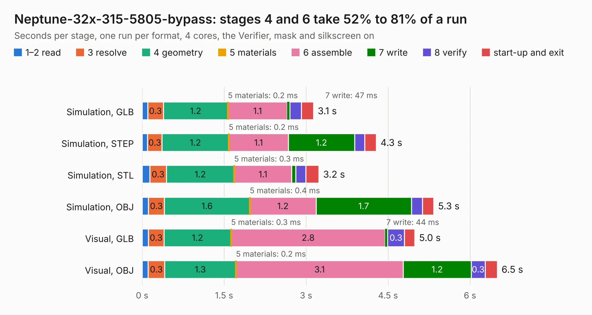

# 652. Neptune-32x-315-5805-bypass

Board 652 of the 3,105 of [Corpus Testing](../Corpus-Testing.md), on [Corpus Page 7](../CorpusTestingPages/Corpus-Testing-07.md#652-neptune-32x-315-5805-bypass).

| Mode and format | 1–2 read | 3 resolve | 4 geometry | 5 materials | 6 assemble | 7 write | 8 verify | start-up and exit | Total |
|---|---:|---:|---:|---:|---:|---:|---:|---:|---:|
| Simulation, GLB | 0.1 | 0.3 | 1.2 | 0.2&nbsp;ms | 1.1 | 47&nbsp;ms | 0.2 | 0.2 | 3.1 |
| Simulation, STEP | 0.1 | 0.3 | 1.2 | 0.2&nbsp;ms | 1.1 | 1.2 | 0.2 | 0.2 | 4.3 |
| Simulation, STL | 0.1 | 0.3 | 1.2 | 0.3&nbsp;ms | 1.1 | 72&nbsp;ms | 0.2 | 0.2 | 3.2 |
| Simulation, OBJ | 0.1 | 0.3 | 1.6 | 0.4&nbsp;ms | 1.2 | 1.7 | 0.2 | 0.2 | 5.3 |
| Visual, GLB | 0.1 | 0.3 | 1.2 | 0.3&nbsp;ms | 2.8 | 44&nbsp;ms | 0.3 | 0.2 | 5.0 |
| Visual, OBJ | 0.1 | 0.3 | 1.3 | 0.2&nbsp;ms | 3.1 | 1.2 | 0.3 | 0.2 | 6.5 |

<table align="center"><tr><td valign="top">

| Board | Repo: [Board-Folk/Neptune](https://github.com/Board-Folk/Neptune) Board: `Neptune-32x-315-5805-bypass.kicad_pcb` |
|---|---|
| Folder | helpers / Neptune-32x-315-5805-bypass |
| Complexity | 234&nbsp;/&nbsp;1000 (size&nbsp;124, features&nbsp;110) |
| KESE&nbsp;features | through vias, padstacks, drill offsets, stack-up, dielectric εr and tanδ, castellated pads |
| Tested | 9th November 2026 |
| Copper&nbsp;layers | 2 |
| File&nbsp;format | KiCad 9 (20241229) |
| Parts,&nbsp;tracks,&nbsp;vias | 1, 306, 44 |
| Triangles,&nbsp;simulation | 282,880 in 67 parts |
| Verifier | PASS in all six runs |

</td><td valign="top">

<table>
<tr><th>File type</th><th>File size</th><th>Peak memory used</th></tr>
<tr><th colspan="3" align="left">Simulation</th></tr>
<tr><td>GLB</td><td align="right">10&nbsp;MB</td><td align="right">224&nbsp;MB</td></tr>
<tr><td>STEP</td><td align="right">49&nbsp;MB</td><td align="right">263&nbsp;MB</td></tr>
<tr><td>STL</td><td align="right">14&nbsp;MB</td><td align="right">232&nbsp;MB</td></tr>
<tr><td>OBJ</td><td align="right">30&nbsp;MB</td><td align="right">257&nbsp;MB</td></tr>
<tr><th colspan="3" align="left">Visual</th></tr>
<tr><td>GLB</td><td align="right">7.5&nbsp;MB</td><td align="right">266&nbsp;MB</td></tr>
<tr><td>OBJ</td><td align="right">22&nbsp;MB</td><td align="right">268&nbsp;MB</td></tr>
</table>

</td></tr></table>

| Previous | Next |
|:---|---:|
| [651. NeoGeoAES3_5](b0651b_NeoGeoAES-3-5_NeoGeoAES3-5.md) | [653. Neptune-32x-315-5818-bypass](b0653b_Neptune_Neptune-32x-315-5818-bypass.md) |
