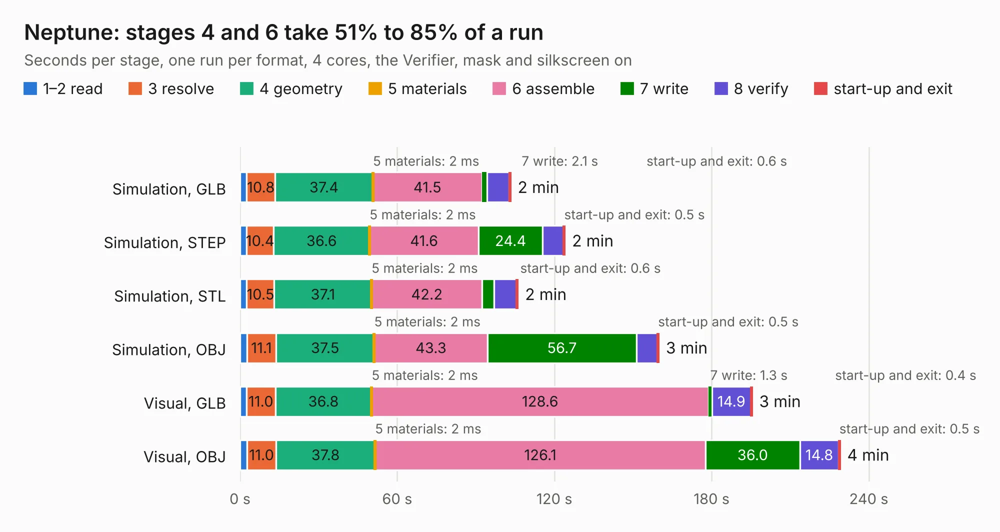

# 652. Neptune

Board 652 of the 3,100 of [Corpus Testing](../Corpus-Testing.md), on [Corpus Page 7](../CorpusTestingPages/Corpus-Testing-07.md#652-neptune).

| Mode and format | 1–2 read | 3 resolve | 4 geometry | 5 materials | 6 assemble | 7 write | 8 verify | start-up and exit | Total |
|---|---:|---:|---:|---:|---:|---:|---:|---:|---:|
| Simulation, GLB | 2.5 | 10.8 | 37.4 | 2&nbsp;ms | 41.5 | 2.1 | 8.3 | 0.6 | 103.3 |
| Simulation, STEP | 2.5 | 10.4 | 36.6 | 2&nbsp;ms | 41.6 | 24.4 | 8.0 | 0.5 | 124.0 |
| Simulation, STL | 2.6 | 10.5 | 37.1 | 2&nbsp;ms | 42.2 | 4.5 | 8.6 | 0.6 | 106.1 |
| Simulation, OBJ | 2.6 | 11.1 | 37.5 | 2&nbsp;ms | 43.3 | 56.7 | 8.1 | 0.5 | 159.8 |
| Visual, GLB | 2.5 | 11.0 | 36.8 | 2&nbsp;ms | 128.6 | 1.3 | 14.9 | 0.4 | 195.4 |
| Visual, OBJ | 2.7 | 11.0 | 37.8 | 2&nbsp;ms | 126.1 | 36.0 | 14.8 | 0.5 | 229.0 |

<table align="center"><tr><td valign="top">

| Board | Repo: [Board-Folk/Neptune](https://github.com/Board-Folk/Neptune) Board: `Neptune.kicad_pcb` |
|---|---|
| Complexity | 468&nbsp;/&nbsp;1000 (size&nbsp;318, features&nbsp;150) |
| KESE&nbsp;features | through vias, slotted holes, custom pads, rounded, trapezoid or chamfered pads, filled zones, copper drawings, copper text, curved board outline, knockout text, stack-up, dielectric εr and tanδ, mask and silkscreen colours |
| Tested | 9th November 2026 |
| Copper&nbsp;layers | 4 |
| File&nbsp;format | KiCad 9 (20241229) |
| Parts,&nbsp;tracks,&nbsp;vias | 374, 11,140, 1,391 |
| Triangles,&nbsp;simulation | 9,804,248 in 748 parts |
| Verifier | PASS in all six runs |

</td><td valign="top">

<table>
<tr><th>File type</th><th>File size</th><th>Peak memory used</th></tr>
<tr><th colspan="3" align="left">Simulation</th></tr>
<tr><td>GLB</td><td align="right">339&nbsp;MB</td><td align="right">2.5&nbsp;GB</td></tr>
<tr><td>STEP</td><td align="right">1.5&nbsp;GB</td><td align="right">3.4&nbsp;GB</td></tr>
<tr><td>STL</td><td align="right">490&nbsp;MB</td><td align="right">2.5&nbsp;GB</td></tr>
<tr><td>OBJ</td><td align="right">1.1&nbsp;GB</td><td align="right">6.2&nbsp;GB</td></tr>
<tr><th colspan="3" align="left">Visual</th></tr>
<tr><td>GLB</td><td align="right">223&nbsp;MB</td><td align="right">3.5&nbsp;GB</td></tr>
<tr><td>OBJ</td><td align="right">725&nbsp;MB</td><td align="right">4.6&nbsp;GB</td></tr>
</table>

</td></tr></table>

| Previous | Next |
|:---|---:|
| [651. Neptune-Region-Fix](b0651b_Neptune_Neptune-Region-Fix.md) | [653. Oric](b0653b_Oric-Remix_Archive-IssueAv1-1_Oric.md) |
