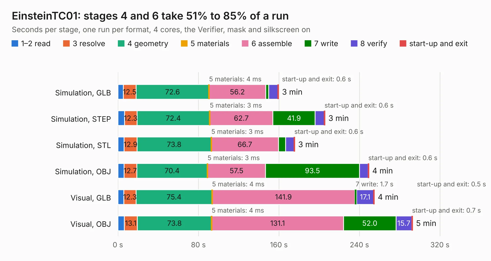

# 653. EinsteinTC01

Board 653 of the 3,131 of [Corpus Testing](../Corpus-Testing.md), on [Corpus Page 7](../CorpusTestingPages/Corpus-Testing-07.md#653-einsteintc01).

| Mode and format | 1–2 read | 3 resolve | 4 geometry | 5 materials | 6 assemble | 7 write | 8 verify | start-up and exit | Total |
|---|---:|---:|---:|---:|---:|---:|---:|---:|---:|
| Simulation, GLB | 5.5 | 12.5 | 72.6 | 4&nbsp;ms | 56.2 | 3.0 | 9.2 | 0.6 | 159.6 |
| Simulation, STEP | 6.6 | 12.3 | 72.4 | 3&nbsp;ms | 62.7 | 41.9 | 9.1 | 0.6 | 205.7 |
| Simulation, STL | 6.2 | 12.9 | 73.8 | 3&nbsp;ms | 66.7 | 7.0 | 8.6 | 0.6 | 175.7 |
| Simulation, OBJ | 6.0 | 12.7 | 70.4 | 3&nbsp;ms | 57.5 | 93.5 | 8.5 | 0.6 | 249.3 |
| Visual, GLB | 5.9 | 12.3 | 75.4 | 4&nbsp;ms | 141.9 | 1.7 | 17.1 | 0.5 | 254.7 |
| Visual, OBJ | 6.3 | 13.1 | 73.8 | 4&nbsp;ms | 131.1 | 52.0 | 15.7 | 0.7 | 292.7 |

<table align="center"><tr><td valign="top">

| Board | Repo: [Board-Folk/Einstein-TC-01](https://github.com/Board-Folk/Einstein-TC-01) Board: `EinsteinTC01.kicad_pcb` |
|---|---|
| Folder | Kicad |
| Complexity | 309&nbsp;/&nbsp;1000 (size&nbsp;234, features&nbsp;75) |
| KESE&nbsp;features | through vias, slotted holes, rounded, trapezoid or chamfered pads, drill offsets, filled zones, curved board outline |
| Tested | 9th November 2026 |
| Copper&nbsp;layers | 2 |
| File&nbsp;format | KiCad 9 (20241229) |
| Parts,&nbsp;tracks,&nbsp;vias | 346, 9,719, 769 |
| Triangles,&nbsp;simulation | 11,902,236 in 528 parts |
| Verifier | PASS in all six runs |

</td><td valign="top">

<table>
<tr><th>File type</th><th>File size</th><th>Peak memory used</th></tr>
<tr><th colspan="3" align="left">Simulation</th></tr>
<tr><td>GLB</td><td align="right">398&nbsp;MB</td><td align="right">3.2&nbsp;GB</td></tr>
<tr><td>STEP</td><td align="right">1.7&nbsp;GB</td><td align="right">4.2&nbsp;GB</td></tr>
<tr><td>STL</td><td align="right">595&nbsp;MB</td><td align="right">3.3&nbsp;GB</td></tr>
<tr><td>OBJ</td><td align="right">1.3&nbsp;GB</td><td align="right">7.4&nbsp;GB</td></tr>
<tr><th colspan="3" align="left">Visual</th></tr>
<tr><td>GLB</td><td align="right">238&nbsp;MB</td><td align="right">3.8&nbsp;GB</td></tr>
<tr><td>OBJ</td><td align="right">765&nbsp;MB</td><td align="right">4.9&nbsp;GB</td></tr>
</table>

</td></tr></table>

| Previous | Next |
|:---|---:|
| [652. V9958AdapterTC01](b0652b_Einstein-TC-01_V9958AdapterTC01.md) | [654. EinsteinCE](b0654b_Einstein-TC-01_EinsteinCE.md) |
