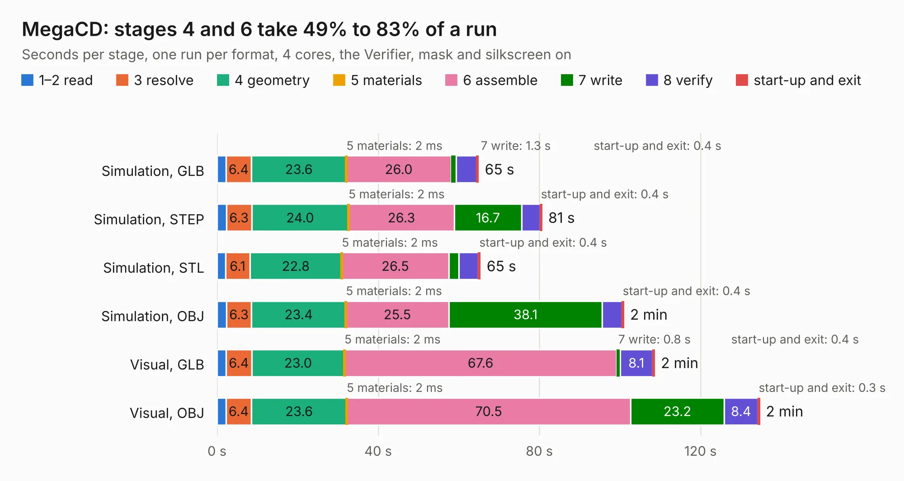

# 653. MegaCD

Board 653 of the 3,122 of [Corpus Testing](../Corpus-Testing.md), on [Corpus Page 7](../CorpusTestingPages/Corpus-Testing-07.md#653-megacd).

| Mode and format | 1–2 read | 3 resolve | 4 geometry | 5 materials | 6 assemble | 7 write | 8 verify | start-up and exit | Total |
|---|---:|---:|---:|---:|---:|---:|---:|---:|---:|
| Simulation, GLB | 2.2 | 6.4 | 23.6 | 2&nbsp;ms | 26.0 | 1.3 | 5.1 | 0.4 | 64.9 |
| Simulation, STEP | 2.3 | 6.3 | 24.0 | 2&nbsp;ms | 26.3 | 16.7 | 4.6 | 0.4 | 80.6 |
| Simulation, STL | 2.1 | 6.1 | 22.8 | 2&nbsp;ms | 26.5 | 2.5 | 4.9 | 0.4 | 65.3 |
| Simulation, OBJ | 2.3 | 6.3 | 23.4 | 2&nbsp;ms | 25.5 | 38.1 | 4.9 | 0.4 | 100.9 |
| Visual, GLB | 2.2 | 6.4 | 23.0 | 2&nbsp;ms | 67.6 | 0.8 | 8.1 | 0.4 | 108.6 |
| Visual, OBJ | 2.2 | 6.4 | 23.6 | 2&nbsp;ms | 70.5 | 23.2 | 8.4 | 0.3 | 134.6 |

<table align="center"><tr><td valign="top">

| Board | Repo: [Board-Folk/MegaCD-Main-BD](https://github.com/Board-Folk/MegaCD-Main-BD) Board: `MegaCD.kicad_pcb` |
|---|---|
| Folder | MegaCD-837-8015-01-Rev1-MCE2 |
| Complexity | 428&nbsp;/&nbsp;1000 (size&nbsp;293, features&nbsp;135) |
| KESE&nbsp;features | through vias, rounded, trapezoid or chamfered pads, filled zones, copper drawings, copper text, curved board outline, knockout text, TrueType text, stack-up, dielectric εr and tanδ |
| Tested | 9th November 2026 |
| Copper&nbsp;layers | 4 |
| File&nbsp;format | KiCad 9 (20241229) |
| Parts,&nbsp;tracks,&nbsp;vias | 103, 10,727, 883 |
| Triangles,&nbsp;simulation | 6,854,478 in 355 parts |
| Verifier | PASS in all six runs |

</td><td valign="top">

<table>
<tr><th>File type</th><th>File size</th><th>Peak memory used</th></tr>
<tr><th colspan="3" align="left">Simulation</th></tr>
<tr><td>GLB</td><td align="right">234&nbsp;MB</td><td align="right">2.0&nbsp;GB</td></tr>
<tr><td>STEP</td><td align="right">994&nbsp;MB</td><td align="right">2.3&nbsp;GB</td></tr>
<tr><td>STL</td><td align="right">343&nbsp;MB</td><td align="right">2.0&nbsp;GB</td></tr>
<tr><td>OBJ</td><td align="right">733&nbsp;MB</td><td align="right">4.3&nbsp;GB</td></tr>
<tr><th colspan="3" align="left">Visual</th></tr>
<tr><td>GLB</td><td align="right">149&nbsp;MB</td><td align="right">2.5&nbsp;GB</td></tr>
<tr><td>OBJ</td><td align="right">486&nbsp;MB</td><td align="right">3.1&nbsp;GB</td></tr>
</table>

</td></tr></table>

| Previous | Next |
|:---|---:|
| [652. EinsteinCE](b0652b_Einstein-TC-01_EinsteinCE.md) | [654. MegaCD](b0654b_MegaCD-Main-BD_MegaCD-837-8015-Rev0-MCE1_MegaCD.md) |
