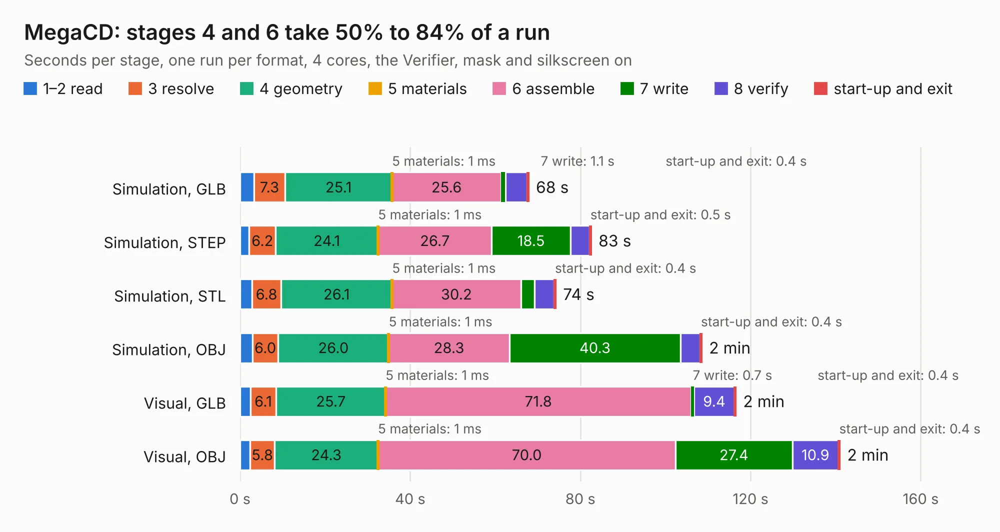

# 654. MegaCD

Board 654 of the 3,119 of [Corpus Testing](../Corpus-Testing.md), on [Corpus Page 7](../CorpusTestingPages/Corpus-Testing-07.md#654-megacd).

| Mode and format | 1–2 read | 3 resolve | 4 geometry | 5 materials | 6 assemble | 7 write | 8 verify | start-up and exit | Total |
|---|---:|---:|---:|---:|---:|---:|---:|---:|---:|
| Simulation, GLB | 3.3 | 7.3 | 25.1 | 1&nbsp;ms | 25.6 | 1.1 | 5.0 | 0.4 | 67.9 |
| Simulation, STEP | 2.2 | 6.2 | 24.1 | 1&nbsp;ms | 26.7 | 18.5 | 4.5 | 0.5 | 82.6 |
| Simulation, STL | 2.8 | 6.8 | 26.1 | 1&nbsp;ms | 30.2 | 3.2 | 4.6 | 0.4 | 74.3 |
| Simulation, OBJ | 2.9 | 6.0 | 26.0 | 1&nbsp;ms | 28.3 | 40.3 | 4.5 | 0.4 | 108.6 |
| Visual, GLB | 2.4 | 6.1 | 25.7 | 1&nbsp;ms | 71.8 | 0.7 | 9.4 | 0.4 | 116.6 |
| Visual, OBJ | 2.3 | 5.8 | 24.3 | 1&nbsp;ms | 70.0 | 27.4 | 10.9 | 0.4 | 141.0 |

<table align="center"><tr><td valign="top">

| Board | Repo: [Board-Folk/MegaCD-Main-BD](https://github.com/Board-Folk/MegaCD-Main-BD) Board: `MegaCD.kicad_pcb` |
|---|---|
| Folder | MegaCD-837-8015-Rev0-MCE1 |
| Complexity | 425&nbsp;/&nbsp;1000 (size&nbsp;290, features&nbsp;135) |
| KESE&nbsp;features | through vias, rounded, trapezoid or chamfered pads, filled zones, copper drawings, copper text, curved board outline, knockout text, TrueType text, stack-up, dielectric εr and tanδ |
| Tested | 9th November 2026 |
| Copper&nbsp;layers | 4 |
| File&nbsp;format | KiCad 9 (20241229) |
| Parts,&nbsp;tracks,&nbsp;vias | 93, 9,360, 822 |
| Triangles,&nbsp;simulation | 6,425,034 in 355 parts |
| Verifier | PASS in all six runs |

</td><td valign="top">

<table>
<tr><th>File type</th><th>File size</th><th>Peak memory used</th></tr>
<tr><th colspan="3" align="left">Simulation</th></tr>
<tr><td>GLB</td><td align="right">220&nbsp;MB</td><td align="right">2.0&nbsp;GB</td></tr>
<tr><td>STEP</td><td align="right">897&nbsp;MB</td><td align="right">2.2&nbsp;GB</td></tr>
<tr><td>STL</td><td align="right">321&nbsp;MB</td><td align="right">1.9&nbsp;GB</td></tr>
<tr><td>OBJ</td><td align="right">686&nbsp;MB</td><td align="right">4.1&nbsp;GB</td></tr>
<tr><th colspan="3" align="left">Visual</th></tr>
<tr><td>GLB</td><td align="right">138&nbsp;MB</td><td align="right">2.3&nbsp;GB</td></tr>
<tr><td>OBJ</td><td align="right">450&nbsp;MB</td><td align="right">2.9&nbsp;GB</td></tr>
</table>

</td></tr></table>

| Previous | Next |
|:---|---:|
| [653. MegaCD](b0653b_MegaCD-Main-BD_MegaCD-837-8015-01-Rev1-MCE2_MegaCD.md) | [655. MegaCD](b0655b_MegaCD-Main-BD_MegaCD-837-8952-Export_MegaCD.md) |
