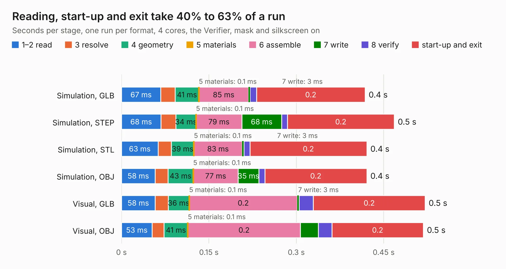

# 656. Neptune-Region-Fix

Board 656 of the 3,112 of [Corpus Testing](../Corpus-Testing.md), on [Corpus Page 7](../CorpusTestingPages/Corpus-Testing-07.md#656-neptune-region-fix).

| Mode and format | 1–2 read | 3 resolve | 4 geometry | 5 materials | 6 assemble | 7 write | 8 verify | start-up and exit | Total |
|---|---:|---:|---:|---:|---:|---:|---:|---:|---:|
| Simulation, GLB | 67&nbsp;ms | 25&nbsp;ms | 41&nbsp;ms | 0.1&nbsp;ms | 85&nbsp;ms | 3&nbsp;ms | 11&nbsp;ms | 0.2 | 0.4 |
| Simulation, STEP | 68&nbsp;ms | 26&nbsp;ms | 34&nbsp;ms | 0.1&nbsp;ms | 79&nbsp;ms | 68&nbsp;ms | 10&nbsp;ms | 0.2 | 0.5 |
| Simulation, STL | 63&nbsp;ms | 23&nbsp;ms | 39&nbsp;ms | 0.1&nbsp;ms | 83&nbsp;ms | 3&nbsp;ms | 10&nbsp;ms | 0.2 | 0.4 |
| Simulation, OBJ | 58&nbsp;ms | 22&nbsp;ms | 43&nbsp;ms | 0.1&nbsp;ms | 77&nbsp;ms | 35&nbsp;ms | 10&nbsp;ms | 0.2 | 0.4 |
| Visual, GLB | 58&nbsp;ms | 23&nbsp;ms | 36&nbsp;ms | 0.1&nbsp;ms | 0.2 | 3&nbsp;ms | 25&nbsp;ms | 0.2 | 0.5 |
| Visual, OBJ | 53&nbsp;ms | 20&nbsp;ms | 41&nbsp;ms | 0.1&nbsp;ms | 0.2 | 31&nbsp;ms | 23&nbsp;ms | 0.2 | 0.5 |

<table align="center"><tr><td valign="top">

| Board | Repo: [Board-Folk/Neptune](https://github.com/Board-Folk/Neptune) Board: `Neptune-Region-Fix.kicad_pcb` |
|---|---|
| Folder | helpers / Neptune-Region-Fix |
| Complexity | 87&nbsp;/&nbsp;1000 (size&nbsp;62, features&nbsp;25) |
| KESE&nbsp;features | through vias, rounded, trapezoid or chamfered pads |
| Tested | 9th November 2026 |
| Copper&nbsp;layers | 2 |
| File&nbsp;format | KiCad 9 (20241229) |
| Parts,&nbsp;tracks,&nbsp;vias | 0, 12, 1 |
| Triangles,&nbsp;simulation | 8,908 in 9 parts |
| Note | no components |
| Verifier | PASS in all six runs |

</td><td valign="top">

<table>
<tr><th>File type</th><th>File size</th><th>Peak memory used</th></tr>
<tr><th colspan="3" align="left">Simulation</th></tr>
<tr><td>GLB</td><td align="right">336&nbsp;kB</td><td align="right">59&nbsp;MB</td></tr>
<tr><td>STEP</td><td align="right">1.7&nbsp;MB</td><td align="right">61&nbsp;MB</td></tr>
<tr><td>STL</td><td align="right">446&nbsp;kB</td><td align="right">60&nbsp;MB</td></tr>
<tr><td>OBJ</td><td align="right">853&nbsp;kB</td><td align="right">63&nbsp;MB</td></tr>
<tr><th colspan="3" align="left">Visual</th></tr>
<tr><td>GLB</td><td align="right">299&nbsp;kB</td><td align="right">83&nbsp;MB</td></tr>
<tr><td>OBJ</td><td align="right">754&nbsp;kB</td><td align="right">83&nbsp;MB</td></tr>
</table>

</td></tr></table>

| Previous | Next |
|:---|---:|
| [655. Neptune-32x-315-5818-bypass](b0655b_Neptune_Neptune-32x-315-5818-bypass.md) | [657. Neptune](b0657b_Neptune_Neptune.md) |
