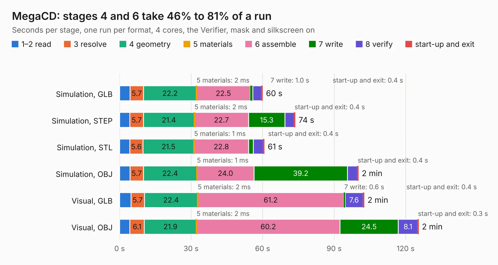

# 657. MegaCD

Board 657 of the 3,132 of [Corpus Testing](../Corpus-Testing.md), on [Corpus Page 7](../CorpusTestingPages/Corpus-Testing-07.md#657-megacd).

| Mode and format | 1–2 read | 3 resolve | 4 geometry | 5 materials | 6 assemble | 7 write | 8 verify | start-up and exit | Total |
|---|---:|---:|---:|---:|---:|---:|---:|---:|---:|
| Simulation, GLB | 4.3 | 5.7 | 22.2 | 2&nbsp;ms | 22.5 | 1.0 | 3.7 | 0.4 | 59.9 |
| Simulation, STEP | 4.3 | 5.7 | 21.4 | 2&nbsp;ms | 22.7 | 15.3 | 3.9 | 0.4 | 73.6 |
| Simulation, STL | 4.2 | 5.6 | 21.5 | 1&nbsp;ms | 22.8 | 2.0 | 4.2 | 0.4 | 60.7 |
| Simulation, OBJ | 4.4 | 5.7 | 22.4 | 1&nbsp;ms | 24.0 | 39.2 | 4.1 | 0.4 | 100.1 |
| Visual, GLB | 4.8 | 5.7 | 22.4 | 2&nbsp;ms | 61.2 | 0.6 | 7.6 | 0.4 | 102.5 |
| Visual, OBJ | 4.3 | 6.1 | 21.9 | 2&nbsp;ms | 60.2 | 24.5 | 8.1 | 0.3 | 125.3 |

<table align="center"><tr><td valign="top">

| Board | Repo: [Board-Folk/MegaCD-Main-BD](https://github.com/Board-Folk/MegaCD-Main-BD) Board: `MegaCD.kicad_pcb` |
|---|---|
| Folder | MegaCD-837-8952-Export |
| Complexity | 424&nbsp;/&nbsp;1000 (size&nbsp;289, features&nbsp;135) |
| KESE&nbsp;features | through vias, rounded, trapezoid or chamfered pads, filled zones, copper drawings, copper text, curved board outline, knockout text, TrueType text, stack-up, dielectric εr and tanδ |
| Tested | 9th November 2026 |
| Copper&nbsp;layers | 4 |
| File&nbsp;format | KiCad 9 (20241229) |
| Parts,&nbsp;tracks,&nbsp;vias | 117, 7,524, 826 |
| Triangles,&nbsp;simulation | 6,123,290 in 361 parts |
| Verifier | PASS in all six runs |

</td><td valign="top">

<table>
<tr><th>File type</th><th>File size</th><th>Peak memory used</th></tr>
<tr><th colspan="3" align="left">Simulation</th></tr>
<tr><td>GLB</td><td align="right">210&nbsp;MB</td><td align="right">1.9&nbsp;GB</td></tr>
<tr><td>STEP</td><td align="right">862&nbsp;MB</td><td align="right">2.2&nbsp;GB</td></tr>
<tr><td>STL</td><td align="right">306&nbsp;MB</td><td align="right">1.9&nbsp;GB</td></tr>
<tr><td>OBJ</td><td align="right">655&nbsp;MB</td><td align="right">4.0&nbsp;GB</td></tr>
<tr><th colspan="3" align="left">Visual</th></tr>
<tr><td>GLB</td><td align="right">137&nbsp;MB</td><td align="right">2.3&nbsp;GB</td></tr>
<tr><td>OBJ</td><td align="right">445&nbsp;MB</td><td align="right">3.1&nbsp;GB</td></tr>
</table>

</td></tr></table>

| Previous | Next |
|:---|---:|
| [656. MegaCD](b0656b_MegaCD-Main-BD_MegaCD-837-8015-Rev0-MCE1_MegaCD.md) | [658. MegaCD](b0658b_MegaCD-Main-BD_RAM-Adapter-837-8015-01_MegaCD.md) |
