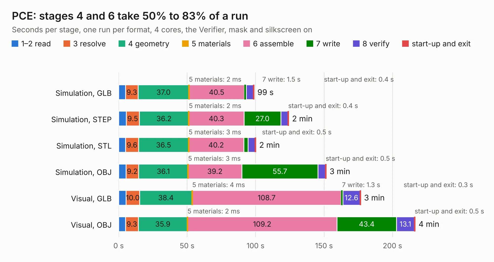

# 658. PCE

Board 658 of the 3,102 of [Corpus Testing](../Corpus-Testing.md), on [Corpus Page 7](../CorpusTestingPages/Corpus-Testing-07.md#658-pce).

| Mode and format | 1–2 read | 3 resolve | 4 geometry | 5 materials | 6 assemble | 7 write | 8 verify | start-up and exit | Total |
|---|---:|---:|---:|---:|---:|---:|---:|---:|---:|
| Simulation, GLB | 5.0 | 9.3 | 37.0 | 2&nbsp;ms | 40.5 | 1.5 | 5.1 | 0.4 | 98.8 |
| Simulation, STEP | 5.6 | 9.5 | 36.2 | 2&nbsp;ms | 40.3 | 27.0 | 5.1 | 0.4 | 124.1 |
| Simulation, STL | 5.0 | 9.6 | 36.5 | 3&nbsp;ms | 40.2 | 3.2 | 5.1 | 0.5 | 100.1 |
| Simulation, OBJ | 5.4 | 9.2 | 36.1 | 3&nbsp;ms | 39.2 | 55.7 | 5.4 | 0.5 | 151.5 |
| Visual, GLB | 5.3 | 10.0 | 38.4 | 4&nbsp;ms | 108.7 | 1.3 | 12.6 | 0.3 | 176.7 |
| Visual, OBJ | 5.0 | 9.3 | 35.9 | 2&nbsp;ms | 109.2 | 43.4 | 13.1 | 0.5 | 216.4 |

<table align="center"><tr><td valign="top">

| Board | Repo: [Board-Folk/PC-Engine-Duo](https://github.com/Board-Folk/PC-Engine-Duo) Board: `PCE.kicad_pcb` |
|---|---|
| Complexity | 414&nbsp;/&nbsp;1000 (size&nbsp;309, features&nbsp;105) |
| KESE&nbsp;features | through vias, slotted holes, rounded, trapezoid or chamfered pads, filled zones, copper drawings, curved board outline, stack-up, dielectric εr and tanδ |
| Tested | 9th November 2026 |
| Copper&nbsp;layers | 2 |
| File&nbsp;format | KiCad 7 (20221018) |
| Parts,&nbsp;tracks,&nbsp;vias | 618, 15,551, 1,491 |
| Triangles,&nbsp;simulation | 8,529,616 in 690 parts |
| Verifier | PASS in all six runs |

</td><td valign="top">

<table>
<tr><th>File type</th><th>File size</th><th>Peak memory used</th></tr>
<tr><th colspan="3" align="left">Simulation</th></tr>
<tr><td>GLB</td><td align="right">295&nbsp;MB</td><td align="right">2.7&nbsp;GB</td></tr>
<tr><td>STEP</td><td align="right">1.6&nbsp;GB</td><td align="right">3.5&nbsp;GB</td></tr>
<tr><td>STL</td><td align="right">427&nbsp;MB</td><td align="right">2.6&nbsp;GB</td></tr>
<tr><td>OBJ</td><td align="right">921&nbsp;MB</td><td align="right">5.5&nbsp;GB</td></tr>
<tr><th colspan="3" align="left">Visual</th></tr>
<tr><td>GLB</td><td align="right">256&nbsp;MB</td><td align="right">3.9&nbsp;GB</td></tr>
<tr><td>OBJ</td><td align="right">826&nbsp;MB</td><td align="right">5.2&nbsp;GB</td></tr>
</table>

</td></tr></table>

| Previous | Next |
|:---|---:|
| [657. PCE](b0657b_PC-Engine_PCE.md) | [659. PCE](b0659b_PC-Engine-GT_PCE.md) |
