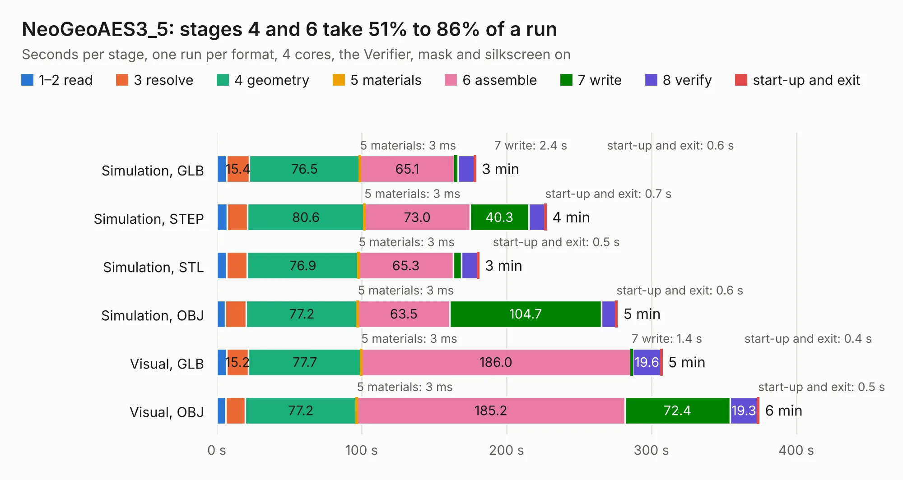

# 659. NeoGeoAES3_5

Board 659 of the 3,123 of [Corpus Testing](../Corpus-Testing.md), on [Corpus Page 7](../CorpusTestingPages/Corpus-Testing-07.md#659-neogeoaes3_5).

| Mode and format | 1–2 read | 3 resolve | 4 geometry | 5 materials | 6 assemble | 7 write | 8 verify | start-up and exit | Total |
|---|---:|---:|---:|---:|---:|---:|---:|---:|---:|
| Simulation, GLB | 7.0 | 15.4 | 76.5 | 3&nbsp;ms | 65.1 | 2.4 | 11.5 | 0.6 | 178.5 |
| Simulation, STEP | 7.1 | 14.2 | 80.6 | 3&nbsp;ms | 73.0 | 40.3 | 11.2 | 0.7 | 227.1 |
| Simulation, STL | 6.8 | 14.2 | 76.9 | 3&nbsp;ms | 65.3 | 5.6 | 11.2 | 0.5 | 180.6 |
| Simulation, OBJ | 5.9 | 14.2 | 77.2 | 3&nbsp;ms | 63.5 | 104.7 | 10.0 | 0.6 | 276.2 |
| Visual, GLB | 6.7 | 15.2 | 77.7 | 3&nbsp;ms | 186.0 | 1.4 | 19.6 | 0.4 | 307.1 |
| Visual, OBJ | 6.3 | 13.2 | 77.2 | 3&nbsp;ms | 185.2 | 72.4 | 19.3 | 0.5 | 374.0 |

<table align="center"><tr><td valign="top">

| Board | Repo: [Board-Folk/NeoGeoAES-3.5](https://github.com/Board-Folk/NeoGeoAES-3.5) Board: `NeoGeoAES3_5.kicad_pcb` |
|---|---|
| Complexity | 368&nbsp;/&nbsp;1000 (size&nbsp;243, features&nbsp;125) |
| KESE&nbsp;features | through vias, slotted holes, custom pads, filled zones, copper drawings, curved board outline, TrueType text, stack-up, dielectric εr and tanδ |
| Tested | 9th November 2026 |
| Copper&nbsp;layers | 2 |
| File&nbsp;format | KiCad 10 (20260206) |
| Parts,&nbsp;tracks,&nbsp;vias | 298, 18,210, 1,498 |
| Triangles,&nbsp;simulation | 12,427,738 in 777 parts |
| Verifier | PASS in all six runs |

</td><td valign="top">

<table>
<tr><th>File type</th><th>File size</th><th>Peak memory used</th></tr>
<tr><th colspan="3" align="left">Simulation</th></tr>
<tr><td>GLB</td><td align="right">421&nbsp;MB</td><td align="right">3.6&nbsp;GB</td></tr>
<tr><td>STEP</td><td align="right">2.0&nbsp;GB</td><td align="right">4.7&nbsp;GB</td></tr>
<tr><td>STL</td><td align="right">621&nbsp;MB</td><td align="right">3.7&nbsp;GB</td></tr>
<tr><td>OBJ</td><td align="right">1.3&nbsp;GB</td><td align="right">7.9&nbsp;GB</td></tr>
<tr><th colspan="3" align="left">Visual</th></tr>
<tr><td>GLB</td><td align="right">290&nbsp;MB</td><td align="right">4.5&nbsp;GB</td></tr>
<tr><td>OBJ</td><td align="right">940&nbsp;MB</td><td align="right">5.8&nbsp;GB</td></tr>
</table>

</td></tr></table>

| Previous | Next |
|:---|---:|
| [658. MegaCD](b0658b_MegaCD-Main-BD_RAM-Adapter-837-8015_MegaCD.md) | [660. Neptune-32x-315-5805-bypass](b0660b_Neptune_Neptune-32x-315-5805-bypass.md) |
