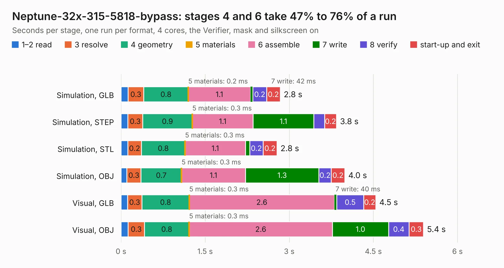

# 661. Neptune-32x-315-5818-bypass

Board 661 of the 3,127 of [Corpus Testing](../Corpus-Testing.md), on [Corpus Page 7](../CorpusTestingPages/Corpus-Testing-07.md#661-neptune-32x-315-5818-bypass).

| Mode and format | 1–2 read | 3 resolve | 4 geometry | 5 materials | 6 assemble | 7 write | 8 verify | start-up and exit | Total |
|---|---:|---:|---:|---:|---:|---:|---:|---:|---:|
| Simulation, GLB | 0.1 | 0.3 | 0.8 | 0.2&nbsp;ms | 1.1 | 42&nbsp;ms | 0.2 | 0.2 | 2.8 |
| Simulation, STEP | 0.1 | 0.3 | 0.9 | 0.3&nbsp;ms | 1.1 | 1.1 | 0.2 | 0.2 | 3.8 |
| Simulation, STL | 0.1 | 0.2 | 0.8 | 0.3&nbsp;ms | 1.1 | 77&nbsp;ms | 0.2 | 0.2 | 2.8 |
| Simulation, OBJ | 0.1 | 0.3 | 0.7 | 0.3&nbsp;ms | 1.1 | 1.3 | 0.2 | 0.2 | 4.0 |
| Visual, GLB | 0.1 | 0.3 | 0.8 | 0.3&nbsp;ms | 2.6 | 40&nbsp;ms | 0.5 | 0.2 | 4.5 |
| Visual, OBJ | 0.1 | 0.3 | 0.8 | 0.3&nbsp;ms | 2.6 | 1.0 | 0.4 | 0.3 | 5.4 |

<table align="center"><tr><td valign="top">

| Board | Repo: [Board-Folk/Neptune](https://github.com/Board-Folk/Neptune) Board: `Neptune-32x-315-5818-bypass.kicad_pcb` |
|---|---|
| Folder | helpers / Neptune-32x-315-5818-bypass |
| Complexity | 173&nbsp;/&nbsp;1000 (size&nbsp;128, features&nbsp;45) |
| KESE&nbsp;features | through vias, stack-up, dielectric εr and tanδ |
| Tested | 9th November 2026 |
| Copper&nbsp;layers | 2 |
| File&nbsp;format | KiCad 9 (20241229) |
| Parts,&nbsp;tracks,&nbsp;vias | 1, 367, 65 |
| Triangles,&nbsp;simulation | 244,460 in 70 parts |
| Verifier | PASS in all six runs |

</td><td valign="top">

<table>
<tr><th>File type</th><th>File size</th><th>Peak memory used</th></tr>
<tr><th colspan="3" align="left">Simulation</th></tr>
<tr><td>GLB</td><td align="right">9.2&nbsp;MB</td><td align="right">253&nbsp;MB</td></tr>
<tr><td>STEP</td><td align="right">47&nbsp;MB</td><td align="right">258&nbsp;MB</td></tr>
<tr><td>STL</td><td align="right">12&nbsp;MB</td><td align="right">259&nbsp;MB</td></tr>
<tr><td>OBJ</td><td align="right">26&nbsp;MB</td><td align="right">262&nbsp;MB</td></tr>
<tr><th colspan="3" align="left">Visual</th></tr>
<tr><td>GLB</td><td align="right">7.5&nbsp;MB</td><td align="right">293&nbsp;MB</td></tr>
<tr><td>OBJ</td><td align="right">23&nbsp;MB</td><td align="right">281&nbsp;MB</td></tr>
</table>

</td></tr></table>

| Previous | Next |
|:---|---:|
| [660. Neptune-32x-315-5805-bypass](b0660b_Neptune_Neptune-32x-315-5805-bypass.md) | [662. Neptune-Region-Fix](b0662b_Neptune_Neptune-Region-Fix.md) |
