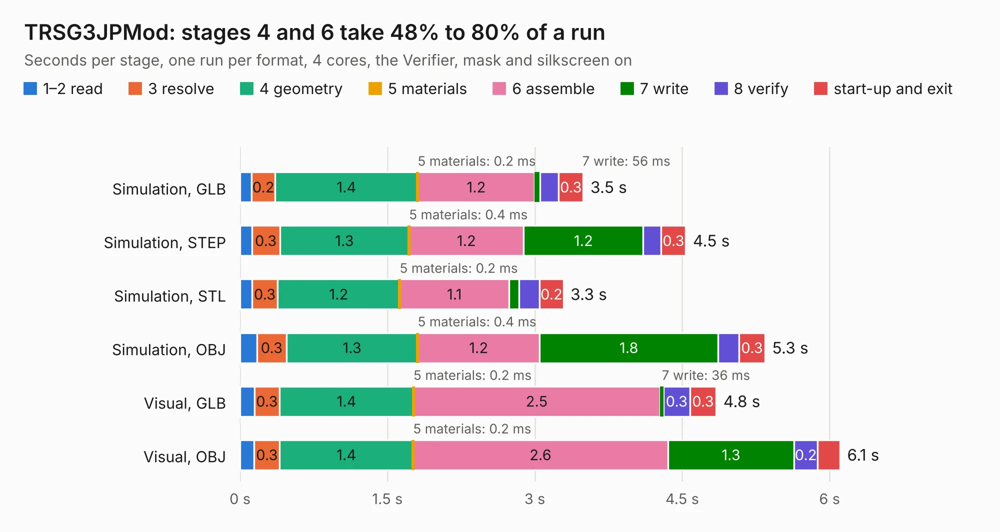

# 664. TRSG3JPMod

Board 664 of the 3,106 of [Corpus Testing](../Corpus-Testing.md), on [Corpus Page 7](../CorpusTestingPages/Corpus-Testing-07.md#664-trsg3jpmod).

| Mode and format | 1–2 read | 3 resolve | 4 geometry | 5 materials | 6 assemble | 7 write | 8 verify | start-up and exit | Total |
|---|---:|---:|---:|---:|---:|---:|---:|---:|---:|
| Simulation, GLB | 0.1 | 0.2 | 1.4 | 0.2&nbsp;ms | 1.2 | 56&nbsp;ms | 0.2 | 0.3 | 3.5 |
| Simulation, STEP | 0.1 | 0.3 | 1.3 | 0.4&nbsp;ms | 1.2 | 1.2 | 0.2 | 0.3 | 4.5 |
| Simulation, STL | 0.1 | 0.3 | 1.2 | 0.2&nbsp;ms | 1.1 | 0.1 | 0.2 | 0.2 | 3.3 |
| Simulation, OBJ | 0.2 | 0.3 | 1.3 | 0.4&nbsp;ms | 1.2 | 1.8 | 0.2 | 0.3 | 5.3 |
| Visual, GLB | 0.1 | 0.3 | 1.4 | 0.2&nbsp;ms | 2.5 | 36&nbsp;ms | 0.3 | 0.3 | 4.8 |
| Visual, OBJ | 0.1 | 0.3 | 1.4 | 0.2&nbsp;ms | 2.6 | 1.3 | 0.2 | 0.2 | 6.1 |

<table align="center"><tr><td valign="top">

| Board | Repo: [Board-Folk/TRS80IJP](https://github.com/Board-Folk/TRS80IJP) Board: `TRSG3JPMod.kicad_pcb` |
|---|---|
| Folder | Extras / TRSG3Mod / TRSG3JPModv1 |
| Complexity | 179&nbsp;/&nbsp;1000 (size&nbsp;114, features&nbsp;65) |
| KESE&nbsp;features | through vias, filled zones, stack-up, dielectric εr and tanδ |
| Tested | 9th November 2026 |
| Copper&nbsp;layers | 2 |
| File&nbsp;format | KiCad 7 (20221018) |
| Parts,&nbsp;tracks,&nbsp;vias | 3, 129, 8 |
| Triangles,&nbsp;simulation | 282,270 in 33 parts |
| Verifier | PASS in all six runs |

</td><td valign="top">

<table>
<tr><th>File type</th><th>File size</th><th>Peak memory used</th></tr>
<tr><th colspan="3" align="left">Simulation</th></tr>
<tr><td>GLB</td><td align="right">9.8&nbsp;MB</td><td align="right">232&nbsp;MB</td></tr>
<tr><td>STEP</td><td align="right">47&nbsp;MB</td><td align="right">249&nbsp;MB</td></tr>
<tr><td>STL</td><td align="right">14&nbsp;MB</td><td align="right">227&nbsp;MB</td></tr>
<tr><td>OBJ</td><td align="right">28&nbsp;MB</td><td align="right">242&nbsp;MB</td></tr>
<tr><th colspan="3" align="left">Visual</th></tr>
<tr><td>GLB</td><td align="right">5.8&nbsp;MB</td><td align="right">237&nbsp;MB</td></tr>
<tr><td>OBJ</td><td align="right">17&nbsp;MB</td><td align="right">236&nbsp;MB</td></tr>
</table>

</td></tr></table>

| Previous | Next |
|:---|---:|
| [663. TRS80I-Charmap](b0663b_TRS80IJP_TRS80I-Charmap.md) | [665. TRSG3Mod](b0665b_TRS80IJP_TRSG3Mod.md) |
