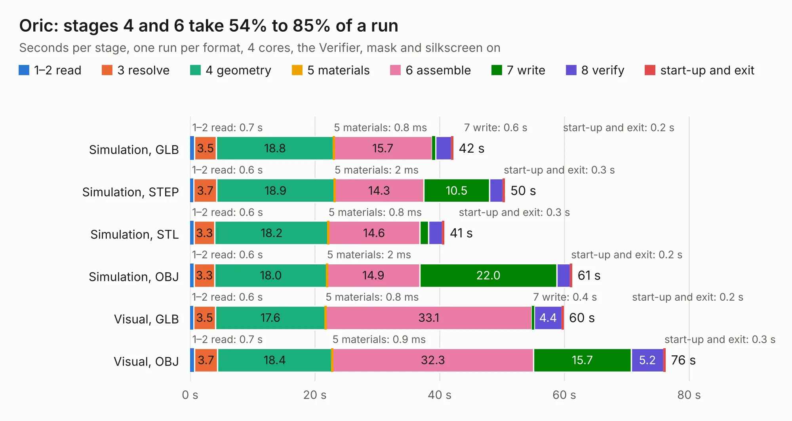

# 665. Oric

Board 665 of the 3,139 of [Corpus Testing](../Corpus-Testing.md), on [Corpus Page 7](../CorpusTestingPages/Corpus-Testing-07.md#665-oric).

| Mode and format | 1–2 read | 3 resolve | 4 geometry | 5 materials | 6 assemble | 7 write | 8 verify | start-up and exit | Total |
|---|---:|---:|---:|---:|---:|---:|---:|---:|---:|
| Simulation, GLB | 0.7 | 3.5 | 18.8 | 0.8&nbsp;ms | 15.7 | 0.6 | 2.5 | 0.2 | 42.1 |
| Simulation, STEP | 0.6 | 3.7 | 18.9 | 2&nbsp;ms | 14.3 | 10.5 | 2.2 | 0.3 | 50.4 |
| Simulation, STL | 0.6 | 3.3 | 18.2 | 0.8&nbsp;ms | 14.6 | 1.4 | 2.2 | 0.3 | 40.7 |
| Simulation, OBJ | 0.6 | 3.3 | 18.0 | 2&nbsp;ms | 14.9 | 22.0 | 2.1 | 0.2 | 61.2 |
| Visual, GLB | 0.6 | 3.5 | 17.6 | 0.8&nbsp;ms | 33.1 | 0.4 | 4.4 | 0.2 | 59.8 |
| Visual, OBJ | 0.7 | 3.7 | 18.4 | 0.9&nbsp;ms | 32.3 | 15.7 | 5.2 | 0.3 | 76.2 |

<table align="center"><tr><td valign="top">

| Board | Repo: [Board-Folk/Oric-Remix](https://github.com/Board-Folk/Oric-Remix) Board: `Oric.kicad_pcb` |
|---|---|
| Folder | Archive / IssueAv1.1 |
| Complexity | 268&nbsp;/&nbsp;1000 (size&nbsp;203, features&nbsp;65) |
| KESE&nbsp;features | through vias, slotted holes, rounded, trapezoid or chamfered pads, filled zones, curved board outline |
| Tested | 9th November 2026 |
| Copper&nbsp;layers | 2 |
| File&nbsp;format | KiCad 8 (20240108) |
| Parts,&nbsp;tracks,&nbsp;vias | 129, 2,835, 234 |
| Triangles,&nbsp;simulation | 4,060,494 in 203 parts |
| Verifier | PASS in all six runs |

</td><td valign="top">

<table>
<tr><th>File type</th><th>File size</th><th>Peak memory used</th></tr>
<tr><th colspan="3" align="left">Simulation</th></tr>
<tr><td>GLB</td><td align="right">136&nbsp;MB</td><td align="right">1.2&nbsp;GB</td></tr>
<tr><td>STEP</td><td align="right">566&nbsp;MB</td><td align="right">1.6&nbsp;GB</td></tr>
<tr><td>STL</td><td align="right">203&nbsp;MB</td><td align="right">1.2&nbsp;GB</td></tr>
<tr><td>OBJ</td><td align="right">426&nbsp;MB</td><td align="right">2.5&nbsp;GB</td></tr>
<tr><th colspan="3" align="left">Visual</th></tr>
<tr><td>GLB</td><td align="right">87&nbsp;MB</td><td align="right">1.5&nbsp;GB</td></tr>
<tr><td>OBJ</td><td align="right">275&nbsp;MB</td><td align="right">1.9&nbsp;GB</td></tr>
</table>

</td></tr></table>

| Previous | Next |
|:---|---:|
| [664. Neptune](b0664b_Neptune_Neptune.md) | [666. Oric-PS2USB](b0666b_Oric-Remix_Oric-PS2USB.md) |
