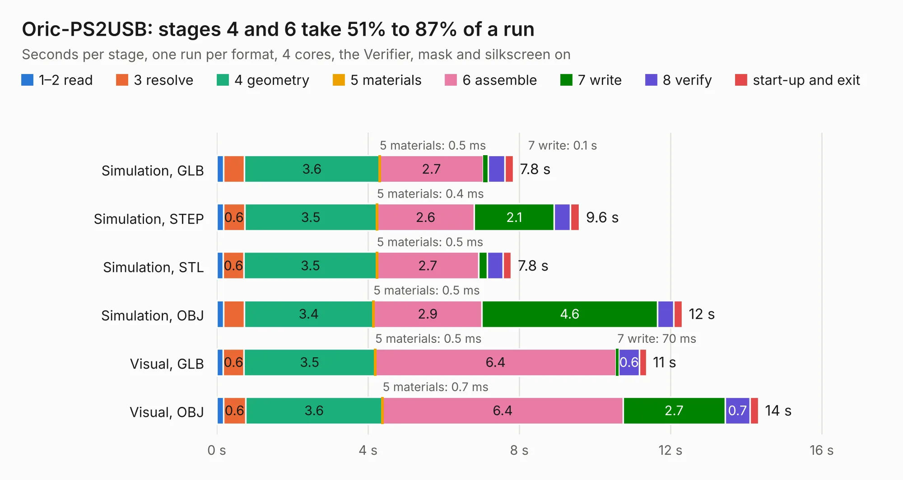

# 666. Oric-PS2USB

Board 666 of the 3,138 of [Corpus Testing](../Corpus-Testing.md), on [Corpus Page 7](../CorpusTestingPages/Corpus-Testing-07.md#666-oric-ps2usb).

| Mode and format | 1–2 read | 3 resolve | 4 geometry | 5 materials | 6 assemble | 7 write | 8 verify | start-up and exit | Total |
|---|---:|---:|---:|---:|---:|---:|---:|---:|---:|
| Simulation, GLB | 0.2 | 0.5 | 3.6 | 0.5&nbsp;ms | 2.7 | 0.1 | 0.4 | 0.2 | 7.8 |
| Simulation, STEP | 0.2 | 0.6 | 3.5 | 0.4&nbsp;ms | 2.6 | 2.1 | 0.4 | 0.2 | 9.6 |
| Simulation, STL | 0.2 | 0.6 | 3.5 | 0.5&nbsp;ms | 2.7 | 0.2 | 0.4 | 0.2 | 7.8 |
| Simulation, OBJ | 0.2 | 0.5 | 3.4 | 0.5&nbsp;ms | 2.9 | 4.6 | 0.4 | 0.2 | 12.3 |
| Visual, GLB | 0.2 | 0.6 | 3.5 | 0.5&nbsp;ms | 6.4 | 70&nbsp;ms | 0.6 | 0.2 | 11.4 |
| Visual, OBJ | 0.2 | 0.6 | 3.6 | 0.7&nbsp;ms | 6.4 | 2.7 | 0.7 | 0.2 | 14.3 |

<table align="center"><tr><td valign="top">

| Board | Repo: [Board-Folk/Oric-Remix](https://github.com/Board-Folk/Oric-Remix) Board: `Oric-PS2USB.kicad_pcb` |
|---|---|
| Folder | Expansions / Oric-PS2USB / Kicad |
| Complexity | 234&nbsp;/&nbsp;1000 (size&nbsp;149, features&nbsp;85) |
| KESE&nbsp;features | through vias, slotted holes, filled zones, curved board outline, stack-up, dielectric εr and tanδ |
| Tested | 9th November 2026 |
| Copper&nbsp;layers | 2 |
| File&nbsp;format | KiCad 8 (20240108) |
| Parts,&nbsp;tracks,&nbsp;vias | 11, 554, 26 |
| Triangles,&nbsp;simulation | 859,924 in 74 parts |
| Verifier | PASS in all six runs |

</td><td valign="top">

<table>
<tr><th>File type</th><th>File size</th><th>Peak memory used</th></tr>
<tr><th colspan="3" align="left">Simulation</th></tr>
<tr><td>GLB</td><td align="right">29&nbsp;MB</td><td align="right">461&nbsp;MB</td></tr>
<tr><td>STEP</td><td align="right">143&nbsp;MB</td><td align="right">456&nbsp;MB</td></tr>
<tr><td>STL</td><td align="right">43&nbsp;MB</td><td align="right">466&nbsp;MB</td></tr>
<tr><td>OBJ</td><td align="right">88&nbsp;MB</td><td align="right">611&nbsp;MB</td></tr>
<tr><th colspan="3" align="left">Visual</th></tr>
<tr><td>GLB</td><td align="right">17&nbsp;MB</td><td align="right">514&nbsp;MB</td></tr>
<tr><td>OBJ</td><td align="right">52&nbsp;MB</td><td align="right">492&nbsp;MB</td></tr>
</table>

</td></tr></table>

| Previous | Next |
|:---|---:|
| [665. Oric](b0665b_Oric-Remix_Archive-IssueAv1-1_Oric.md) | [667. Oric](b0667b_Oric-Remix_Kicad_Oric.md) |
