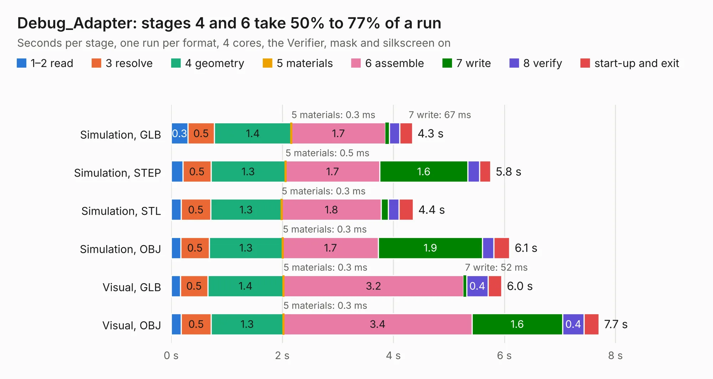

# 666. Debug_Adapter

Board 666 of the 3,101 of [Corpus Testing](../Corpus-Testing.md), on [Corpus Page 7](../CorpusTestingPages/Corpus-Testing-07.md#666-debug_adapter).

| Mode and format | 1–2 read | 3 resolve | 4 geometry | 5 materials | 6 assemble | 7 write | 8 verify | start-up and exit | Total |
|---|---:|---:|---:|---:|---:|---:|---:|---:|---:|
| Simulation, GLB | 0.3 | 0.5 | 1.4 | 0.3&nbsp;ms | 1.7 | 67&nbsp;ms | 0.2 | 0.2 | 4.3 |
| Simulation, STEP | 0.2 | 0.5 | 1.3 | 0.5&nbsp;ms | 1.7 | 1.6 | 0.2 | 0.2 | 5.8 |
| Simulation, STL | 0.2 | 0.5 | 1.3 | 0.3&nbsp;ms | 1.8 | 0.1 | 0.2 | 0.3 | 4.4 |
| Simulation, OBJ | 0.2 | 0.5 | 1.3 | 0.3&nbsp;ms | 1.7 | 1.9 | 0.2 | 0.3 | 6.1 |
| Visual, GLB | 0.2 | 0.5 | 1.4 | 0.3&nbsp;ms | 3.2 | 52&nbsp;ms | 0.4 | 0.2 | 6.0 |
| Visual, OBJ | 0.2 | 0.5 | 1.3 | 0.3&nbsp;ms | 3.4 | 1.6 | 0.4 | 0.3 | 7.7 |

<table align="center"><tr><td valign="top">

| Board | Repo: [bogdan8266/h616-board](https://github.com/bogdan8266/h616-board) Board: `Debug_Adapter.kicad_pcb` |
|---|---|
| Folder | Hardware / Debug_Adapter |
| Complexity | 261&nbsp;/&nbsp;1000 (size&nbsp;161, features&nbsp;100) |
| KESE&nbsp;features | through vias, slotted holes, rounded, trapezoid or chamfered pads, filled zones, copper drawings, copper text, curved board outline, knockout text |
| Tested | 9th November 2026 |
| Copper&nbsp;layers | 2 |
| File&nbsp;format | KiCad 9 (20241229) |
| Parts,&nbsp;tracks,&nbsp;vias | 25, 251, 179 |
| Triangles,&nbsp;simulation | 370,438 in 57 parts |
| Verifier | PASS in all six runs |

</td><td valign="top">

<table>
<tr><th>File type</th><th>File size</th><th>Peak memory used</th></tr>
<tr><th colspan="3" align="left">Simulation</th></tr>
<tr><td>GLB</td><td align="right">13&nbsp;MB</td><td align="right">306&nbsp;MB</td></tr>
<tr><td>STEP</td><td align="right">50&nbsp;MB</td><td align="right">338&nbsp;MB</td></tr>
<tr><td>STL</td><td align="right">19&nbsp;MB</td><td align="right">299&nbsp;MB</td></tr>
<tr><td>OBJ</td><td align="right">37&nbsp;MB</td><td align="right">298&nbsp;MB</td></tr>
<tr><th colspan="3" align="left">Visual</th></tr>
<tr><td>GLB</td><td align="right">11&nbsp;MB</td><td align="right">334&nbsp;MB</td></tr>
<tr><td>OBJ</td><td align="right">32&nbsp;MB</td><td align="right">337&nbsp;MB</td></tr>
</table>

</td></tr></table>

| Previous | Next |
|:---|---:|
| [665. TRS80IUS](b0665b_TRS80IUS_TRS80IUS.md) | [667. H616_devboard](b0667b_h616-board_Hardware-H616-DDR3_H616-devboard.md) |
