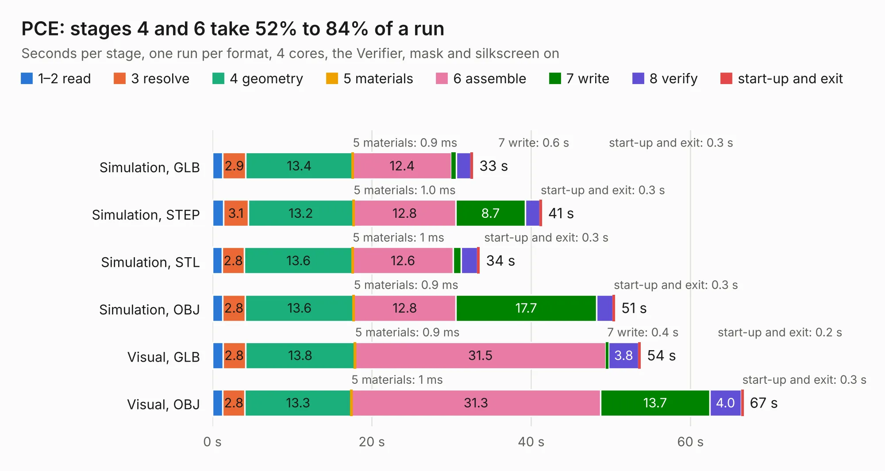

# 667. PCE

Board 667 of the 3,125 of [Corpus Testing](../Corpus-Testing.md), on [Corpus Page 7](../CorpusTestingPages/Corpus-Testing-07.md#667-pce).

| Mode and format | 1–2 read | 3 resolve | 4 geometry | 5 materials | 6 assemble | 7 write | 8 verify | start-up and exit | Total |
|---|---:|---:|---:|---:|---:|---:|---:|---:|---:|
| Simulation, GLB | 1.3 | 2.9 | 13.4 | 0.9&nbsp;ms | 12.4 | 0.6 | 1.9 | 0.3 | 32.7 |
| Simulation, STEP | 1.4 | 3.1 | 13.2 | 1.0&nbsp;ms | 12.8 | 8.7 | 1.8 | 0.3 | 41.3 |
| Simulation, STL | 1.2 | 2.8 | 13.6 | 1&nbsp;ms | 12.6 | 1.0 | 2.1 | 0.3 | 33.5 |
| Simulation, OBJ | 1.3 | 2.8 | 13.6 | 0.9&nbsp;ms | 12.8 | 17.7 | 2.0 | 0.3 | 50.5 |
| Visual, GLB | 1.3 | 2.8 | 13.8 | 0.9&nbsp;ms | 31.5 | 0.4 | 3.8 | 0.2 | 53.7 |
| Visual, OBJ | 1.3 | 2.8 | 13.3 | 1&nbsp;ms | 31.3 | 13.7 | 4.0 | 0.3 | 66.6 |

<table align="center"><tr><td valign="top">

| Board | Repo: [Board-Folk/PC-Engine](https://github.com/Board-Folk/PC-Engine) Board: `PCE.kicad_pcb` |
|---|---|
| Complexity | 325&nbsp;/&nbsp;1000 (size&nbsp;210, features&nbsp;115) |
| KESE&nbsp;features | through vias, slotted holes, rounded, trapezoid or chamfered pads, filled zones, copper drawings, copper text, curved board outline, stack-up, dielectric εr and tanδ |
| Tested | 9th November 2026 |
| Copper&nbsp;layers | 2 |
| File&nbsp;format | KiCad 7 (20221018) |
| Parts,&nbsp;tracks,&nbsp;vias | 123, 4,523, 290 |
| Triangles,&nbsp;simulation | 3,209,090 in 199 parts |
| Verifier | PASS in all six runs |

</td><td valign="top">

<table>
<tr><th>File type</th><th>File size</th><th>Peak memory used</th></tr>
<tr><th colspan="3" align="left">Simulation</th></tr>
<tr><td>GLB</td><td align="right">112&nbsp;MB</td><td align="right">1.1&nbsp;GB</td></tr>
<tr><td>STEP</td><td align="right">614&nbsp;MB</td><td align="right">1.3&nbsp;GB</td></tr>
<tr><td>STL</td><td align="right">160&nbsp;MB</td><td align="right">1.2&nbsp;GB</td></tr>
<tr><td>OBJ</td><td align="right">345&nbsp;MB</td><td align="right">2.1&nbsp;GB</td></tr>
<tr><th colspan="3" align="left">Visual</th></tr>
<tr><td>GLB</td><td align="right">87&nbsp;MB</td><td align="right">1.5&nbsp;GB</td></tr>
<tr><td>OBJ</td><td align="right">273&nbsp;MB</td><td align="right">1.8&nbsp;GB</td></tr>
</table>

</td></tr></table>

| Previous | Next |
|:---|---:|
| [666. Oric](b0666b_Oric-Remix_Kicad_Oric.md) | [668. PCE](b0668b_PC-Engine-Duo_PCE.md) |
