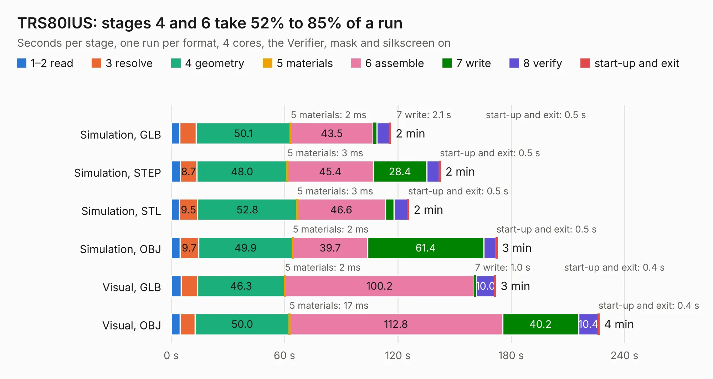

# 668. TRS80IUS

Board 668 of the 3,106 of [Corpus Testing](../Corpus-Testing.md), on [Corpus Page 7](../CorpusTestingPages/Corpus-Testing-07.md#668-trs80ius).

| Mode and format | 1–2 read | 3 resolve | 4 geometry | 5 materials | 6 assemble | 7 write | 8 verify | start-up and exit | Total |
|---|---:|---:|---:|---:|---:|---:|---:|---:|---:|
| Simulation, GLB | 4.6 | 8.6 | 50.1 | 2&nbsp;ms | 43.5 | 2.1 | 6.7 | 0.5 | 116.2 |
| Simulation, STEP | 4.9 | 8.7 | 48.0 | 3&nbsp;ms | 45.4 | 28.4 | 6.7 | 0.5 | 142.5 |
| Simulation, STL | 4.4 | 9.5 | 52.8 | 3&nbsp;ms | 46.6 | 4.6 | 7.3 | 0.5 | 125.7 |
| Simulation, OBJ | 4.8 | 9.7 | 49.9 | 2&nbsp;ms | 39.7 | 61.4 | 6.5 | 0.5 | 172.5 |
| Visual, GLB | 5.3 | 8.6 | 46.3 | 2&nbsp;ms | 100.2 | 1.0 | 10.0 | 0.4 | 171.7 |
| Visual, OBJ | 4.7 | 8.0 | 50.0 | 17&nbsp;ms | 112.8 | 40.2 | 10.4 | 0.4 | 226.5 |

<table align="center"><tr><td valign="top">

| Board | Repo: [Board-Folk/TRS80IUS](https://github.com/Board-Folk/TRS80IUS) Board: `TRS80IUS.kicad_pcb` |
|---|---|
| Folder | v1.1 / Kicad |
| Complexity | 308&nbsp;/&nbsp;1000 (size&nbsp;228, features&nbsp;80) |
| KESE&nbsp;features | through vias, custom pads, filled zones, copper drawings, copper text, curved board outline |
| Tested | 9th November 2026 |
| Copper&nbsp;layers | 2 |
| File&nbsp;format | KiCad 7 (20221018) |
| Parts,&nbsp;tracks,&nbsp;vias | 231, 9,962, 380 |
| Triangles,&nbsp;simulation | 8,820,422 in 392 parts |
| Verifier | PASS in all six runs |

</td><td valign="top">

<table>
<tr><th>File type</th><th>File size</th><th>Peak memory used</th></tr>
<tr><th colspan="3" align="left">Simulation</th></tr>
<tr><td>GLB</td><td align="right">296&nbsp;MB</td><td align="right">2.4&nbsp;GB</td></tr>
<tr><td>STEP</td><td align="right">1.3&nbsp;GB</td><td align="right">3.3&nbsp;GB</td></tr>
<tr><td>STL</td><td align="right">441&nbsp;MB</td><td align="right">2.5&nbsp;GB</td></tr>
<tr><td>OBJ</td><td align="right">933&nbsp;MB</td><td align="right">5.5&nbsp;GB</td></tr>
<tr><th colspan="3" align="left">Visual</th></tr>
<tr><td>GLB</td><td align="right">183&nbsp;MB</td><td align="right">3.0&nbsp;GB</td></tr>
<tr><td>OBJ</td><td align="right">587&nbsp;MB</td><td align="right">3.7&nbsp;GB</td></tr>
</table>

</td></tr></table>

| Previous | Next |
|:---|---:|
| [667. TRS80ILCMod](b0667b_TRS80IUS_TRS80ILCMod.md) | [669. Debug_Adapter](b0669b_h616-board_Debug-Adapter.md) |
