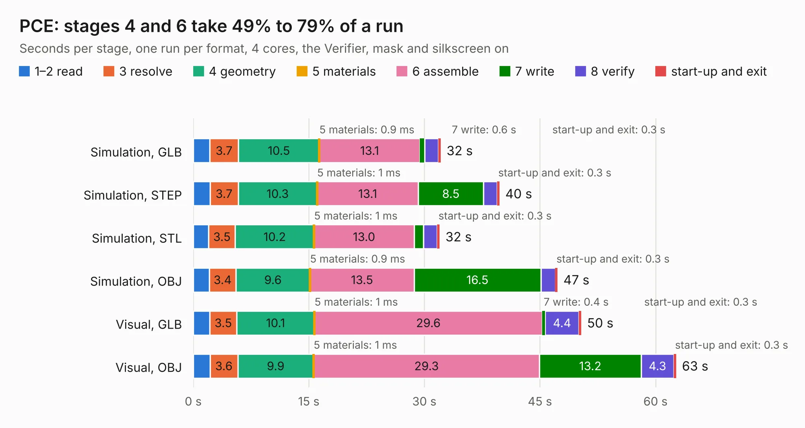

# 669. PCE

Board 669 of the 3,126 of [Corpus Testing](../Corpus-Testing.md), on [Corpus Page 7](../CorpusTestingPages/Corpus-Testing-07.md#669-pce).

| Mode and format | 1–2 read | 3 resolve | 4 geometry | 5 materials | 6 assemble | 7 write | 8 verify | start-up and exit | Total |
|---|---:|---:|---:|---:|---:|---:|---:|---:|---:|
| Simulation, GLB | 2.1 | 3.7 | 10.5 | 0.9&nbsp;ms | 13.1 | 0.6 | 1.7 | 0.3 | 32.1 |
| Simulation, STEP | 2.2 | 3.7 | 10.3 | 1&nbsp;ms | 13.1 | 8.5 | 1.7 | 0.3 | 39.8 |
| Simulation, STL | 2.0 | 3.5 | 10.2 | 1&nbsp;ms | 13.0 | 1.2 | 1.8 | 0.3 | 32.0 |
| Simulation, OBJ | 2.1 | 3.4 | 9.6 | 0.9&nbsp;ms | 13.5 | 16.5 | 1.9 | 0.3 | 47.3 |
| Visual, GLB | 2.2 | 3.5 | 10.1 | 1&nbsp;ms | 29.6 | 0.4 | 4.4 | 0.3 | 50.4 |
| Visual, OBJ | 2.2 | 3.6 | 9.9 | 1&nbsp;ms | 29.3 | 13.2 | 4.3 | 0.3 | 62.7 |

<table align="center"><tr><td valign="top">

| Board | Repo: [Board-Folk/PC-Engine-GT](https://github.com/Board-Folk/PC-Engine-GT) Board: `PCE.kicad_pcb` |
|---|---|
| Complexity | 348&nbsp;/&nbsp;1000 (size&nbsp;233, features&nbsp;115) |
| KESE&nbsp;features | through vias, slotted holes, rounded, trapezoid or chamfered pads, filled zones, copper drawings, copper text, curved board outline, stack-up, dielectric εr and tanδ |
| Tested | 9th November 2026 |
| Copper&nbsp;layers | 4 |
| File&nbsp;format | KiCad 9 (20241229) |
| Parts,&nbsp;tracks,&nbsp;vias | 195, 4,794, 322 |
| Triangles,&nbsp;simulation | 3,256,982 in 307 parts |
| Verifier | PASS in all six runs |

</td><td valign="top">

<table>
<tr><th>File type</th><th>File size</th><th>Peak memory used</th></tr>
<tr><th colspan="3" align="left">Simulation</th></tr>
<tr><td>GLB</td><td align="right">113&nbsp;MB</td><td align="right">1.2&nbsp;GB</td></tr>
<tr><td>STEP</td><td align="right">511&nbsp;MB</td><td align="right">1.3&nbsp;GB</td></tr>
<tr><td>STL</td><td align="right">163&nbsp;MB</td><td align="right">1.2&nbsp;GB</td></tr>
<tr><td>OBJ</td><td align="right">349&nbsp;MB</td><td align="right">2.1&nbsp;GB</td></tr>
<tr><th colspan="3" align="left">Visual</th></tr>
<tr><td>GLB</td><td align="right">81&nbsp;MB</td><td align="right">1.3&nbsp;GB</td></tr>
<tr><td>OBJ</td><td align="right">255&nbsp;MB</td><td align="right">1.7&nbsp;GB</td></tr>
</table>

</td></tr></table>

| Previous | Next |
|:---|---:|
| [668. PCE](b0668b_PC-Engine-Duo_PCE.md) | [670. TRS80I-Charmap](b0670b_TRS80IJP_TRS80I-Charmap.md) |
