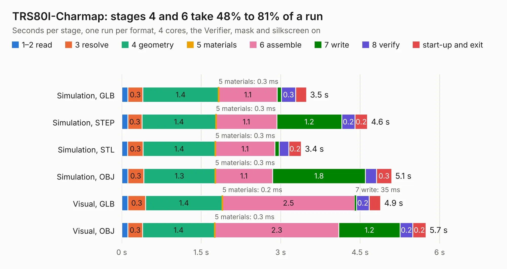

# 671 TRS80I-Charmap

Board 671 of the 3,138 of [Corpus Testing](../Corpus-Testing.md), on [Corpus Page 7](../CorpusTestingPages/Corpus-Testing-07.md#671-trs80i-charmap).

| Mode and format | 1–2 read | 3 resolve | 4 geometry | 5 materials | 6 assemble | 7 write | 8 verify | start-up and exit | Total |
|---|---:|---:|---:|---:|---:|---:|---:|---:|---:|
| Simulation, GLB | 0.1 | 0.3 | 1.4 | 0.3&nbsp;ms | 1.1 | 81&nbsp;ms | 0.3 | 0.2 | 3.5 |
| Simulation, STEP | 0.1 | 0.3 | 1.4 | 0.3&nbsp;ms | 1.1 | 1.2 | 0.2 | 0.2 | 4.6 |
| Simulation, STL | 0.1 | 0.3 | 1.4 | 0.3&nbsp;ms | 1.1 | 80&nbsp;ms | 0.2 | 0.2 | 3.4 |
| Simulation, OBJ | 0.1 | 0.3 | 1.3 | 0.3&nbsp;ms | 1.1 | 1.8 | 0.2 | 0.3 | 5.1 |
| Visual, GLB | 0.1 | 0.3 | 1.4 | 0.2&nbsp;ms | 2.5 | 35&nbsp;ms | 0.2 | 0.2 | 4.9 |
| Visual, OBJ | 0.1 | 0.3 | 1.4 | 0.3&nbsp;ms | 2.3 | 1.2 | 0.2 | 0.2 | 5.7 |

<table align="center"><tr><td valign="top">

| Board | Repo: [Board-Folk/TRS80IJP](https://github.com/Board-Folk/TRS80IJP) Board: `TRS80I-Charmap.kicad_pcb` |
|---|---|
| Folder | Extras / Charmap / Kicad |
| Complexity | 163&nbsp;/&nbsp;1000 (size&nbsp;123, features&nbsp;40) |
| KESE&nbsp;features | rounded, trapezoid or chamfered pads, stack-up, dielectric εr and tanδ |
| Tested | 9th November 2026 |
| Copper&nbsp;layers | 2 |
| File&nbsp;format | KiCad 6 (20211014) |
| Parts,&nbsp;tracks,&nbsp;vias | 5, 197, 0 |
| Triangles,&nbsp;simulation | 323,104 in 38 parts |
| Verifier | PASS in all six runs |

</td><td valign="top">

<table>
<tr><th>File type</th><th>File size</th><th>Peak memory used</th></tr>
<tr><th colspan="3" align="left">Simulation</th></tr>
<tr><td>GLB</td><td align="right">11&nbsp;MB</td><td align="right">238&nbsp;MB</td></tr>
<tr><td>STEP</td><td align="right">42&nbsp;MB</td><td align="right">261&nbsp;MB</td></tr>
<tr><td>STL</td><td align="right">16&nbsp;MB</td><td align="right">231&nbsp;MB</td></tr>
<tr><td>OBJ</td><td align="right">32&nbsp;MB</td><td align="right">266&nbsp;MB</td></tr>
<tr><th colspan="3" align="left">Visual</th></tr>
<tr><td>GLB</td><td align="right">6.5&nbsp;MB</td><td align="right">238&nbsp;MB</td></tr>
<tr><td>OBJ</td><td align="right">19&nbsp;MB</td><td align="right">242&nbsp;MB</td></tr>
</table>

</td></tr></table>

| Previous | Next |
|:---|---:|
| [670 PCE](b0670b_PC-Engine-GT_PCE.md) | [672 TRSG3JPMod](b0672b_TRS80IJP_TRSG3JPMod.md) |
