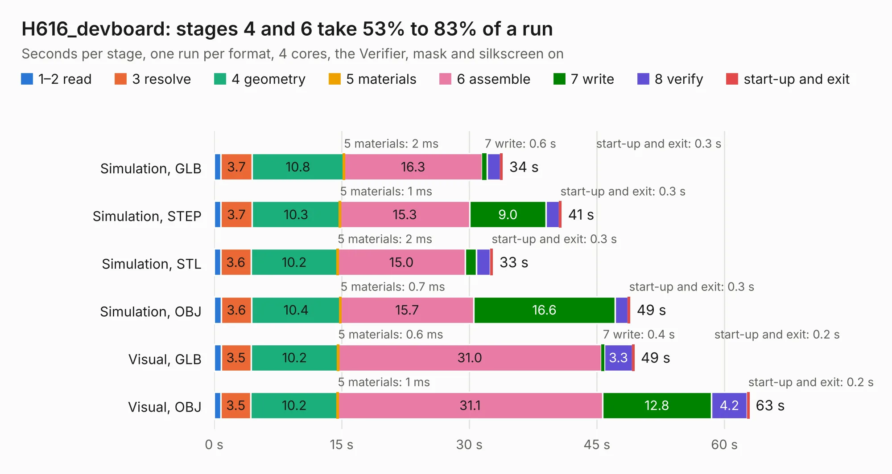

# 671. H616_devboard

Board 671 of the 3,108 of [Corpus Testing](../Corpus-Testing.md), on [Corpus Page 7](../CorpusTestingPages/Corpus-Testing-07.md#671-h616_devboard).

| Mode and format | 1–2 read | 3 resolve | 4 geometry | 5 materials | 6 assemble | 7 write | 8 verify | start-up and exit | Total |
|---|---:|---:|---:|---:|---:|---:|---:|---:|---:|
| Simulation, GLB | 0.8 | 3.7 | 10.8 | 2&nbsp;ms | 16.3 | 0.6 | 1.5 | 0.3 | 33.9 |
| Simulation, STEP | 0.8 | 3.7 | 10.3 | 1&nbsp;ms | 15.3 | 9.0 | 1.5 | 0.3 | 40.9 |
| Simulation, STL | 0.8 | 3.6 | 10.2 | 2&nbsp;ms | 15.0 | 1.3 | 1.6 | 0.3 | 32.8 |
| Simulation, OBJ | 0.8 | 3.6 | 10.4 | 0.7&nbsp;ms | 15.7 | 16.6 | 1.5 | 0.3 | 48.9 |
| Visual, GLB | 0.8 | 3.5 | 10.2 | 0.6&nbsp;ms | 31.0 | 0.4 | 3.3 | 0.2 | 49.4 |
| Visual, OBJ | 0.8 | 3.5 | 10.2 | 1&nbsp;ms | 31.1 | 12.8 | 4.2 | 0.2 | 62.9 |

<table align="center"><tr><td valign="top">

| Board | Repo: [bogdan8266/h616-board](https://github.com/bogdan8266/h616-board) Board: `H616_devboard.kicad_pcb` |
|---|---|
| Folder | Hardware / H616_LPDDR4 |
| Complexity | 447&nbsp;/&nbsp;1000 (size&nbsp;297, features&nbsp;150) |
| KESE&nbsp;features | through vias, rounded, trapezoid or chamfered pads, arc tracks, filled zones, copper drawings, copper text, curved board outline, knockout text, stack-up, dielectric εr and tanδ, copper finish |
| Tested | 9th November 2026 |
| Copper&nbsp;layers | 4 |
| File&nbsp;format | KiCad 9 (20241229) |
| Parts,&nbsp;tracks,&nbsp;vias | 152, 6,210, 715 |
| Triangles,&nbsp;simulation | 4,013,826 in 333 parts |
| Verifier | PASS in all six runs |

</td><td valign="top">

<table>
<tr><th>File type</th><th>File size</th><th>Peak memory used</th></tr>
<tr><th colspan="3" align="left">Simulation</th></tr>
<tr><td>GLB</td><td align="right">135&nbsp;MB</td><td align="right">1.3&nbsp;GB</td></tr>
<tr><td>STEP</td><td align="right">567&nbsp;MB</td><td align="right">1.7&nbsp;GB</td></tr>
<tr><td>STL</td><td align="right">201&nbsp;MB</td><td align="right">1.3&nbsp;GB</td></tr>
<tr><td>OBJ</td><td align="right">422&nbsp;MB</td><td align="right">2.5&nbsp;GB</td></tr>
<tr><th colspan="3" align="left">Visual</th></tr>
<tr><td>GLB</td><td align="right">99&nbsp;MB</td><td align="right">1.7&nbsp;GB</td></tr>
<tr><td>OBJ</td><td align="right">316&nbsp;MB</td><td align="right">2.2&nbsp;GB</td></tr>
</table>

</td></tr></table>

| Previous | Next |
|:---|---:|
| [670. H616_devboard](b0670b_h616-board_Hardware-H616-DDR3_H616-devboard.md) | [672. SmartPrintCoreH7x](b0672b_SmartPrintCoreH7x_SmartPrintCoreH7x.md) |
