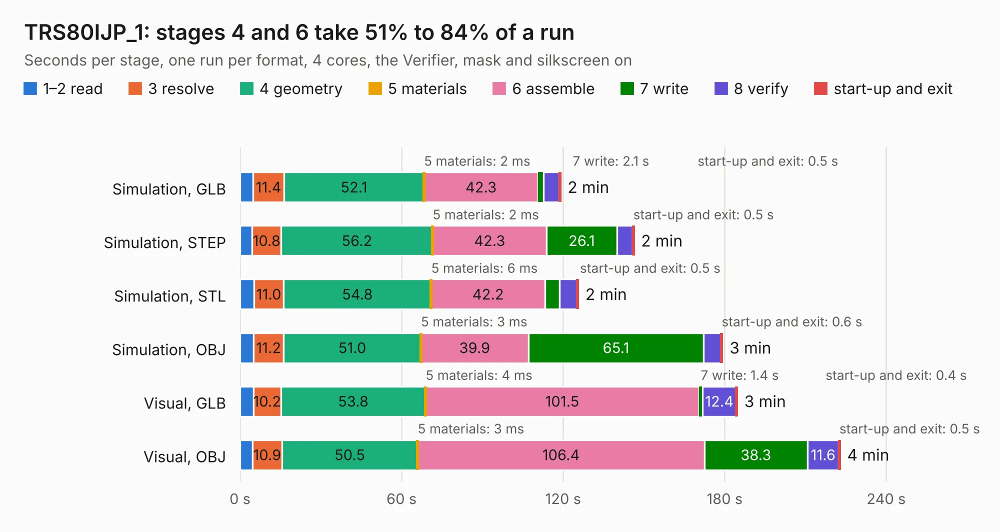

# 672. TRS80IJP_1

Board 672 of the 3,121 of [Corpus Testing](../Corpus-Testing.md), on [Corpus Page 7](../CorpusTestingPages/Corpus-Testing-07.md#672-trs80ijp_1).

| Mode and format | 1–2 read | 3 resolve | 4 geometry | 5 materials | 6 assemble | 7 write | 8 verify | start-up and exit | Total |
|---|---:|---:|---:|---:|---:|---:|---:|---:|---:|
| Simulation, GLB | 4.9 | 11.4 | 52.1 | 2&nbsp;ms | 42.3 | 2.1 | 5.8 | 0.5 | 119.0 |
| Simulation, STEP | 4.5 | 10.8 | 56.2 | 2&nbsp;ms | 42.3 | 26.1 | 5.9 | 0.5 | 146.3 |
| Simulation, STL | 5.2 | 11.0 | 54.8 | 6&nbsp;ms | 42.2 | 5.4 | 6.5 | 0.5 | 125.6 |
| Simulation, OBJ | 5.0 | 11.2 | 51.0 | 3&nbsp;ms | 39.9 | 65.1 | 6.4 | 0.6 | 179.2 |
| Visual, GLB | 5.0 | 10.2 | 53.8 | 4&nbsp;ms | 101.5 | 1.4 | 12.4 | 0.4 | 184.6 |
| Visual, OBJ | 4.7 | 10.9 | 50.5 | 3&nbsp;ms | 106.4 | 38.3 | 11.6 | 0.5 | 222.9 |

<table align="center"><tr><td valign="top">

| Board | Repo: [Board-Folk/TRS80IJP](https://github.com/Board-Folk/TRS80IJP) Board: `TRS80IJP_1.kicad_pcb` |
|---|---|
| Folder | v1.1 / Kicad |
| Complexity | 297&nbsp;/&nbsp;1000 (size&nbsp;232, features&nbsp;65) |
| KESE&nbsp;features | through vias, filled zones, stack-up, dielectric εr and tanδ |
| Tested | 9th November 2026 |
| Copper&nbsp;layers | 2 |
| File&nbsp;format | KiCad 7 (20221018) |
| Parts,&nbsp;tracks,&nbsp;vias | 254, 10,574, 737 |
| Triangles,&nbsp;simulation | 9,938,980 in 419 parts |
| Verifier | PASS in all six runs |

</td><td valign="top">

<table>
<tr><th>File type</th><th>File size</th><th>Peak memory used</th></tr>
<tr><th colspan="3" align="left">Simulation</th></tr>
<tr><td>GLB</td><td align="right">335&nbsp;MB</td><td align="right">3.1&nbsp;GB</td></tr>
<tr><td>STEP</td><td align="right">1.5&nbsp;GB</td><td align="right">3.7&nbsp;GB</td></tr>
<tr><td>STL</td><td align="right">497&nbsp;MB</td><td align="right">3.1&nbsp;GB</td></tr>
<tr><td>OBJ</td><td align="right">1.1&nbsp;GB</td><td align="right">6.2&nbsp;GB</td></tr>
<tr><th colspan="3" align="left">Visual</th></tr>
<tr><td>GLB</td><td align="right">223&nbsp;MB</td><td align="right">3.5&nbsp;GB</td></tr>
<tr><td>OBJ</td><td align="right">715&nbsp;MB</td><td align="right">4.6&nbsp;GB</td></tr>
</table>

</td></tr></table>

| Previous | Next |
|:---|---:|
| [671. TRSG3Mod](b0671b_TRS80IJP_TRSG3Mod.md) | [673. TRS80ILCMod](b0673b_TRS80IUS_TRS80ILCMod.md) |
