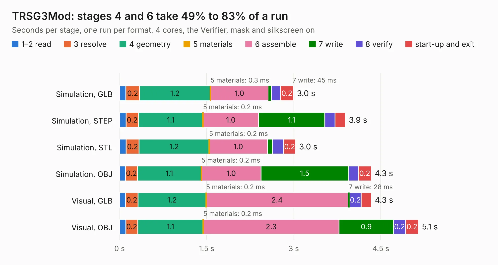

# 672. TRSG3Mod

Board 672 of the 3,125 of [Corpus Testing](../Corpus-Testing.md), on [Corpus Page 7](../CorpusTestingPages/Corpus-Testing-07.md#672-trsg3mod).

| Mode and format | 1–2 read | 3 resolve | 4 geometry | 5 materials | 6 assemble | 7 write | 8 verify | start-up and exit | Total |
|---|---:|---:|---:|---:|---:|---:|---:|---:|---:|
| Simulation, GLB | 0.1 | 0.2 | 1.2 | 0.3&nbsp;ms | 1.0 | 45&nbsp;ms | 0.2 | 0.2 | 3.0 |
| Simulation, STEP | 0.1 | 0.2 | 1.1 | 0.2&nbsp;ms | 1.0 | 1.1 | 0.2 | 0.2 | 3.9 |
| Simulation, STL | 0.1 | 0.2 | 1.2 | 0.2&nbsp;ms | 1.0 | 87&nbsp;ms | 0.2 | 0.2 | 3.0 |
| Simulation, OBJ | 0.1 | 0.2 | 1.1 | 0.2&nbsp;ms | 1.0 | 1.5 | 0.2 | 0.2 | 4.3 |
| Visual, GLB | 0.1 | 0.2 | 1.2 | 0.2&nbsp;ms | 2.4 | 28&nbsp;ms | 0.2 | 0.2 | 4.3 |
| Visual, OBJ | 0.1 | 0.2 | 1.1 | 0.2&nbsp;ms | 2.3 | 0.9 | 0.2 | 0.2 | 5.1 |

<table align="center"><tr><td valign="top">

| Board | Repo: [Board-Folk/TRS80IJP](https://github.com/Board-Folk/TRS80IJP) Board: `TRSG3Mod.kicad_pcb` |
|---|---|
| Folder | Extras / TRSG3Mod / TRSG3Modv1 |
| Complexity | 198&nbsp;/&nbsp;1000 (size&nbsp;123, features&nbsp;75) |
| KESE&nbsp;features | through vias, rounded, trapezoid or chamfered pads, filled zones, stack-up, dielectric εr and tanδ |
| Tested | 9th November 2026 |
| Copper&nbsp;layers | 2 |
| File&nbsp;format | KiCad 7 (20221018) |
| Parts,&nbsp;tracks,&nbsp;vias | 6, 153, 10 |
| Triangles,&nbsp;simulation | 308,292 in 34 parts |
| Verifier | PASS in all six runs |

</td><td valign="top">

<table>
<tr><th>File type</th><th>File size</th><th>Peak memory used</th></tr>
<tr><th colspan="3" align="left">Simulation</th></tr>
<tr><td>GLB</td><td align="right">11&nbsp;MB</td><td align="right">238&nbsp;MB</td></tr>
<tr><td>STEP</td><td align="right">52&nbsp;MB</td><td align="right">261&nbsp;MB</td></tr>
<tr><td>STL</td><td align="right">15&nbsp;MB</td><td align="right">243&nbsp;MB</td></tr>
<tr><td>OBJ</td><td align="right">31&nbsp;MB</td><td align="right">245&nbsp;MB</td></tr>
<tr><th colspan="3" align="left">Visual</th></tr>
<tr><td>GLB</td><td align="right">6.6&nbsp;MB</td><td align="right">260&nbsp;MB</td></tr>
<tr><td>OBJ</td><td align="right">19&nbsp;MB</td><td align="right">262&nbsp;MB</td></tr>
</table>

</td></tr></table>

| Previous | Next |
|:---|---:|
| [671. TRSG3JPMod](b0671b_TRS80IJP_TRSG3JPMod.md) | [673. TRS80IJP_1](b0673b_TRS80IJP_TRS80IJP-1.md) |
