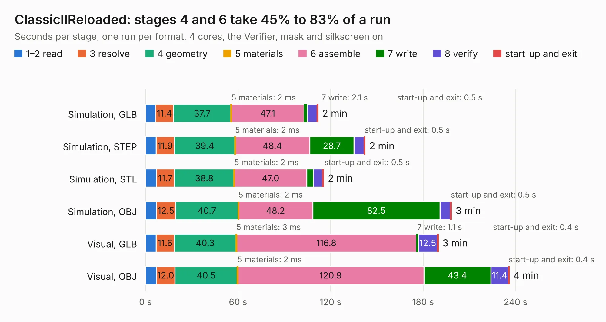

# 674. ClassicIIReloaded

Board 674 of the 3,110 of [Corpus Testing](../Corpus-Testing.md), on [Corpus Page 7](../CorpusTestingPages/Corpus-Testing-07.md#674-classiciireloaded).

| Mode and format | 1–2 read | 3 resolve | 4 geometry | 5 materials | 6 assemble | 7 write | 8 verify | start-up and exit | Total |
|---|---:|---:|---:|---:|---:|---:|---:|---:|---:|
| Simulation, GLB | 6.6 | 11.4 | 37.7 | 2&nbsp;ms | 47.1 | 2.1 | 6.4 | 0.5 | 111.8 |
| Simulation, STEP | 6.8 | 11.9 | 39.4 | 2&nbsp;ms | 48.4 | 28.7 | 6.6 | 0.5 | 142.3 |
| Simulation, STL | 7.1 | 11.7 | 38.8 | 2&nbsp;ms | 47.0 | 4.2 | 6.1 | 0.5 | 115.4 |
| Simulation, OBJ | 7.0 | 12.5 | 40.7 | 2&nbsp;ms | 48.2 | 82.5 | 6.9 | 0.5 | 198.3 |
| Visual, GLB | 6.9 | 11.6 | 40.3 | 3&nbsp;ms | 116.8 | 1.1 | 12.5 | 0.4 | 189.7 |
| Visual, OBJ | 7.1 | 12.0 | 40.5 | 2&nbsp;ms | 120.9 | 43.4 | 11.4 | 0.4 | 235.7 |

<table align="center"><tr><td valign="top">

| Board | Repo: [btb/ClassicII](https://github.com/btb/ClassicII) Board: `ClassicIIReloaded.kicad_pcb` |
|---|---|
| Folder | ClassicIIReloaded |
| Complexity | 450&nbsp;/&nbsp;1000 (size&nbsp;305, features&nbsp;145) |
| KESE&nbsp;features | through vias, slotted holes, rounded, trapezoid or chamfered pads, drill offsets, arc tracks, filled zones, copper drawings, copper text, TrueType text, stack-up, dielectric εr and tanδ |
| Tested | 9th November 2026 |
| Copper&nbsp;layers | 4 |
| File&nbsp;format | KiCad 9 (20241229) |
| Parts,&nbsp;tracks,&nbsp;vias | 290, 10,450, 1,255 |
| Triangles,&nbsp;simulation | 11,075,382 in 454 parts |
| Verifier | PASS in all six runs |

</td><td valign="top">

<table>
<tr><th>File type</th><th>File size</th><th>Peak memory used</th></tr>
<tr><th colspan="3" align="left">Simulation</th></tr>
<tr><td>GLB</td><td align="right">378&nbsp;MB</td><td align="right">2.7&nbsp;GB</td></tr>
<tr><td>STEP</td><td align="right">1.5&nbsp;GB</td><td align="right">3.6&nbsp;GB</td></tr>
<tr><td>STL</td><td align="right">554&nbsp;MB</td><td align="right">2.5&nbsp;GB</td></tr>
<tr><td>OBJ</td><td align="right">1.2&nbsp;GB</td><td align="right">7.1&nbsp;GB</td></tr>
<tr><th colspan="3" align="left">Visual</th></tr>
<tr><td>GLB</td><td align="right">223&nbsp;MB</td><td align="right">3.7&nbsp;GB</td></tr>
<tr><td>OBJ</td><td align="right">726&nbsp;MB</td><td align="right">4.9&nbsp;GB</td></tr>
</table>

</td></tr></table>

| Previous | Next |
|:---|---:|
| [673. other-m68k](b0673b_other-m68k_other-m68k.md) | [675. ClassicIIRevB](b0675b_ClassicII_ClassicIIRevB.md) |
