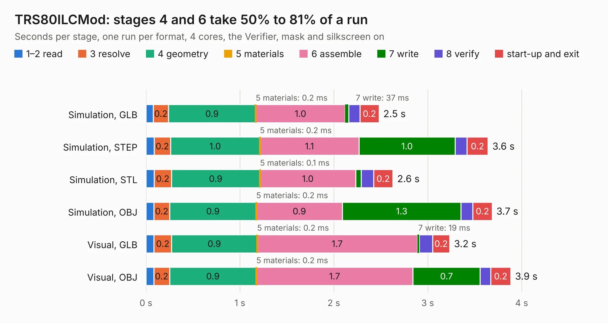

# 674. TRS80ILCMod

Board 674 of the 3,128 of [Corpus Testing](../Corpus-Testing.md), on [Corpus Page 7](../CorpusTestingPages/Corpus-Testing-07.md#674-trs80ilcmod).

| Mode and format | 1–2 read | 3 resolve | 4 geometry | 5 materials | 6 assemble | 7 write | 8 verify | start-up and exit | Total |
|---|---:|---:|---:|---:|---:|---:|---:|---:|---:|
| Simulation, GLB | 79&nbsp;ms | 0.2 | 0.9 | 0.2&nbsp;ms | 1.0 | 37&nbsp;ms | 0.1 | 0.2 | 2.5 |
| Simulation, STEP | 87&nbsp;ms | 0.2 | 1.0 | 0.2&nbsp;ms | 1.1 | 1.0 | 0.1 | 0.2 | 3.6 |
| Simulation, STL | 86&nbsp;ms | 0.2 | 0.9 | 0.1&nbsp;ms | 1.0 | 58&nbsp;ms | 0.1 | 0.2 | 2.6 |
| Simulation, OBJ | 83&nbsp;ms | 0.2 | 0.9 | 0.2&nbsp;ms | 0.9 | 1.3 | 0.1 | 0.2 | 3.7 |
| Visual, GLB | 86&nbsp;ms | 0.2 | 0.9 | 0.2&nbsp;ms | 1.7 | 19&nbsp;ms | 0.1 | 0.2 | 3.2 |
| Visual, OBJ | 83&nbsp;ms | 0.2 | 0.9 | 0.2&nbsp;ms | 1.7 | 0.7 | 0.1 | 0.2 | 3.9 |

<table align="center"><tr><td valign="top">

| Board | Repo: [Board-Folk/TRS80IUS](https://github.com/Board-Folk/TRS80IUS) Board: `TRS80ILCMod.kicad_pcb` |
|---|---|
| Folder | Extras / TRS80ILCMod / Kicad |
| Complexity | 139&nbsp;/&nbsp;1000 (size&nbsp;109, features&nbsp;30) |
| KESE&nbsp;features | stack-up, dielectric εr and tanδ |
| Tested | 9th November 2026 |
| Copper&nbsp;layers | 2 |
| File&nbsp;format | KiCad 7 (20221018) |
| Parts,&nbsp;tracks,&nbsp;vias | 5, 83, 0 |
| Triangles,&nbsp;simulation | 246,726 in 28 parts |
| Verifier | PASS in all six runs |

</td><td valign="top">

<table>
<tr><th>File type</th><th>File size</th><th>Peak memory used</th></tr>
<tr><th colspan="3" align="left">Simulation</th></tr>
<tr><td>GLB</td><td align="right">8.2&nbsp;MB</td><td align="right">218&nbsp;MB</td></tr>
<tr><td>STEP</td><td align="right">31&nbsp;MB</td><td align="right">236&nbsp;MB</td></tr>
<tr><td>STL</td><td align="right">12&nbsp;MB</td><td align="right">213&nbsp;MB</td></tr>
<tr><td>OBJ</td><td align="right">24&nbsp;MB</td><td align="right">217&nbsp;MB</td></tr>
<tr><th colspan="3" align="left">Visual</th></tr>
<tr><td>GLB</td><td align="right">4.5&nbsp;MB</td><td align="right">206&nbsp;MB</td></tr>
<tr><td>OBJ</td><td align="right">13&nbsp;MB</td><td align="right">212&nbsp;MB</td></tr>
</table>

</td></tr></table>

| Previous | Next |
|:---|---:|
| [673. TRS80IJP_1](b0673b_TRS80IJP_TRS80IJP-1.md) | [675. TRS80IUS](b0675b_TRS80IUS_TRS80IUS.md) |
