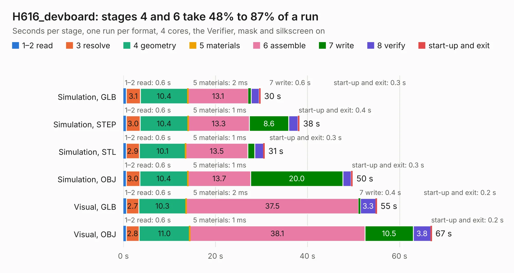

# 675. H616_devboard

Board 675 of the 3,117 of [Corpus Testing](../Corpus-Testing.md), on [Corpus Page 7](../CorpusTestingPages/Corpus-Testing-07.md#675-h616_devboard).

| Mode and format | 1–2 read | 3 resolve | 4 geometry | 5 materials | 6 assemble | 7 write | 8 verify | start-up and exit | Total |
|---|---:|---:|---:|---:|---:|---:|---:|---:|---:|
| Simulation, GLB | 0.6 | 3.1 | 10.4 | 2&nbsp;ms | 13.1 | 0.6 | 1.7 | 0.3 | 29.8 |
| Simulation, STEP | 0.6 | 3.0 | 10.4 | 1&nbsp;ms | 13.3 | 8.6 | 2.0 | 0.4 | 38.3 |
| Simulation, STL | 0.6 | 2.9 | 10.1 | 1&nbsp;ms | 13.5 | 1.5 | 1.9 | 0.3 | 30.7 |
| Simulation, OBJ | 0.6 | 3.0 | 10.4 | 1&nbsp;ms | 13.7 | 20.0 | 1.8 | 0.3 | 49.8 |
| Visual, GLB | 0.6 | 2.7 | 10.3 | 2&nbsp;ms | 37.5 | 0.4 | 3.3 | 0.2 | 55.1 |
| Visual, OBJ | 0.6 | 2.8 | 11.0 | 1&nbsp;ms | 38.1 | 10.5 | 3.8 | 0.2 | 67.0 |

<table align="center"><tr><td valign="top">

| Board | Repo: [bogdan8266/h616-board](https://github.com/bogdan8266/h616-board) Board: `H616_devboard.kicad_pcb` |
|---|---|
| Folder | Hardware / H616_DDR3 |
| Complexity | 412&nbsp;/&nbsp;1000 (size&nbsp;297, features&nbsp;115) |
| KESE&nbsp;features | through vias, slotted holes, rounded, trapezoid or chamfered pads, drill offsets, arc tracks, copper text, stack-up, dielectric εr and tanδ, copper finish |
| Tested | 9th November 2026 |
| Copper&nbsp;layers | 8 |
| File&nbsp;format | KiCad 10 (20260206) |
| Parts,&nbsp;tracks,&nbsp;vias | 167, 1,531, 263 |
| Triangles,&nbsp;simulation | 4,056,192 in 464 parts |
| Verifier | PASS in all six runs |

</td><td valign="top">

<table>
<tr><th>File type</th><th>File size</th><th>Peak memory used</th></tr>
<tr><th colspan="3" align="left">Simulation</th></tr>
<tr><td>GLB</td><td align="right">131&nbsp;MB</td><td align="right">1.1&nbsp;GB</td></tr>
<tr><td>STEP</td><td align="right">460&nbsp;MB</td><td align="right">1.3&nbsp;GB</td></tr>
<tr><td>STL</td><td align="right">203&nbsp;MB</td><td align="right">1.1&nbsp;GB</td></tr>
<tr><td>OBJ</td><td align="right">426&nbsp;MB</td><td align="right">2.5&nbsp;GB</td></tr>
<tr><th colspan="3" align="left">Visual</th></tr>
<tr><td>GLB</td><td align="right">73&nbsp;MB</td><td align="right">1.3&nbsp;GB</td></tr>
<tr><td>OBJ</td><td align="right">230&nbsp;MB</td><td align="right">1.5&nbsp;GB</td></tr>
</table>

</td></tr></table>

| Previous | Next |
|:---|---:|
| [674. Debug_Adapter](b0674b_h616-board_Debug-Adapter.md) | [676. H616_devboard](b0676b_h616-board_Hardware-H616-LPDDR4_H616-devboard.md) |
