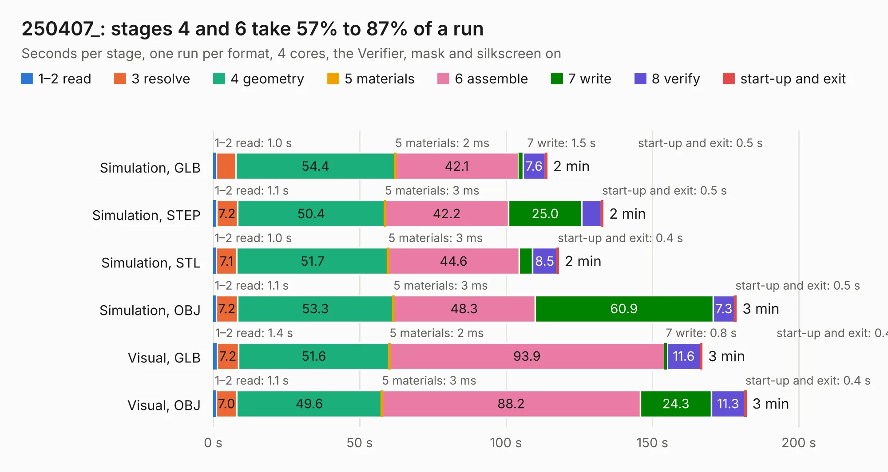

# 676. 250407_

Board 676 of the 3,102 of [Corpus Testing](../Corpus-Testing.md), on [Corpus Page 7](../CorpusTestingPages/Corpus-Testing-07.md#676-250407_).

| Mode and format | 1–2 read | 3 resolve | 4 geometry | 5 materials | 6 assemble | 7 write | 8 verify | start-up and exit | Total |
|---|---:|---:|---:|---:|---:|---:|---:|---:|---:|
| Simulation, GLB | 1.0 | 6.7 | 54.4 | 2&nbsp;ms | 42.1 | 1.5 | 7.6 | 0.5 | 113.9 |
| Simulation, STEP | 1.1 | 7.2 | 50.4 | 3&nbsp;ms | 42.2 | 25.0 | 6.7 | 0.5 | 133.1 |
| Simulation, STL | 1.0 | 7.1 | 51.7 | 3&nbsp;ms | 44.6 | 4.6 | 8.5 | 0.4 | 117.9 |
| Simulation, OBJ | 1.1 | 7.2 | 53.3 | 3&nbsp;ms | 48.3 | 60.9 | 7.3 | 0.5 | 178.6 |
| Visual, GLB | 1.4 | 7.2 | 51.6 | 2&nbsp;ms | 93.9 | 0.8 | 11.6 | 0.4 | 166.9 |
| Visual, OBJ | 1.1 | 7.0 | 49.6 | 3&nbsp;ms | 88.2 | 24.3 | 11.3 | 0.4 | 181.9 |

<table align="center"><tr><td valign="top">

| Board | Repo: [bwack/C64-250407-Replica-KiCad](https://github.com/bwack/C64-250407-Replica-KiCad) Board: `250407_.kicad_pcb` |
|---|---|
| Complexity | 283&nbsp;/&nbsp;1000 (size&nbsp;223, features&nbsp;60) |
| KESE&nbsp;features | through vias, custom pads, filled zones, copper drawings |
| Tested | 9th November 2026 |
| Copper&nbsp;layers | 2 |
| File&nbsp;format | KiCad 9 (20241229) |
| Parts,&nbsp;tracks,&nbsp;vias | 215, 6,552, 574 |
| Triangles,&nbsp;simulation | 8,877,004 in 261 parts |
| Verifier | PASS in all six runs |

</td><td valign="top">

<table>
<tr><th>File type</th><th>File size</th><th>Peak memory used</th></tr>
<tr><th colspan="3" align="left">Simulation</th></tr>
<tr><td>GLB</td><td align="right">301&nbsp;MB</td><td align="right">2.3&nbsp;GB</td></tr>
<tr><td>STEP</td><td align="right">1.4&nbsp;GB</td><td align="right">3.1&nbsp;GB</td></tr>
<tr><td>STL</td><td align="right">444&nbsp;MB</td><td align="right">2.3&nbsp;GB</td></tr>
<tr><td>OBJ</td><td align="right">949&nbsp;MB</td><td align="right">5.6&nbsp;GB</td></tr>
<tr><th colspan="3" align="left">Visual</th></tr>
<tr><td>GLB</td><td align="right">152&nbsp;MB</td><td align="right">2.5&nbsp;GB</td></tr>
<tr><td>OBJ</td><td align="right">484&nbsp;MB</td><td align="right">3.2&nbsp;GB</td></tr>
</table>

</td></tr></table>

| Previous | Next |
|:---|---:|
| [675. ButterStick](b0675b_butterstick-hardware_hardware-ButterStick-r1-0_ButterStick.md) | [677. C64-250469-KiCad](b0677b_C64C-250469-KiCAD-Replica_C64-250469-KiCad.md) |
