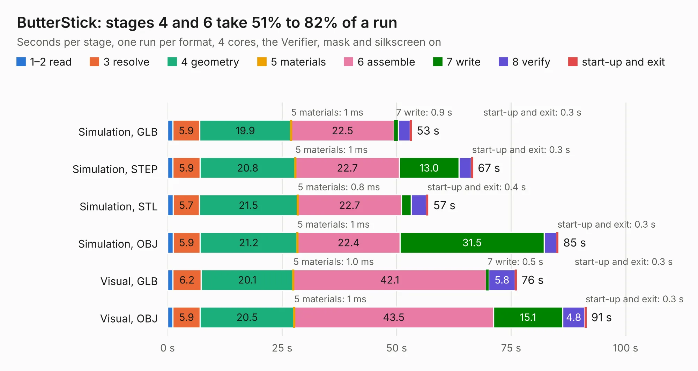

# 676. ButterStick

Board 676 of the 3,104 of [Corpus Testing](../Corpus-Testing.md), on [Corpus Page 7](../CorpusTestingPages/Corpus-Testing-07.md#676-butterstick).

| Mode and format | 1–2 read | 3 resolve | 4 geometry | 5 materials | 6 assemble | 7 write | 8 verify | start-up and exit | Total |
|---|---:|---:|---:|---:|---:|---:|---:|---:|---:|
| Simulation, GLB | 1.1 | 5.9 | 19.9 | 1&nbsp;ms | 22.5 | 0.9 | 2.6 | 0.3 | 53.3 |
| Simulation, STEP | 1.1 | 5.9 | 20.8 | 1&nbsp;ms | 22.7 | 13.0 | 2.7 | 0.3 | 66.7 |
| Simulation, STL | 1.2 | 5.7 | 21.5 | 0.8&nbsp;ms | 22.7 | 2.1 | 3.3 | 0.4 | 56.9 |
| Simulation, OBJ | 1.2 | 5.9 | 21.2 | 1&nbsp;ms | 22.4 | 31.5 | 2.8 | 0.3 | 85.3 |
| Visual, GLB | 1.2 | 6.2 | 20.1 | 1.0&nbsp;ms | 42.1 | 0.5 | 5.8 | 0.3 | 76.2 |
| Visual, OBJ | 1.2 | 5.9 | 20.5 | 1&nbsp;ms | 43.5 | 15.1 | 4.8 | 0.3 | 91.4 |

<table align="center"><tr><td valign="top">

| Board | Repo: [butterstick-fpga/butterstick-hardware](https://github.com/butterstick-fpga/butterstick-hardware) Board: `ButterStick.kicad_pcb` |
|---|---|
| Folder | hardware / ButterStick_r0.2 |
| Complexity | 410&nbsp;/&nbsp;1000 (size&nbsp;320, features&nbsp;90) |
| KESE&nbsp;features | through vias, custom pads, rounded, trapezoid or chamfered pads, filled zones, copper drawings, copper text, curved board outline |
| Tested | 9th November 2026 |
| Copper&nbsp;layers | 6 |
| File&nbsp;format | KiCad 5 (20171130) |
| Parts,&nbsp;tracks,&nbsp;vias | 223, 16,942, 792 |
| Triangles,&nbsp;simulation | 6,727,172 in 339 parts |
| Verifier | PASS in all six runs |

</td><td valign="top">

<table>
<tr><th>File type</th><th>File size</th><th>Peak memory used</th></tr>
<tr><th colspan="3" align="left">Simulation</th></tr>
<tr><td>GLB</td><td align="right">231&nbsp;MB</td><td align="right">1.7&nbsp;GB</td></tr>
<tr><td>STEP</td><td align="right">896&nbsp;MB</td><td align="right">2.3&nbsp;GB</td></tr>
<tr><td>STL</td><td align="right">336&nbsp;MB</td><td align="right">1.6&nbsp;GB</td></tr>
<tr><td>OBJ</td><td align="right">722&nbsp;MB</td><td align="right">4.2&nbsp;GB</td></tr>
<tr><th colspan="3" align="left">Visual</th></tr>
<tr><td>GLB</td><td align="right">117&nbsp;MB</td><td align="right">2.1&nbsp;GB</td></tr>
<tr><td>OBJ</td><td align="right">383&nbsp;MB</td><td align="right">2.6&nbsp;GB</td></tr>
</table>

</td></tr></table>

| Previous | Next |
|:---|---:|
| [675. ButterStick](b0675b_butterstick-hardware_hardware-ButterStick-r0-1_ButterStick.md) | [677. ButterStick](b0677b_butterstick-hardware_hardware-ButterStick-r1-0_ButterStick.md) |
