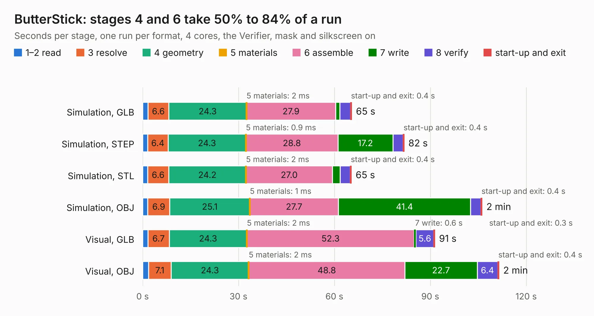

# 677. ButterStick

Board 677 of the 3,112 of [Corpus Testing](../Corpus-Testing.md), on [Corpus Page 7](../CorpusTestingPages/Corpus-Testing-07.md#677-butterstick).

| Mode and format | 1–2 read | 3 resolve | 4 geometry | 5 materials | 6 assemble | 7 write | 8 verify | start-up and exit | Total |
|---|---:|---:|---:|---:|---:|---:|---:|---:|---:|
| Simulation, GLB | 1.6 | 6.6 | 24.3 | 2&nbsp;ms | 27.9 | 1.4 | 3.3 | 0.4 | 65.4 |
| Simulation, STEP | 1.6 | 6.4 | 24.3 | 0.9&nbsp;ms | 28.8 | 17.2 | 3.1 | 0.4 | 81.8 |
| Simulation, STL | 1.6 | 6.6 | 24.2 | 2&nbsp;ms | 27.0 | 2.4 | 3.2 | 0.4 | 65.3 |
| Simulation, OBJ | 1.6 | 6.9 | 25.1 | 1&nbsp;ms | 27.7 | 41.4 | 3.2 | 0.4 | 106.2 |
| Visual, GLB | 1.6 | 6.7 | 24.3 | 2&nbsp;ms | 52.3 | 0.6 | 5.6 | 0.3 | 91.4 |
| Visual, OBJ | 1.8 | 7.1 | 24.3 | 2&nbsp;ms | 48.8 | 22.7 | 6.4 | 0.4 | 111.5 |

<table align="center"><tr><td valign="top">

| Board | Repo: [butterstick-fpga/butterstick-hardware](https://github.com/butterstick-fpga/butterstick-hardware) Board: `ButterStick.kicad_pcb` |
|---|---|
| Folder | hardware / ButterStick_r0.1 |
| Complexity | 398&nbsp;/&nbsp;1000 (size&nbsp;318, features&nbsp;80) |
| KESE&nbsp;features | through vias, custom pads, rounded, trapezoid or chamfered pads, filled zones, copper drawings, curved board outline |
| Tested | 9th November 2026 |
| Copper&nbsp;layers | 6 |
| File&nbsp;format | KiCad 5 (20171130) |
| Parts,&nbsp;tracks,&nbsp;vias | 181, 17,618, 671 |
| Triangles,&nbsp;simulation | 6,232,652 in 340 parts |
| Verifier | PASS in all six runs |

</td><td valign="top">

<table>
<tr><th>File type</th><th>File size</th><th>Peak memory used</th></tr>
<tr><th colspan="3" align="left">Simulation</th></tr>
<tr><td>GLB</td><td align="right">214&nbsp;MB</td><td align="right">1.6&nbsp;GB</td></tr>
<tr><td>STEP</td><td align="right">881&nbsp;MB</td><td align="right">2.3&nbsp;GB</td></tr>
<tr><td>STL</td><td align="right">312&nbsp;MB</td><td align="right">1.7&nbsp;GB</td></tr>
<tr><td>OBJ</td><td align="right">667&nbsp;MB</td><td align="right">4.0&nbsp;GB</td></tr>
<tr><th colspan="3" align="left">Visual</th></tr>
<tr><td>GLB</td><td align="right">114&nbsp;MB</td><td align="right">2.0&nbsp;GB</td></tr>
<tr><td>OBJ</td><td align="right">374&nbsp;MB</td><td align="right">2.6&nbsp;GB</td></tr>
</table>

</td></tr></table>

| Previous | Next |
|:---|---:|
| [676. ClassicIIRevB](b0676b_ClassicII_ClassicIIRevB.md) | [678. ButterStick](b0678b_butterstick-hardware_hardware-ButterStick-r0-2_ButterStick.md) |
