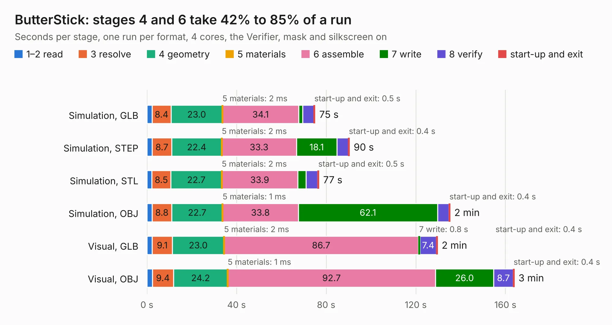

# 678. ButterStick

Board 678 of the 3,111 of [Corpus Testing](../Corpus-Testing.md), on [Corpus Page 7](../CorpusTestingPages/Corpus-Testing-07.md#678-butterstick).

| Mode and format | 1–2 read | 3 resolve | 4 geometry | 5 materials | 6 assemble | 7 write | 8 verify | start-up and exit | Total |
|---|---:|---:|---:|---:|---:|---:|---:|---:|---:|
| Simulation, GLB | 2.4 | 8.4 | 23.0 | 2&nbsp;ms | 34.1 | 1.6 | 5.1 | 0.5 | 75.0 |
| Simulation, STEP | 2.4 | 8.7 | 22.4 | 2&nbsp;ms | 33.3 | 18.1 | 5.2 | 0.4 | 90.4 |
| Simulation, STL | 2.2 | 8.5 | 22.7 | 2&nbsp;ms | 33.9 | 3.7 | 5.2 | 0.5 | 76.7 |
| Simulation, OBJ | 2.3 | 8.8 | 22.7 | 1&nbsp;ms | 33.8 | 62.1 | 5.1 | 0.4 | 135.3 |
| Visual, GLB | 2.3 | 9.1 | 23.0 | 2&nbsp;ms | 86.7 | 0.8 | 7.4 | 0.4 | 129.6 |
| Visual, OBJ | 2.4 | 9.4 | 24.2 | 1&nbsp;ms | 92.7 | 26.0 | 8.7 | 0.4 | 163.9 |

<table align="center"><tr><td valign="top">

| Board | Repo: [butterstick-fpga/butterstick-hardware](https://github.com/butterstick-fpga/butterstick-hardware) Board: `ButterStick.kicad_pcb` |
|---|---|
| Folder | hardware / ButterStick_r1.0 |
| Complexity | 491&nbsp;/&nbsp;1000 (size&nbsp;341, features&nbsp;150) |
| KESE&nbsp;features | through vias, slotted holes, custom pads, rounded, trapezoid or chamfered pads, filled zones, copper drawings, copper text, curved board outline, stack-up, dielectric εr and tanδ, copper finish, mask and silkscreen colours |
| Tested | 9th November 2026 |
| Copper&nbsp;layers | 8 |
| File&nbsp;format | KiCad 6 (20211014) |
| Parts,&nbsp;tracks,&nbsp;vias | 327, 19,487, 1,061 |
| Triangles,&nbsp;simulation | 10,425,092 in 367 parts |
| Verifier | PASS in all six runs |

</td><td valign="top">

<table>
<tr><th>File type</th><th>File size</th><th>Peak memory used</th></tr>
<tr><th colspan="3" align="left">Simulation</th></tr>
<tr><td>GLB</td><td align="right">345&nbsp;MB</td><td align="right">2.1&nbsp;GB</td></tr>
<tr><td>STEP</td><td align="right">1.1&nbsp;GB</td><td align="right">3.1&nbsp;GB</td></tr>
<tr><td>STL</td><td align="right">521&nbsp;MB</td><td align="right">2.1&nbsp;GB</td></tr>
<tr><td>OBJ</td><td align="right">1.1&nbsp;GB</td><td align="right">6.5&nbsp;GB</td></tr>
<tr><th colspan="3" align="left">Visual</th></tr>
<tr><td>GLB</td><td align="right">154&nbsp;MB</td><td align="right">2.8&nbsp;GB</td></tr>
<tr><td>OBJ</td><td align="right">520&nbsp;MB</td><td align="right">3.5&nbsp;GB</td></tr>
</table>

</td></tr></table>

| Previous | Next |
|:---|---:|
| [677. ButterStick](b0677b_butterstick-hardware_hardware-ButterStick-r0-2_ButterStick.md) | [679. 250407_](b0679b_C64-250407-Replica-KiCad_250407.md) |
