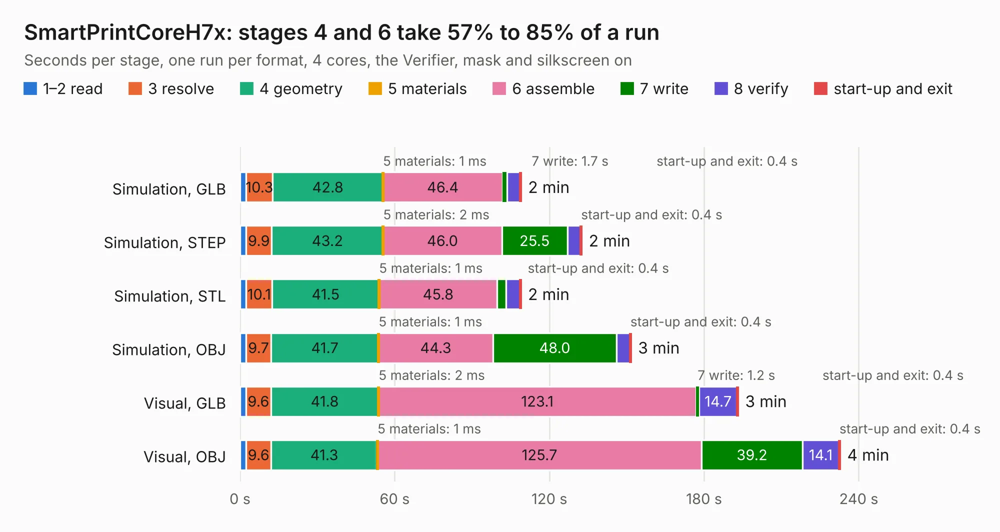

# 680 SmartPrintCoreH7x

Board 680 of the 3,138 of [Corpus Testing](../Corpus-Testing.md), on [Corpus Page 7](../CorpusTestingPages/Corpus-Testing-07.md#680-smartprintcoreh7x).

| Mode and format | 1–2 read | 3 resolve | 4 geometry | 5 materials | 6 assemble | 7 write | 8 verify | start-up and exit | Total |
|---|---:|---:|---:|---:|---:|---:|---:|---:|---:|
| Simulation, GLB | 2.4 | 10.3 | 42.8 | 1&nbsp;ms | 46.4 | 1.7 | 5.0 | 0.4 | 109.0 |
| Simulation, STEP | 2.4 | 9.9 | 43.2 | 2&nbsp;ms | 46.0 | 25.5 | 5.1 | 0.4 | 132.5 |
| Simulation, STL | 2.4 | 10.1 | 41.5 | 1&nbsp;ms | 45.8 | 3.5 | 5.3 | 0.4 | 108.9 |
| Simulation, OBJ | 2.4 | 9.7 | 41.7 | 1&nbsp;ms | 44.3 | 48.0 | 5.1 | 0.4 | 151.6 |
| Visual, GLB | 2.3 | 9.6 | 41.8 | 2&nbsp;ms | 123.1 | 1.2 | 14.7 | 0.4 | 193.2 |
| Visual, OBJ | 2.4 | 9.6 | 41.3 | 1&nbsp;ms | 125.7 | 39.2 | 14.1 | 0.4 | 232.7 |

<table align="center"><tr><td valign="top">

| Board | Repo: [BoltzRnD/SmartPrintCoreH7x](https://github.com/BoltzRnD/SmartPrintCoreH7x) Board: `SmartPrintCoreH7x.kicad_pcb` |
|---|---|
| Folder | SmartPrintCoreH7x |
| Complexity | 410&nbsp;/&nbsp;1000 (size&nbsp;280, features&nbsp;130) |
| KESE&nbsp;features | through vias, slotted holes, custom pads, rounded, trapezoid or chamfered pads, arc tracks, filled zones, copper drawings, stack-up, dielectric εr and tanδ, mask and silkscreen colours |
| Tested | 9th November 2026 |
| Copper&nbsp;layers | 2 |
| File&nbsp;format | KiCad 7 (20221018) |
| Parts,&nbsp;tracks,&nbsp;vias | 541, 8,490, 1,506 |
| Triangles,&nbsp;simulation | 7,949,190 in 428 parts |
| Verifier | PASS in all six runs |

</td><td valign="top">

<table>
<tr><th>File type</th><th>File size</th><th>Peak memory used</th></tr>
<tr><th colspan="3" align="left">Simulation</th></tr>
<tr><td>GLB</td><td align="right">273&nbsp;MB</td><td align="right">2.7&nbsp;GB</td></tr>
<tr><td>STEP</td><td align="right">1.5&nbsp;GB</td><td align="right">3.1&nbsp;GB</td></tr>
<tr><td>STL</td><td align="right">397&nbsp;MB</td><td align="right">2.8&nbsp;GB</td></tr>
<tr><td>OBJ</td><td align="right">851&nbsp;MB</td><td align="right">5.0&nbsp;GB</td></tr>
<tr><th colspan="3" align="left">Visual</th></tr>
<tr><td>GLB</td><td align="right">238&nbsp;MB</td><td align="right">3.5&nbsp;GB</td></tr>
<tr><td>OBJ</td><td align="right">764&nbsp;MB</td><td align="right">4.9&nbsp;GB</td></tr>
</table>

</td></tr></table>

| Previous | Next |
|:---|---:|
| [679 H616_devboard](b0679b_h616-board_Hardware-H616-LPDDR4_H616-devboard.md) | [681 other-m68k](b0681b_other-m68k_other-m68k.md) |
