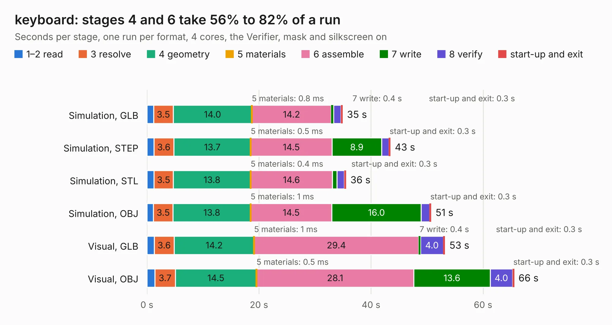

# 680. keyboard

Board 680 of the 3,102 of [Corpus Testing](../Corpus-Testing.md), on [Corpus Page 7](../CorpusTestingPages/Corpus-Testing-07.md#680-keyboard).

| Mode and format | 1–2 read | 3 resolve | 4 geometry | 5 materials | 6 assemble | 7 write | 8 verify | start-up and exit | Total |
|---|---:|---:|---:|---:|---:|---:|---:|---:|---:|
| Simulation, GLB | 1.2 | 3.5 | 14.0 | 0.8&nbsp;ms | 14.2 | 0.4 | 1.3 | 0.3 | 34.9 |
| Simulation, STEP | 1.2 | 3.6 | 13.7 | 0.5&nbsp;ms | 14.5 | 8.9 | 1.3 | 0.3 | 43.5 |
| Simulation, STL | 1.2 | 3.5 | 13.8 | 0.4&nbsp;ms | 14.6 | 0.8 | 1.3 | 0.3 | 35.5 |
| Simulation, OBJ | 1.2 | 3.5 | 13.8 | 1&nbsp;ms | 14.5 | 16.0 | 1.5 | 0.3 | 50.7 |
| Visual, GLB | 1.3 | 3.6 | 14.2 | 1&nbsp;ms | 29.4 | 0.4 | 4.0 | 0.3 | 53.2 |
| Visual, OBJ | 1.4 | 3.7 | 14.5 | 0.5&nbsp;ms | 28.1 | 13.6 | 4.0 | 0.3 | 65.5 |

<table align="center"><tr><td valign="top">

| Board | Repo: [byrantech/laptop](https://github.com/byrantech/laptop) Board: `keyboard.kicad_pcb` |
|---|---|
| Folder | keyboard |
| Complexity | 327&nbsp;/&nbsp;1000 (size&nbsp;247, features&nbsp;80) |
| KESE&nbsp;features | through vias, slotted holes, rounded, trapezoid or chamfered pads, filled zones, curved board outline, TrueType text |
| Tested | 9th November 2026 |
| Copper&nbsp;layers | 2 |
| File&nbsp;format | KiCad 9 (20240225) |
| Parts,&nbsp;tracks,&nbsp;vias | 208, 1,484, 571 |
| Triangles,&nbsp;simulation | 2,715,872 in 171 parts |
| Verifier | PASS in all six runs |

</td><td valign="top">

<table>
<tr><th>File type</th><th>File size</th><th>Peak memory used</th></tr>
<tr><th colspan="3" align="left">Simulation</th></tr>
<tr><td>GLB</td><td align="right">94&nbsp;MB</td><td align="right">1.1&nbsp;GB</td></tr>
<tr><td>STEP</td><td align="right">491&nbsp;MB</td><td align="right">1.5&nbsp;GB</td></tr>
<tr><td>STL</td><td align="right">136&nbsp;MB</td><td align="right">1.1&nbsp;GB</td></tr>
<tr><td>OBJ</td><td align="right">290&nbsp;MB</td><td align="right">1.9&nbsp;GB</td></tr>
<tr><th colspan="3" align="left">Visual</th></tr>
<tr><td>GLB</td><td align="right">84&nbsp;MB</td><td align="right">1.4&nbsp;GB</td></tr>
<tr><td>OBJ</td><td align="right">261&nbsp;MB</td><td align="right">1.8&nbsp;GB</td></tr>
</table>

</td></tr></table>

| Previous | Next |
|:---|---:|
| [679. encoder](b0679b_laptop_encoder.md) | [681. protector](b0681b_laptop_protector.md) |
