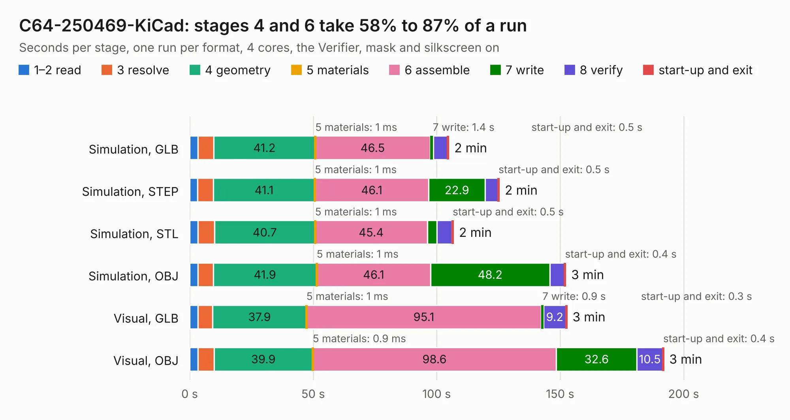

# 681. C64-250469-KiCad

Board 681 of the 3,112 of [Corpus Testing](../Corpus-Testing.md), on [Corpus Page 7](../CorpusTestingPages/Corpus-Testing-07.md#681-c64-250469-kicad).

| Mode and format | 1–2 read | 3 resolve | 4 geometry | 5 materials | 6 assemble | 7 write | 8 verify | start-up and exit | Total |
|---|---:|---:|---:|---:|---:|---:|---:|---:|---:|
| Simulation, GLB | 3.3 | 6.4 | 41.2 | 1&nbsp;ms | 46.5 | 1.4 | 5.7 | 0.5 | 104.9 |
| Simulation, STEP | 3.3 | 6.3 | 41.1 | 1&nbsp;ms | 46.1 | 22.9 | 5.2 | 0.5 | 125.3 |
| Simulation, STL | 3.4 | 6.7 | 40.7 | 1&nbsp;ms | 45.4 | 3.9 | 6.1 | 0.5 | 106.8 |
| Simulation, OBJ | 3.3 | 6.2 | 41.9 | 1&nbsp;ms | 46.1 | 48.2 | 6.0 | 0.4 | 152.2 |
| Visual, GLB | 3.3 | 6.0 | 37.9 | 1&nbsp;ms | 95.1 | 0.9 | 9.2 | 0.3 | 152.7 |
| Visual, OBJ | 3.4 | 6.5 | 39.9 | 0.9&nbsp;ms | 98.6 | 32.6 | 10.5 | 0.4 | 191.9 |

<table align="center"><tr><td valign="top">

| Board | Repo: [bwack/C64C-250469-KiCAD-Replica](https://github.com/bwack/C64C-250469-KiCAD-Replica) Board: `C64-250469-KiCad.kicad_pcb` |
|---|---|
| Complexity | 322&nbsp;/&nbsp;1000 (size&nbsp;222, features&nbsp;100) |
| KESE&nbsp;features | through vias, slotted holes, rounded, trapezoid or chamfered pads, arc tracks, filled zones, stack-up, dielectric εr and tanδ |
| Tested | 9th November 2026 to 10th November 2026 |
| Copper&nbsp;layers | 2 |
| File&nbsp;format | KiCad 7 (20221018) |
| Parts,&nbsp;tracks,&nbsp;vias | 138, 8,544, 642 |
| Triangles,&nbsp;simulation | 8,242,170 in 213 parts |
| Verifier | PASS in all six runs |
| Run&nbsp;again | Simulation, GLB; Simulation, STEP; Simulation, STL; Simulation, OBJ: failed in the corpus run, run again with fixes to KESE made after the corpus run, and passed |

</td><td valign="top">

<table>
<tr><th>File type</th><th>File size</th><th>Peak memory used</th></tr>
<tr><th colspan="3" align="left">Simulation</th></tr>
<tr><td>GLB</td><td align="right">280&nbsp;MB</td><td align="right">2.3&nbsp;GB</td></tr>
<tr><td>STEP</td><td align="right">1.4&nbsp;GB</td><td align="right">3.1&nbsp;GB</td></tr>
<tr><td>STL</td><td align="right">412&nbsp;MB</td><td align="right">2.3&nbsp;GB</td></tr>
<tr><td>OBJ</td><td align="right">880&nbsp;MB</td><td align="right">5.2&nbsp;GB</td></tr>
<tr><th colspan="3" align="left">Visual</th></tr>
<tr><td>GLB</td><td align="right">191&nbsp;MB</td><td align="right">3.0&nbsp;GB</td></tr>
<tr><td>OBJ</td><td align="right">615&nbsp;MB</td><td align="right">3.8&nbsp;GB</td></tr>
</table>

</td></tr></table>

| Previous | Next |
|:---|---:|
| [680. 250407_](b0680b_C64-250407-Replica-KiCad_250407.md) | [682. audio](b0682b_laptop_audio.md) |
