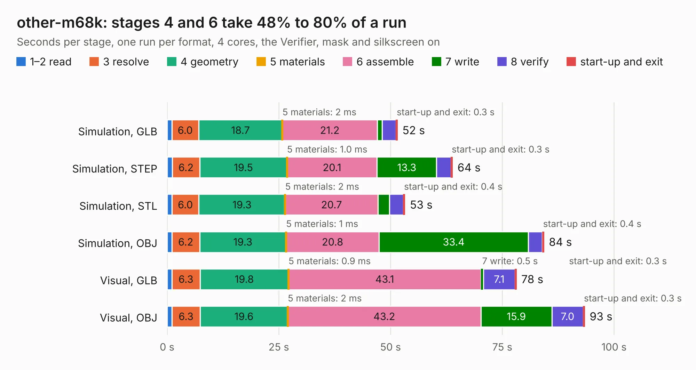

# 681. other-m68k

Board 681 of the 3,138 of [Corpus Testing](../Corpus-Testing.md), on [Corpus Page 7](../CorpusTestingPages/Corpus-Testing-07.md#681-other-m68k).

| Mode and format | 1–2 read | 3 resolve | 4 geometry | 5 materials | 6 assemble | 7 write | 8 verify | start-up and exit | Total |
|---|---:|---:|---:|---:|---:|---:|---:|---:|---:|
| Simulation, GLB | 1.1 | 6.0 | 18.7 | 2&nbsp;ms | 21.2 | 1.1 | 3.1 | 0.3 | 51.5 |
| Simulation, STEP | 1.1 | 6.2 | 19.5 | 1.0&nbsp;ms | 20.1 | 13.3 | 3.2 | 0.3 | 63.9 |
| Simulation, STL | 1.1 | 6.0 | 19.3 | 2&nbsp;ms | 20.7 | 2.6 | 3.1 | 0.4 | 53.2 |
| Simulation, OBJ | 1.1 | 6.2 | 19.3 | 1&nbsp;ms | 20.8 | 33.4 | 3.1 | 0.4 | 84.3 |
| Visual, GLB | 1.1 | 6.3 | 19.8 | 0.9&nbsp;ms | 43.1 | 0.5 | 7.1 | 0.3 | 78.1 |
| Visual, OBJ | 1.1 | 6.3 | 19.6 | 2&nbsp;ms | 43.2 | 15.9 | 7.0 | 0.3 | 93.4 |

<table align="center"><tr><td valign="top">

| Board | Repo: [bradgrantham/other-m68k](https://github.com/bradgrantham/other-m68k) Board: `other-m68k.kicad_pcb` |
|---|---|
| Folder | kicad / release |
| Complexity | 349&nbsp;/&nbsp;1000 (size&nbsp;284, features&nbsp;65) |
| KESE&nbsp;features | through vias, slotted holes, rounded, trapezoid or chamfered pads, filled zones, curved board outline |
| Tested | 9th November 2026 |
| Copper&nbsp;layers | 4 |
| File&nbsp;format | KiCad 9 (20241229) |
| Parts,&nbsp;tracks,&nbsp;vias | 163, 6,720, 665 |
| Triangles,&nbsp;simulation | 6,929,688 in 267 parts |
| Verifier | PASS in all six runs |

</td><td valign="top">

<table>
<tr><th>File type</th><th>File size</th><th>Peak memory used</th></tr>
<tr><th colspan="3" align="left">Simulation</th></tr>
<tr><td>GLB</td><td align="right">234&nbsp;MB</td><td align="right">2.0&nbsp;GB</td></tr>
<tr><td>STEP</td><td align="right">837&nbsp;MB</td><td align="right">2.3&nbsp;GB</td></tr>
<tr><td>STL</td><td align="right">347&nbsp;MB</td><td align="right">1.9&nbsp;GB</td></tr>
<tr><td>OBJ</td><td align="right">734&nbsp;MB</td><td align="right">4.3&nbsp;GB</td></tr>
<tr><th colspan="3" align="left">Visual</th></tr>
<tr><td>GLB</td><td align="right">126&nbsp;MB</td><td align="right">2.1&nbsp;GB</td></tr>
<tr><td>OBJ</td><td align="right">403&nbsp;MB</td><td align="right">2.6&nbsp;GB</td></tr>
</table>

</td></tr></table>

| Previous | Next |
|:---|---:|
| [680. SmartPrintCoreH7x](b0680b_SmartPrintCoreH7x_SmartPrintCoreH7x.md) | [682. ClassicIIReloaded](b0682b_ClassicII_ClassicIIReloaded.md) |
