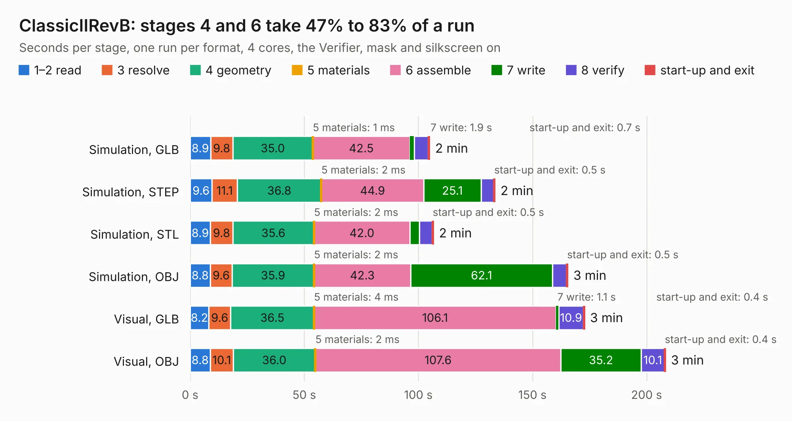

# 682. ClassicIIRevB

Board 682 of the 3,130 of [Corpus Testing](../Corpus-Testing.md), on [Corpus Page 7](../CorpusTestingPages/Corpus-Testing-07.md#682-classiciirevb).

| Mode and format | 1–2 read | 3 resolve | 4 geometry | 5 materials | 6 assemble | 7 write | 8 verify | start-up and exit | Total |
|---|---:|---:|---:|---:|---:|---:|---:|---:|---:|
| Simulation, GLB | 8.9 | 9.8 | 35.0 | 1&nbsp;ms | 42.5 | 1.9 | 6.0 | 0.7 | 104.9 |
| Simulation, STEP | 9.6 | 11.1 | 36.8 | 2&nbsp;ms | 44.9 | 25.1 | 5.6 | 0.5 | 133.5 |
| Simulation, STL | 8.9 | 9.8 | 35.6 | 2&nbsp;ms | 42.0 | 4.2 | 5.6 | 0.5 | 106.6 |
| Simulation, OBJ | 8.8 | 9.6 | 35.9 | 2&nbsp;ms | 42.3 | 62.1 | 6.2 | 0.5 | 165.5 |
| Visual, GLB | 8.2 | 9.6 | 36.5 | 4&nbsp;ms | 106.1 | 1.1 | 10.9 | 0.4 | 172.8 |
| Visual, OBJ | 8.8 | 10.1 | 36.0 | 2&nbsp;ms | 107.6 | 35.2 | 10.1 | 0.4 | 208.2 |

<table align="center"><tr><td valign="top">

| Board | Repo: [btb/ClassicII](https://github.com/btb/ClassicII) Board: `ClassicIIRevB.kicad_pcb` |
|---|---|
| Folder | ClassicIIRevB |
| Complexity | 449&nbsp;/&nbsp;1000 (size&nbsp;304, features&nbsp;145) |
| KESE&nbsp;features | through vias, slotted holes, rounded, trapezoid or chamfered pads, drill offsets, arc tracks, filled zones, copper drawings, copper text, TrueType text, stack-up, dielectric εr and tanδ |
| Tested | 9th November 2026 |
| Copper&nbsp;layers | 4 |
| File&nbsp;format | KiCad 9 (20241229) |
| Parts,&nbsp;tracks,&nbsp;vias | 281, 10,002, 1,306 |
| Triangles,&nbsp;simulation | 10,662,252 in 454 parts |
| Verifier | PASS in all six runs |

</td><td valign="top">

<table>
<tr><th>File type</th><th>File size</th><th>Peak memory used</th></tr>
<tr><th colspan="3" align="left">Simulation</th></tr>
<tr><td>GLB</td><td align="right">365&nbsp;MB</td><td align="right">2.6&nbsp;GB</td></tr>
<tr><td>STEP</td><td align="right">1.4&nbsp;GB</td><td align="right">3.6&nbsp;GB</td></tr>
<tr><td>STL</td><td align="right">533&nbsp;MB</td><td align="right">2.6&nbsp;GB</td></tr>
<tr><td>OBJ</td><td align="right">1.1&nbsp;GB</td><td align="right">6.9&nbsp;GB</td></tr>
<tr><th colspan="3" align="left">Visual</th></tr>
<tr><td>GLB</td><td align="right">217&nbsp;MB</td><td align="right">3.6&nbsp;GB</td></tr>
<tr><td>OBJ</td><td align="right">706&nbsp;MB</td><td align="right">4.8&nbsp;GB</td></tr>
</table>

</td></tr></table>

| Previous | Next |
|:---|---:|
| [681. ClassicIIReloaded](b0681b_ClassicII_ClassicIIReloaded.md) | [683. ButterStick](b0683b_butterstick-hardware_hardware-ButterStick-r0-1_ButterStick.md) |
