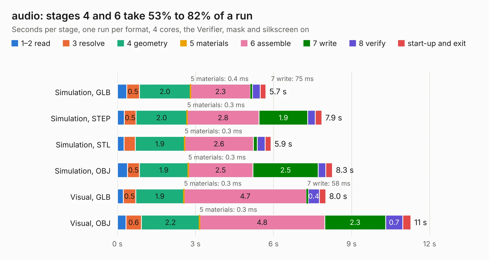

# 682. audio

Board 682 of the 3,112 of [Corpus Testing](../Corpus-Testing.md), on [Corpus Page 7](../CorpusTestingPages/Corpus-Testing-07.md#682-audio).

| Mode and format | 1–2 read | 3 resolve | 4 geometry | 5 materials | 6 assemble | 7 write | 8 verify | start-up and exit | Total |
|---|---:|---:|---:|---:|---:|---:|---:|---:|---:|
| Simulation, GLB | 0.4 | 0.5 | 2.0 | 0.4&nbsp;ms | 2.3 | 75&nbsp;ms | 0.3 | 0.2 | 5.7 |
| Simulation, STEP | 0.3 | 0.5 | 2.0 | 0.3&nbsp;ms | 2.8 | 1.9 | 0.3 | 0.3 | 7.9 |
| Simulation, STL | 0.3 | 0.4 | 1.9 | 0.3&nbsp;ms | 2.6 | 0.1 | 0.3 | 0.2 | 5.9 |
| Simulation, OBJ | 0.4 | 0.5 | 1.9 | 0.3&nbsp;ms | 2.5 | 2.5 | 0.3 | 0.3 | 8.3 |
| Visual, GLB | 0.2 | 0.5 | 1.9 | 0.3&nbsp;ms | 4.7 | 58&nbsp;ms | 0.4 | 0.2 | 8.0 |
| Visual, OBJ | 0.3 | 0.6 | 2.2 | 0.3&nbsp;ms | 4.8 | 2.3 | 0.7 | 0.3 | 11.3 |

<table align="center"><tr><td valign="top">

| Board | Repo: [byrantech/laptop](https://github.com/byrantech/laptop) Board: `audio.kicad_pcb` |
|---|---|
| Folder | audio |
| Complexity | 291&nbsp;/&nbsp;1000 (size&nbsp;196, features&nbsp;95) |
| KESE&nbsp;features | through vias, custom pads, rounded, trapezoid or chamfered pads, filled zones, copper drawings, curved board outline, TrueType text |
| Tested | 9th November 2026 |
| Copper&nbsp;layers | 2 |
| File&nbsp;format | KiCad 9 (20241007) |
| Parts,&nbsp;tracks,&nbsp;vias | 41, 244, 58 |
| Triangles,&nbsp;simulation | 416,276 in 71 parts |
| Verifier | PASS in all six runs |

</td><td valign="top">

<table>
<tr><th>File type</th><th>File size</th><th>Peak memory used</th></tr>
<tr><th colspan="3" align="left">Simulation</th></tr>
<tr><td>GLB</td><td align="right">14&nbsp;MB</td><td align="right">272&nbsp;MB</td></tr>
<tr><td>STEP</td><td align="right">74&nbsp;MB</td><td align="right">305&nbsp;MB</td></tr>
<tr><td>STL</td><td align="right">21&nbsp;MB</td><td align="right">272&nbsp;MB</td></tr>
<tr><td>OBJ</td><td align="right">42&nbsp;MB</td><td align="right">313&nbsp;MB</td></tr>
<tr><th colspan="3" align="left">Visual</th></tr>
<tr><td>GLB</td><td align="right">12&nbsp;MB</td><td align="right">318&nbsp;MB</td></tr>
<tr><td>OBJ</td><td align="right">35&nbsp;MB</td><td align="right">310&nbsp;MB</td></tr>
</table>

</td></tr></table>

| Previous | Next |
|:---|---:|
| [681. C64-250469-KiCad](b0681b_C64C-250469-KiCAD-Replica_C64-250469-KiCad.md) | [683. encoder](b0683b_laptop_encoder.md) |
