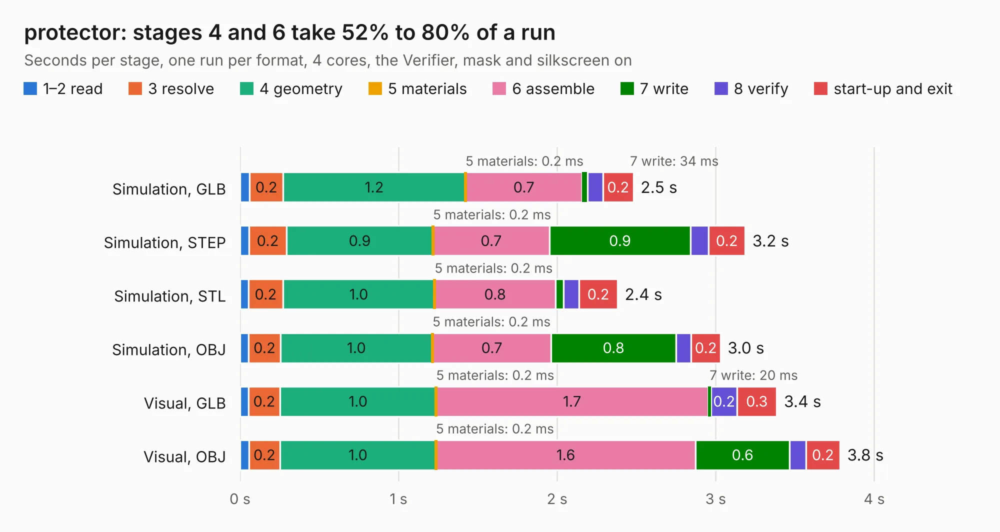

# 684. protector

Board 684 of the 3,110 of [Corpus Testing](../Corpus-Testing.md), on [Corpus Page 7](../CorpusTestingPages/Corpus-Testing-07.md#684-protector).

| Mode and format | 1–2 read | 3 resolve | 4 geometry | 5 materials | 6 assemble | 7 write | 8 verify | start-up and exit | Total |
|---|---:|---:|---:|---:|---:|---:|---:|---:|---:|
| Simulation, GLB | 61&nbsp;ms | 0.2 | 1.2 | 0.2&nbsp;ms | 0.7 | 34&nbsp;ms | 97&nbsp;ms | 0.2 | 2.5 |
| Simulation, STEP | 57&nbsp;ms | 0.2 | 0.9 | 0.2&nbsp;ms | 0.7 | 0.9 | 0.1 | 0.2 | 3.2 |
| Simulation, STL | 54&nbsp;ms | 0.2 | 1.0 | 0.2&nbsp;ms | 0.8 | 51&nbsp;ms | 97&nbsp;ms | 0.2 | 2.4 |
| Simulation, OBJ | 54&nbsp;ms | 0.2 | 1.0 | 0.2&nbsp;ms | 0.7 | 0.8 | 96&nbsp;ms | 0.2 | 3.0 |
| Visual, GLB | 53&nbsp;ms | 0.2 | 1.0 | 0.2&nbsp;ms | 1.7 | 20&nbsp;ms | 0.2 | 0.3 | 3.4 |
| Visual, OBJ | 55&nbsp;ms | 0.2 | 1.0 | 0.2&nbsp;ms | 1.6 | 0.6 | 0.1 | 0.2 | 3.8 |

<table align="center"><tr><td valign="top">

| Board | Repo: [byrantech/laptop](https://github.com/byrantech/laptop) Board: `protector.kicad_pcb` |
|---|---|
| Folder | keyboard / protector |
| Complexity | 218&nbsp;/&nbsp;1000 (size&nbsp;133, features&nbsp;85) |
| KESE&nbsp;features | through vias, rounded, trapezoid or chamfered pads, filled zones, copper text, knockout text, TrueType text |
| Tested | 9th November 2026 |
| Copper&nbsp;layers | 2 |
| File&nbsp;format | KiCad 9 (20240225) |
| Parts,&nbsp;tracks,&nbsp;vias | 6, 37, 97 |
| Triangles,&nbsp;simulation | 203,696 in 21 parts |
| Verifier | PASS in all six runs |

</td><td valign="top">

<table>
<tr><th>File type</th><th>File size</th><th>Peak memory used</th></tr>
<tr><th colspan="3" align="left">Simulation</th></tr>
<tr><td>GLB</td><td align="right">6.9&nbsp;MB</td><td align="right">193&nbsp;MB</td></tr>
<tr><td>STEP</td><td align="right">23&nbsp;MB</td><td align="right">202&nbsp;MB</td></tr>
<tr><td>STL</td><td align="right">10&nbsp;MB</td><td align="right">196&nbsp;MB</td></tr>
<tr><td>OBJ</td><td align="right">20&nbsp;MB</td><td align="right">194&nbsp;MB</td></tr>
<tr><th colspan="3" align="left">Visual</th></tr>
<tr><td>GLB</td><td align="right">4.5&nbsp;MB</td><td align="right">162&nbsp;MB</td></tr>
<tr><td>OBJ</td><td align="right">13&nbsp;MB</td><td align="right">159&nbsp;MB</td></tr>
</table>

</td></tr></table>

| Previous | Next |
|:---|---:|
| [683. keyboard](b0683b_laptop_keyboard.md) | [685. display_eval](b0685b_laptop_display-eval.md) |
