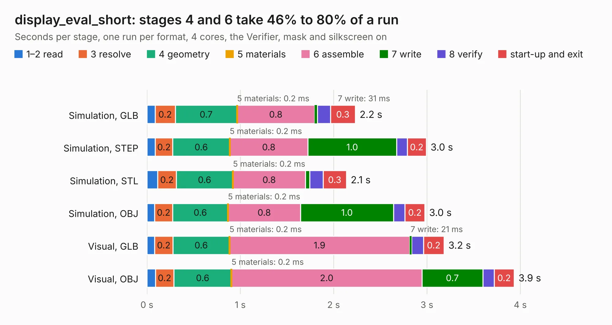

# 686. display_eval_short

Board 686 of the 3,110 of [Corpus Testing](../Corpus-Testing.md), on [Corpus Page 7](../CorpusTestingPages/Corpus-Testing-07.md#686-display_eval_short).

| Mode and format | 1–2 read | 3 resolve | 4 geometry | 5 materials | 6 assemble | 7 write | 8 verify | start-up and exit | Total |
|---|---:|---:|---:|---:|---:|---:|---:|---:|---:|
| Simulation, GLB | 87&nbsp;ms | 0.2 | 0.7 | 0.2&nbsp;ms | 0.8 | 31&nbsp;ms | 0.1 | 0.3 | 2.2 |
| Simulation, STEP | 89&nbsp;ms | 0.2 | 0.6 | 0.2&nbsp;ms | 0.8 | 1.0 | 0.1 | 0.2 | 3.0 |
| Simulation, STL | 0.1 | 0.2 | 0.6 | 0.2&nbsp;ms | 0.8 | 48&nbsp;ms | 0.1 | 0.3 | 2.1 |
| Simulation, OBJ | 82&nbsp;ms | 0.2 | 0.6 | 0.2&nbsp;ms | 0.8 | 1.0 | 0.1 | 0.2 | 3.0 |
| Visual, GLB | 82&nbsp;ms | 0.2 | 0.6 | 0.2&nbsp;ms | 1.9 | 21&nbsp;ms | 0.1 | 0.2 | 3.2 |
| Visual, OBJ | 90&nbsp;ms | 0.2 | 0.6 | 0.2&nbsp;ms | 2.0 | 0.7 | 0.1 | 0.2 | 3.9 |

<table align="center"><tr><td valign="top">

| Board | Repo: [byrantech/laptop](https://github.com/byrantech/laptop) Board: `display_eval_short.kicad_pcb` |
|---|---|
| Folder | motherboard / display_eval_short |
| Complexity | 224&nbsp;/&nbsp;1000 (size&nbsp;134, features&nbsp;90) |
| KESE&nbsp;features | through vias, filled zones, curved board outline, TrueType text, stack-up, dielectric εr and tanδ |
| Tested | 9th November 2026 |
| Copper&nbsp;layers | 4 |
| File&nbsp;format | KiCad 9 (20240225) |
| Parts,&nbsp;tracks,&nbsp;vias | 4, 121, 13 |
| Triangles,&nbsp;simulation | 165,308 in 43 parts |
| Verifier | PASS in all six runs |

</td><td valign="top">

<table>
<tr><th>File type</th><th>File size</th><th>Peak memory used</th></tr>
<tr><th colspan="3" align="left">Simulation</th></tr>
<tr><td>GLB</td><td align="right">5.9&nbsp;MB</td><td align="right">174&nbsp;MB</td></tr>
<tr><td>STEP</td><td align="right">25&nbsp;MB</td><td align="right">188&nbsp;MB</td></tr>
<tr><td>STL</td><td align="right">8.3&nbsp;MB</td><td align="right">184&nbsp;MB</td></tr>
<tr><td>OBJ</td><td align="right">17&nbsp;MB</td><td align="right">183&nbsp;MB</td></tr>
<tr><th colspan="3" align="left">Visual</th></tr>
<tr><td>GLB</td><td align="right">4.1&nbsp;MB</td><td align="right">145&nbsp;MB</td></tr>
<tr><td>OBJ</td><td align="right">12&nbsp;MB</td><td align="right">141&nbsp;MB</td></tr>
</table>

</td></tr></table>

| Previous | Next |
|:---|---:|
| [685. display_eval](b0685b_laptop_display-eval.md) | [687. motherboard](b0687b_laptop_motherboard.md) |
