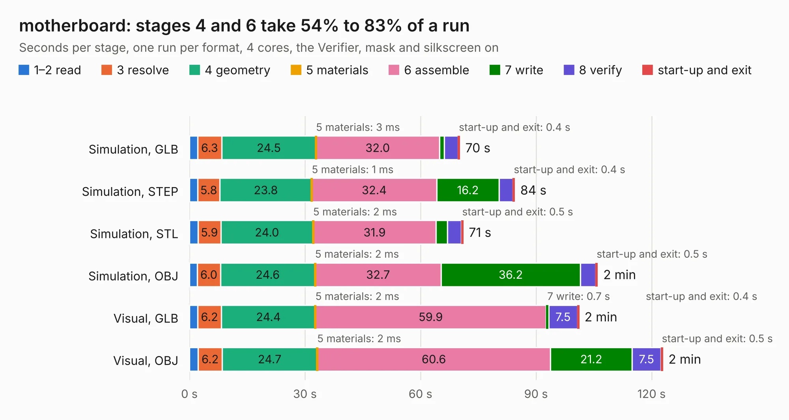

# 687. motherboard

Board 687 of the 3,111 of [Corpus Testing](../Corpus-Testing.md), on [Corpus Page 7](../CorpusTestingPages/Corpus-Testing-07.md#687-motherboard).

| Mode and format | 1–2 read | 3 resolve | 4 geometry | 5 materials | 6 assemble | 7 write | 8 verify | start-up and exit | Total |
|---|---:|---:|---:|---:|---:|---:|---:|---:|---:|
| Simulation, GLB | 2.1 | 6.3 | 24.5 | 3&nbsp;ms | 32.0 | 1.2 | 3.6 | 0.4 | 70.2 |
| Simulation, STEP | 2.1 | 5.8 | 23.8 | 1&nbsp;ms | 32.4 | 16.2 | 3.6 | 0.4 | 84.5 |
| Simulation, STL | 2.2 | 5.9 | 24.0 | 2&nbsp;ms | 31.9 | 2.9 | 3.6 | 0.5 | 71.1 |
| Simulation, OBJ | 2.1 | 6.0 | 24.6 | 2&nbsp;ms | 32.7 | 36.2 | 4.0 | 0.5 | 106.0 |
| Visual, GLB | 2.1 | 6.2 | 24.4 | 2&nbsp;ms | 59.9 | 0.7 | 7.5 | 0.4 | 101.1 |
| Visual, OBJ | 2.3 | 6.2 | 24.7 | 2&nbsp;ms | 60.6 | 21.2 | 7.5 | 0.5 | 122.9 |

<table align="center"><tr><td valign="top">

| Board | Repo: [byrantech/laptop](https://github.com/byrantech/laptop) Board: `motherboard.kicad_pcb` |
|---|---|
| Folder | motherboard |
| Complexity | 417&nbsp;/&nbsp;1000 (size&nbsp;247, features&nbsp;170) |
| KESE&nbsp;features | through vias, slotted holes, custom pads, rounded, trapezoid or chamfered pads, arc tracks, filled zones, copper drawings, curved board outline, TrueType text, stack-up, dielectric εr and tanδ, copper finish, mask and silkscreen colours |
| Tested | 9th November 2026 |
| Copper&nbsp;layers | 6 |
| File&nbsp;format | KiCad 9 (20241007) |
| Parts,&nbsp;tracks,&nbsp;vias | 258, 4,080, 734 |
| Triangles,&nbsp;simulation | 6,514,532 in 491 parts |
| Verifier | PASS in all six runs |

</td><td valign="top">

<table>
<tr><th>File type</th><th>File size</th><th>Peak memory used</th></tr>
<tr><th colspan="3" align="left">Simulation</th></tr>
<tr><td>GLB</td><td align="right">222&nbsp;MB</td><td align="right">1.6&nbsp;GB</td></tr>
<tr><td>STEP</td><td align="right">900&nbsp;MB</td><td align="right">2.2&nbsp;GB</td></tr>
<tr><td>STL</td><td align="right">326&nbsp;MB</td><td align="right">1.7&nbsp;GB</td></tr>
<tr><td>OBJ</td><td align="right">698&nbsp;MB</td><td align="right">4.2&nbsp;GB</td></tr>
<tr><th colspan="3" align="left">Visual</th></tr>
<tr><td>GLB</td><td align="right">132&nbsp;MB</td><td align="right">2.2&nbsp;GB</td></tr>
<tr><td>OBJ</td><td align="right">425&nbsp;MB</td><td align="right">2.7&nbsp;GB</td></tr>
</table>

</td></tr></table>

| Previous | Next |
|:---|---:|
| [686. display_eval_short](b0686b_laptop_display-eval-short.md) | [688. power](b0688b_laptop_power.md) |
