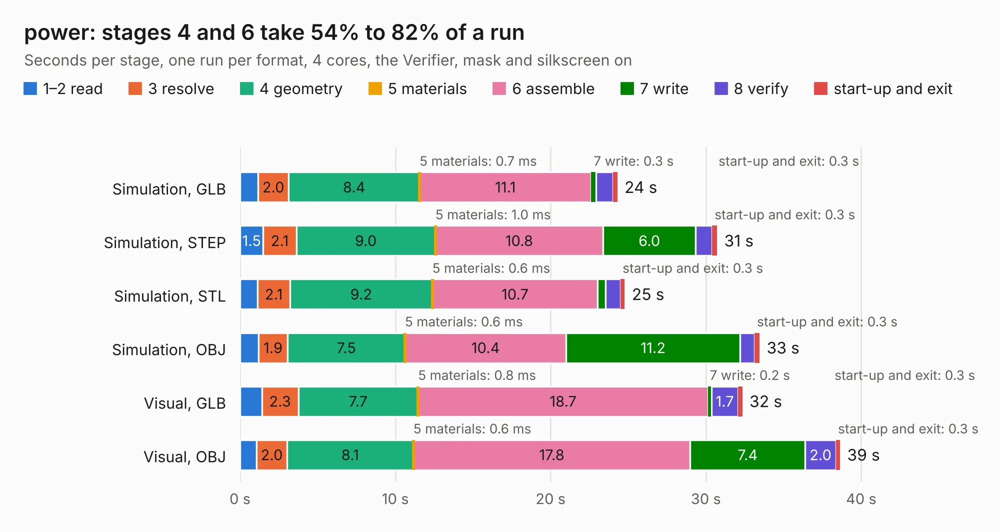

# 688. power

Board 688 of the 3,109 of [Corpus Testing](../Corpus-Testing.md), on [Corpus Page 7](../CorpusTestingPages/Corpus-Testing-07.md#688-power).

| Mode and format | 1–2 read | 3 resolve | 4 geometry | 5 materials | 6 assemble | 7 write | 8 verify | start-up and exit | Total |
|---|---:|---:|---:|---:|---:|---:|---:|---:|---:|
| Simulation, GLB | 1.2 | 2.0 | 8.4 | 0.7&nbsp;ms | 11.1 | 0.3 | 1.1 | 0.3 | 24.3 |
| Simulation, STEP | 1.5 | 2.1 | 9.0 | 1.0&nbsp;ms | 10.8 | 6.0 | 1.1 | 0.3 | 30.7 |
| Simulation, STL | 1.1 | 2.1 | 9.2 | 0.6&nbsp;ms | 10.7 | 0.5 | 1.0 | 0.3 | 24.8 |
| Simulation, OBJ | 1.2 | 1.9 | 7.5 | 0.6&nbsp;ms | 10.4 | 11.2 | 0.9 | 0.3 | 33.5 |
| Visual, GLB | 1.4 | 2.3 | 7.7 | 0.8&nbsp;ms | 18.7 | 0.2 | 1.7 | 0.3 | 32.3 |
| Visual, OBJ | 1.1 | 2.0 | 8.1 | 0.6&nbsp;ms | 17.8 | 7.4 | 2.0 | 0.3 | 38.6 |

<table align="center"><tr><td valign="top">

| Board | Repo: [byrantech/laptop](https://github.com/byrantech/laptop) Board: `power.kicad_pcb` |
|---|---|
| Folder | power |
| Complexity | 394&nbsp;/&nbsp;1000 (size&nbsp;239, features&nbsp;155) |
| KESE&nbsp;features | through vias, slotted holes, custom pads, rounded, trapezoid or chamfered pads, filled zones, copper drawings, curved board outline, TrueType text, stack-up, dielectric εr and tanδ, copper finish, mask and silkscreen colours |
| Tested | 9th November 2026 |
| Copper&nbsp;layers | 13 |
| File&nbsp;format | KiCad 9 (20241007) |
| Parts,&nbsp;tracks,&nbsp;vias | 176, 1,129, 167 |
| Triangles,&nbsp;simulation | 1,717,024 in 153 parts |
| Verifier | PASS in all six runs |

</td><td valign="top">

<table>
<tr><th>File type</th><th>File size</th><th>Peak memory used</th></tr>
<tr><th colspan="3" align="left">Simulation</th></tr>
<tr><td>GLB</td><td align="right">59&nbsp;MB</td><td align="right">647&nbsp;MB</td></tr>
<tr><td>STEP</td><td align="right">289&nbsp;MB</td><td align="right">811&nbsp;MB</td></tr>
<tr><td>STL</td><td align="right">86&nbsp;MB</td><td align="right">658&nbsp;MB</td></tr>
<tr><td>OBJ</td><td align="right">179&nbsp;MB</td><td align="right">1.2&nbsp;GB</td></tr>
<tr><th colspan="3" align="left">Visual</th></tr>
<tr><td>GLB</td><td align="right">42&nbsp;MB</td><td align="right">857&nbsp;MB</td></tr>
<tr><td>OBJ</td><td align="right">126&nbsp;MB</td><td align="right">959&nbsp;MB</td></tr>
</table>

</td></tr></table>

| Previous | Next |
|:---|---:|
| [687. motherboard](b0687b_laptop_motherboard.md) | [689. switch](b0689b_laptop_switch.md) |
