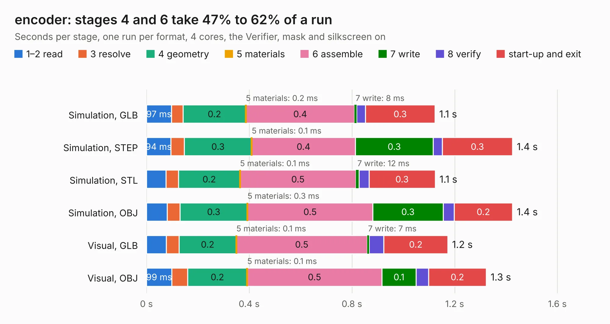

# 689. encoder

Board 689 of the 3,125 of [Corpus Testing](../Corpus-Testing.md), on [Corpus Page 7](../CorpusTestingPages/Corpus-Testing-07.md#689-encoder).

| Mode and format | 1–2 read | 3 resolve | 4 geometry | 5 materials | 6 assemble | 7 write | 8 verify | start-up and exit | Total |
|---|---:|---:|---:|---:|---:|---:|---:|---:|---:|
| Simulation, GLB | 97&nbsp;ms | 45&nbsp;ms | 0.2 | 0.2&nbsp;ms | 0.4 | 8&nbsp;ms | 35&nbsp;ms | 0.3 | 1.1 |
| Simulation, STEP | 94&nbsp;ms | 53&nbsp;ms | 0.3 | 0.1&nbsp;ms | 0.4 | 0.3 | 36&nbsp;ms | 0.3 | 1.4 |
| Simulation, STL | 76&nbsp;ms | 49&nbsp;ms | 0.2 | 0.1&nbsp;ms | 0.5 | 12&nbsp;ms | 39&nbsp;ms | 0.3 | 1.1 |
| Simulation, OBJ | 80&nbsp;ms | 50&nbsp;ms | 0.3 | 0.3&nbsp;ms | 0.5 | 0.3 | 43&nbsp;ms | 0.2 | 1.4 |
| Visual, GLB | 78&nbsp;ms | 49&nbsp;ms | 0.2 | 0.1&nbsp;ms | 0.5 | 7&nbsp;ms | 58&nbsp;ms | 0.2 | 1.2 |
| Visual, OBJ | 99&nbsp;ms | 61&nbsp;ms | 0.2 | 0.1&nbsp;ms | 0.5 | 0.1 | 48&nbsp;ms | 0.2 | 1.3 |

<table align="center"><tr><td valign="top">

| Board | Repo: [byrantech/laptop](https://github.com/byrantech/laptop) Board: `encoder.kicad_pcb` |
|---|---|
| Folder | haptic / encoder |
| Complexity | 101&nbsp;/&nbsp;1000 (size&nbsp;81, features&nbsp;20) |
| KESE&nbsp;features | rounded, trapezoid or chamfered pads, curved board outline |
| Tested | 9th November 2026 |
| Copper&nbsp;layers | 2 |
| File&nbsp;format | KiCad 9 (20240225) |
| Parts,&nbsp;tracks,&nbsp;vias | 2, 24, 0 |
| Triangles,&nbsp;simulation | 43,206 in 17 parts |
| Verifier | PASS in all six runs |

</td><td valign="top">

<table>
<tr><th>File type</th><th>File size</th><th>Peak memory used</th></tr>
<tr><th colspan="3" align="left">Simulation</th></tr>
<tr><td>GLB</td><td align="right">1.5&nbsp;MB</td><td align="right">67&nbsp;MB</td></tr>
<tr><td>STEP</td><td align="right">7.1&nbsp;MB</td><td align="right">72&nbsp;MB</td></tr>
<tr><td>STL</td><td align="right">2.2&nbsp;MB</td><td align="right">68&nbsp;MB</td></tr>
<tr><td>OBJ</td><td align="right">4.1&nbsp;MB</td><td align="right">77&nbsp;MB</td></tr>
<tr><th colspan="3" align="left">Visual</th></tr>
<tr><td>GLB</td><td align="right">990&nbsp;kB</td><td align="right">102&nbsp;MB</td></tr>
<tr><td>OBJ</td><td align="right">2.7&nbsp;MB</td><td align="right">103&nbsp;MB</td></tr>
</table>

</td></tr></table>

| Previous | Next |
|:---|---:|
| [688. audio](b0688b_laptop_audio.md) | [690. keyboard](b0690b_laptop_keyboard.md) |
