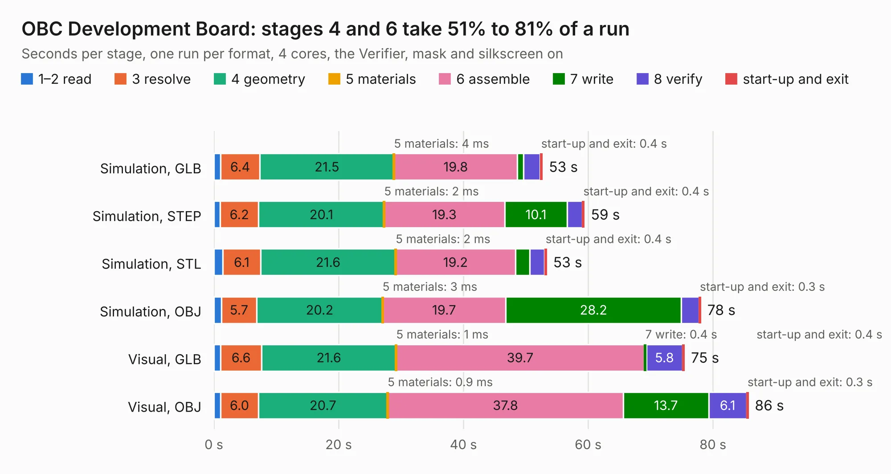

# 691. OBC Development Board

Board 691 of the 3,108 of [Corpus Testing](../Corpus-Testing.md), on [Corpus Page 7](../CorpusTestingPages/Corpus-Testing-07.md#691-obc-development-board).

| Mode and format | 1–2 read | 3 resolve | 4 geometry | 5 materials | 6 assemble | 7 write | 8 verify | start-up and exit | Total |
|---|---:|---:|---:|---:|---:|---:|---:|---:|---:|
| Simulation, GLB | 1.0 | 6.4 | 21.5 | 4&nbsp;ms | 19.8 | 1.0 | 2.6 | 0.4 | 52.7 |
| Simulation, STEP | 1.0 | 6.2 | 20.1 | 2&nbsp;ms | 19.3 | 10.1 | 2.4 | 0.4 | 59.4 |
| Simulation, STL | 1.4 | 6.1 | 21.6 | 2&nbsp;ms | 19.2 | 2.3 | 2.3 | 0.4 | 53.4 |
| Simulation, OBJ | 1.2 | 5.7 | 20.2 | 3&nbsp;ms | 19.7 | 28.2 | 2.8 | 0.3 | 78.1 |
| Visual, GLB | 1.1 | 6.6 | 21.6 | 1&nbsp;ms | 39.7 | 0.4 | 5.8 | 0.4 | 75.5 |
| Visual, OBJ | 1.1 | 6.0 | 20.7 | 0.9&nbsp;ms | 37.8 | 13.7 | 6.1 | 0.3 | 85.7 |

<table align="center"><tr><td valign="top">

| Board | Repo: [calgarytospace/cts-sat-2-obc-pcb](https://github.com/calgarytospace/cts-sat-2-obc-pcb) Board: `OBC Development Board.kicad_pcb` |
|---|---|
| Folder | CTS-SAT-1 Hardware |
| Complexity | 337&nbsp;/&nbsp;1000 (size&nbsp;237, features&nbsp;100) |
| KESE&nbsp;features | through vias, padstacks, rounded, trapezoid or chamfered pads, arc tracks, filled zones, curved board outline |
| Tested | 9th November 2026 |
| Copper&nbsp;layers | 6 |
| File&nbsp;format | KiCad 9 (20241229) |
| Parts,&nbsp;tracks,&nbsp;vias | 221, 1,889, 667 |
| Triangles,&nbsp;simulation | 5,120,894 in 206 parts |
| Verifier | PASS in all six runs |

</td><td valign="top">

<table>
<tr><th>File type</th><th>File size</th><th>Peak memory used</th></tr>
<tr><th colspan="3" align="left">Simulation</th></tr>
<tr><td>GLB</td><td align="right">176&nbsp;MB</td><td align="right">1.4&nbsp;GB</td></tr>
<tr><td>STEP</td><td align="right">525&nbsp;MB</td><td align="right">1.8&nbsp;GB</td></tr>
<tr><td>STL</td><td align="right">256&nbsp;MB</td><td align="right">1.4&nbsp;GB</td></tr>
<tr><td>OBJ</td><td align="right">565&nbsp;MB</td><td align="right">3.3&nbsp;GB</td></tr>
<tr><th colspan="3" align="left">Visual</th></tr>
<tr><td>GLB</td><td align="right">87&nbsp;MB</td><td align="right">1.6&nbsp;GB</td></tr>
<tr><td>OBJ</td><td align="right">280&nbsp;MB</td><td align="right">1.9&nbsp;GB</td></tr>
</table>

</td></tr></table>

| Previous | Next |
|:---|---:|
| [690. motherboard](b0690b_motherboard_motherboard.md) | [692. CTS-SAT-2-OBC-PCB](b0692b_cts-sat-2-obc-pcb_CTS-SAT-2-OBC-PCB.md) |
