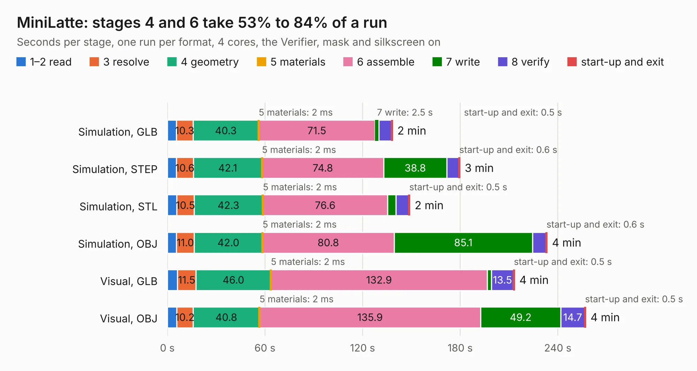

# 691. MiniLatte

Board 691 of the 3,102 of [Corpus Testing](../Corpus-Testing.md), on [Corpus Page 7](../CorpusTestingPages/Corpus-Testing-07.md#691-minilatte).

| Mode and format | 1–2 read | 3 resolve | 4 geometry | 5 materials | 6 assemble | 7 write | 8 verify | start-up and exit | Total |
|---|---:|---:|---:|---:|---:|---:|---:|---:|---:|
| Simulation, GLB | 5.5 | 10.3 | 40.3 | 2&nbsp;ms | 71.5 | 2.5 | 7.7 | 0.5 | 138.3 |
| Simulation, STEP | 5.5 | 10.6 | 42.1 | 2&nbsp;ms | 74.8 | 38.8 | 7.4 | 0.6 | 179.8 |
| Simulation, STL | 5.9 | 10.5 | 42.3 | 2&nbsp;ms | 76.6 | 5.2 | 8.0 | 0.5 | 149.0 |
| Simulation, OBJ | 5.6 | 11.0 | 42.0 | 2&nbsp;ms | 80.8 | 85.1 | 8.3 | 0.6 | 233.4 |
| Visual, GLB | 6.2 | 11.5 | 46.0 | 2&nbsp;ms | 132.9 | 2.6 | 13.5 | 0.5 | 213.3 |
| Visual, OBJ | 5.7 | 10.2 | 40.8 | 2&nbsp;ms | 135.9 | 49.2 | 14.7 | 0.5 | 257.0 |

<table align="center"><tr><td valign="top">

| Board | Repo: [cath272/minilatte](https://github.com/cath272/minilatte) Board: `MiniLatte.kicad_pcb` |
|---|---|
| Folder | PCB |
| Complexity | 450&nbsp;/&nbsp;1000 (size&nbsp;315, features&nbsp;135) |
| KESE&nbsp;features | through vias, slotted holes, custom pads, rounded, trapezoid or chamfered pads, arc tracks, filled zones, copper drawings, curved board outline, stack-up, dielectric εr and tanδ |
| Tested | 9th November 2026 |
| Copper&nbsp;layers | 4 |
| File&nbsp;format | KiCad 10 (20260206) |
| Parts,&nbsp;tracks,&nbsp;vias | 495, 11,156, 736 |
| Triangles,&nbsp;simulation | 8,966,200 in 848 parts |
| Verifier | PASS in all six runs |

</td><td valign="top">

<table>
<tr><th>File type</th><th>File size</th><th>Peak memory used</th></tr>
<tr><th colspan="3" align="left">Simulation</th></tr>
<tr><td>GLB</td><td align="right">306&nbsp;MB</td><td align="right">2.9&nbsp;GB</td></tr>
<tr><td>STEP</td><td align="right">1.5&nbsp;GB</td><td align="right">3.5&nbsp;GB</td></tr>
<tr><td>STL</td><td align="right">448&nbsp;MB</td><td align="right">2.8&nbsp;GB</td></tr>
<tr><td>OBJ</td><td align="right">971&nbsp;MB</td><td align="right">5.8&nbsp;GB</td></tr>
<tr><th colspan="3" align="left">Visual</th></tr>
<tr><td>GLB</td><td align="right">232&nbsp;MB</td><td align="right">3.6&nbsp;GB</td></tr>
<tr><td>OBJ</td><td align="right">752&nbsp;MB</td><td align="right">4.7&nbsp;GB</td></tr>
</table>

</td></tr></table>

| Previous | Next |
|:---|---:|
| [690. MiniLatteLedArray](b0690b_minilatte_MiniLatteLedArray.md) | [692. hdmi-edp2](b0692b_reform-next-mirror_hdmi-edp2.md) |
