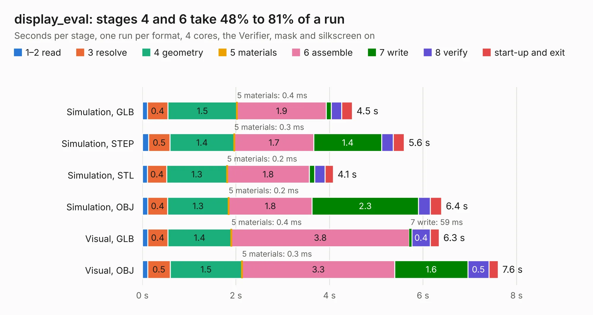

# 692. display_eval

Board 692 of the 3,129 of [Corpus Testing](../Corpus-Testing.md), on [Corpus Page 7](../CorpusTestingPages/Corpus-Testing-07.md#692-display_eval).

| Mode and format | 1–2 read | 3 resolve | 4 geometry | 5 materials | 6 assemble | 7 write | 8 verify | start-up and exit | Total |
|---|---:|---:|---:|---:|---:|---:|---:|---:|---:|
| Simulation, GLB | 0.1 | 0.4 | 1.5 | 0.4&nbsp;ms | 1.9 | 0.1 | 0.2 | 0.2 | 4.5 |
| Simulation, STEP | 0.1 | 0.5 | 1.4 | 0.3&nbsp;ms | 1.7 | 1.4 | 0.2 | 0.2 | 5.6 |
| Simulation, STL | 0.1 | 0.4 | 1.3 | 0.2&nbsp;ms | 1.8 | 0.1 | 0.2 | 0.2 | 4.1 |
| Simulation, OBJ | 0.1 | 0.4 | 1.3 | 0.2&nbsp;ms | 1.8 | 2.3 | 0.3 | 0.2 | 6.4 |
| Visual, GLB | 0.1 | 0.4 | 1.4 | 0.4&nbsp;ms | 3.8 | 59&nbsp;ms | 0.4 | 0.2 | 6.3 |
| Visual, OBJ | 0.1 | 0.5 | 1.5 | 0.3&nbsp;ms | 3.3 | 1.6 | 0.5 | 0.2 | 7.6 |

<table align="center"><tr><td valign="top">

| Board | Repo: [byrantech/laptop](https://github.com/byrantech/laptop) Board: `display_eval.kicad_pcb` |
|---|---|
| Folder | motherboard / display_eval |
| Complexity | 296&nbsp;/&nbsp;1000 (size&nbsp;171, features&nbsp;125) |
| KESE&nbsp;features | through vias, slotted holes, rounded, trapezoid or chamfered pads, arc tracks, filled zones, curved board outline, TrueType text, stack-up, dielectric εr and tanδ |
| Tested | 9th November 2026 |
| Copper&nbsp;layers | 4 |
| File&nbsp;format | KiCad 9 (20240225) |
| Parts,&nbsp;tracks,&nbsp;vias | 10, 577, 108 |
| Triangles,&nbsp;simulation | 523,320 in 47 parts |
| Verifier | PASS in all six runs |

</td><td valign="top">

<table>
<tr><th>File type</th><th>File size</th><th>Peak memory used</th></tr>
<tr><th colspan="3" align="left">Simulation</th></tr>
<tr><td>GLB</td><td align="right">18&nbsp;MB</td><td align="right">311&nbsp;MB</td></tr>
<tr><td>STEP</td><td align="right">66&nbsp;MB</td><td align="right">353&nbsp;MB</td></tr>
<tr><td>STL</td><td align="right">26&nbsp;MB</td><td align="right">286&nbsp;MB</td></tr>
<tr><td>OBJ</td><td align="right">52&nbsp;MB</td><td align="right">383&nbsp;MB</td></tr>
<tr><th colspan="3" align="left">Visual</th></tr>
<tr><td>GLB</td><td align="right">12&nbsp;MB</td><td align="right">322&nbsp;MB</td></tr>
<tr><td>OBJ</td><td align="right">36&nbsp;MB</td><td align="right">348&nbsp;MB</td></tr>
</table>

</td></tr></table>

| Previous | Next |
|:---|---:|
| [691. protector](b0691b_laptop_protector.md) | [693. display_eval_short](b0693b_laptop_display-eval-short.md) |
