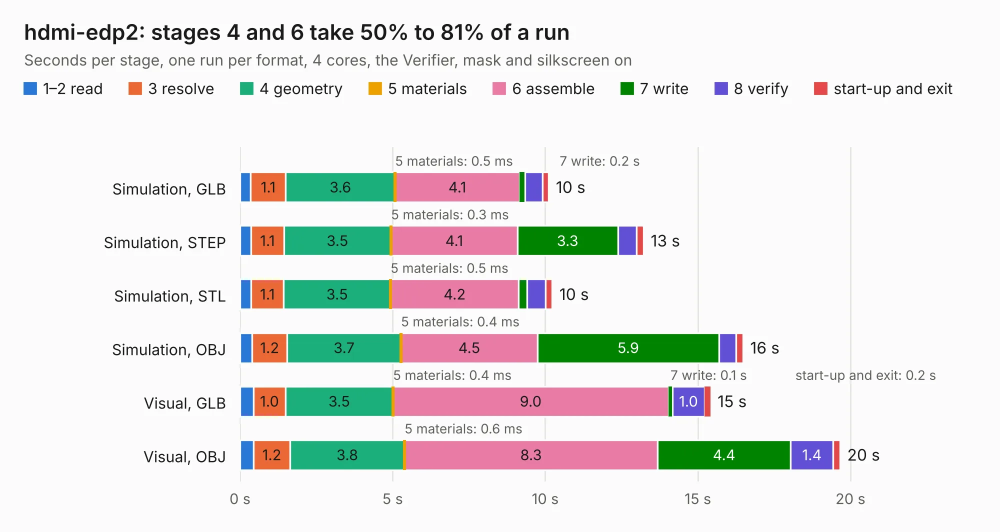

# 692. hdmi-edp2

Board 692 of the 3,102 of [Corpus Testing](../Corpus-Testing.md), on [Corpus Page 7](../CorpusTestingPages/Corpus-Testing-07.md#692-hdmi-edp2).

| Mode and format | 1–2 read | 3 resolve | 4 geometry | 5 materials | 6 assemble | 7 write | 8 verify | start-up and exit | Total |
|---|---:|---:|---:|---:|---:|---:|---:|---:|---:|
| Simulation, GLB | 0.3 | 1.1 | 3.6 | 0.5&nbsp;ms | 4.1 | 0.2 | 0.6 | 0.2 | 10.1 |
| Simulation, STEP | 0.4 | 1.1 | 3.5 | 0.3&nbsp;ms | 4.1 | 3.3 | 0.6 | 0.2 | 13.2 |
| Simulation, STL | 0.4 | 1.1 | 3.5 | 0.5&nbsp;ms | 4.2 | 0.3 | 0.6 | 0.2 | 10.2 |
| Simulation, OBJ | 0.4 | 1.2 | 3.7 | 0.4&nbsp;ms | 4.5 | 5.9 | 0.6 | 0.2 | 16.5 |
| Visual, GLB | 0.4 | 1.0 | 3.5 | 0.4&nbsp;ms | 9.0 | 0.1 | 1.0 | 0.2 | 15.4 |
| Visual, OBJ | 0.4 | 1.2 | 3.8 | 0.6&nbsp;ms | 8.3 | 4.4 | 1.4 | 0.2 | 19.7 |

<table align="center"><tr><td valign="top">

| Board | Repo: [cetola/reform-next-mirror](https://github.com/cetola/reform-next-mirror) Board: `hdmi-edp2.kicad_pcb` |
|---|---|
| Folder | hdmi-edp2 |
| Complexity | 329&nbsp;/&nbsp;1000 (size&nbsp;254, features&nbsp;75) |
| KESE&nbsp;features | through vias, rounded, trapezoid or chamfered pads, filled zones, stack-up, dielectric εr and tanδ |
| Tested | 9th November 2026 |
| Copper&nbsp;layers | 4 |
| File&nbsp;format | KiCad 8 (20240108) |
| Parts,&nbsp;tracks,&nbsp;vias | 93, 910, 170 |
| Triangles,&nbsp;simulation | 1,071,490 in 92 parts |
| Verifier | PASS in all six runs |

</td><td valign="top">

<table>
<tr><th>File type</th><th>File size</th><th>Peak memory used</th></tr>
<tr><th colspan="3" align="left">Simulation</th></tr>
<tr><td>GLB</td><td align="right">37&nbsp;MB</td><td align="right">460&nbsp;MB</td></tr>
<tr><td>STEP</td><td align="right">156&nbsp;MB</td><td align="right">547&nbsp;MB</td></tr>
<tr><td>STL</td><td align="right">54&nbsp;MB</td><td align="right">452&nbsp;MB</td></tr>
<tr><td>OBJ</td><td align="right">108&nbsp;MB</td><td align="right">740&nbsp;MB</td></tr>
<tr><th colspan="3" align="left">Visual</th></tr>
<tr><td>GLB</td><td align="right">27&nbsp;MB</td><td align="right">635&nbsp;MB</td></tr>
<tr><td>OBJ</td><td align="right">81&nbsp;MB</td><td align="right">626&nbsp;MB</td></tr>
</table>

</td></tr></table>

| Previous | Next |
|:---|---:|
| [691. MiniLatte](b0691b_minilatte_MiniLatte.md) | [693. nref-batterypack-backside](b0693b_reform-next-mirror_nref-batterypack-v3_nref-batterypack-backside.md) |
