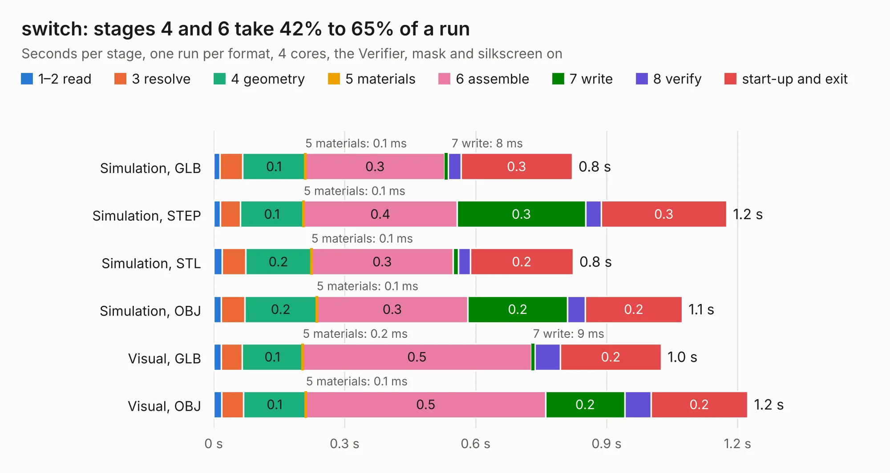

# 695. switch

Board 695 of the 3,118 of [Corpus Testing](../Corpus-Testing.md), on [Corpus Page 7](../CorpusTestingPages/Corpus-Testing-07.md#695-switch).

| Mode and format | 1–2 read | 3 resolve | 4 geometry | 5 materials | 6 assemble | 7 write | 8 verify | start-up and exit | Total |
|---|---:|---:|---:|---:|---:|---:|---:|---:|---:|
| Simulation, GLB | 15&nbsp;ms | 52&nbsp;ms | 0.1 | 0.1&nbsp;ms | 0.3 | 8&nbsp;ms | 29&nbsp;ms | 0.3 | 0.8 |
| Simulation, STEP | 15&nbsp;ms | 46&nbsp;ms | 0.1 | 0.1&nbsp;ms | 0.4 | 0.3 | 35&nbsp;ms | 0.3 | 1.2 |
| Simulation, STL | 19&nbsp;ms | 54&nbsp;ms | 0.2 | 0.1&nbsp;ms | 0.3 | 12&nbsp;ms | 27&nbsp;ms | 0.2 | 0.8 |
| Simulation, OBJ | 18&nbsp;ms | 54&nbsp;ms | 0.2 | 0.1&nbsp;ms | 0.3 | 0.2 | 41&nbsp;ms | 0.2 | 1.1 |
| Visual, GLB | 17&nbsp;ms | 48&nbsp;ms | 0.1 | 0.2&nbsp;ms | 0.5 | 9&nbsp;ms | 58&nbsp;ms | 0.2 | 1.0 |
| Visual, OBJ | 19&nbsp;ms | 49&nbsp;ms | 0.1 | 0.1&nbsp;ms | 0.5 | 0.2 | 60&nbsp;ms | 0.2 | 1.2 |

<table align="center"><tr><td valign="top">

| Board | Repo: [byrantech/laptop](https://github.com/byrantech/laptop) Board: `switch.kicad_pcb` |
|---|---|
| Folder | switch |
| Complexity | 151&nbsp;/&nbsp;1000 (size&nbsp;101, features&nbsp;50) |
| KESE&nbsp;features | through vias, rounded, trapezoid or chamfered pads, curved board outline, TrueType text |
| Tested | 9th November 2026 |
| Copper&nbsp;layers | 2 |
| File&nbsp;format | KiCad 9 (20241007) |
| Parts,&nbsp;tracks,&nbsp;vias | 6, 32, 5 |
| Triangles,&nbsp;simulation | 39,470 in 15 parts |
| Verifier | PASS in all six runs |

</td><td valign="top">

<table>
<tr><th>File type</th><th>File size</th><th>Peak memory used</th></tr>
<tr><th colspan="3" align="left">Simulation</th></tr>
<tr><td>GLB</td><td align="right">1.4&nbsp;MB</td><td align="right">46&nbsp;MB</td></tr>
<tr><td>STEP</td><td align="right">5.5&nbsp;MB</td><td align="right">52&nbsp;MB</td></tr>
<tr><td>STL</td><td align="right">2.0&nbsp;MB</td><td align="right">48&nbsp;MB</td></tr>
<tr><td>OBJ</td><td align="right">3.7&nbsp;MB</td><td align="right">60&nbsp;MB</td></tr>
<tr><th colspan="3" align="left">Visual</th></tr>
<tr><td>GLB</td><td align="right">1.0&nbsp;MB</td><td align="right">71&nbsp;MB</td></tr>
<tr><td>OBJ</td><td align="right">2.9&nbsp;MB</td><td align="right">78&nbsp;MB</td></tr>
</table>

</td></tr></table>

| Previous | Next |
|:---|---:|
| [694. power](b0694b_laptop_power.md) | [696. motherboard](b0696b_motherboard_motherboard.md) |
