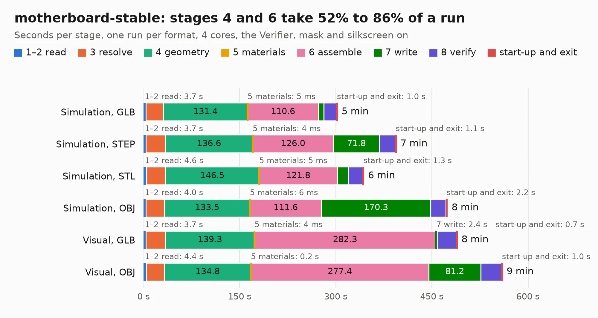

# 696. motherboard-stable

Board 696 of the 3,120 of [Corpus Testing](../Corpus-Testing.md), on [Corpus Page 7](../CorpusTestingPages/Corpus-Testing-07.md#696-motherboard-stable).

| Mode and format | 1–2 read | 3 resolve | 4 geometry | 5 materials | 6 assemble | 7 write | 8 verify | start-up and exit | Total |
|---|---:|---:|---:|---:|---:|---:|---:|---:|---:|
| Simulation, GLB | 3.7 | 27.2 | 131.4 | 5&nbsp;ms | 110.6 | 8.4 | 20.1 | 1.0 | 302.5 |
| Simulation, STEP | 3.7 | 30.1 | 136.6 | 4&nbsp;ms | 126.0 | 71.8 | 25.0 | 1.1 | 394.3 |
| Simulation, STL | 4.6 | 29.6 | 146.5 | 5&nbsp;ms | 121.8 | 17.4 | 22.6 | 1.3 | 343.7 |
| Simulation, OBJ | 4.0 | 28.6 | 133.5 | 6&nbsp;ms | 111.6 | 170.3 | 24.0 | 2.2 | 474.3 |
| Visual, GLB | 3.7 | 30.4 | 139.3 | 4&nbsp;ms | 282.3 | 2.4 | 30.8 | 0.7 | 489.6 |
| Visual, OBJ | 4.4 | 28.4 | 134.8 | 0.2 | 277.4 | 81.2 | 32.7 | 1.0 | 560.1 |

<table align="center"><tr><td valign="top">

| Board | Repo: [c4puter/motherboard](https://github.com/c4puter/motherboard) Board: `motherboard-stable.kicad_pcb` |
|---|---|
| Complexity | 402&nbsp;/&nbsp;1000 (size&nbsp;327, features&nbsp;75) |
| KESE&nbsp;features | through vias, slotted holes, drill offsets, filled zones, copper text, curved board outline |
| Tested | 9th November 2026 to 11th November 2026 |
| Copper&nbsp;layers | 6 |
| File&nbsp;format | KiCad 4 (4) |
| Parts,&nbsp;tracks,&nbsp;vias | 591, 22,267, 2,074 |
| Triangles,&nbsp;simulation | 22,500,734 in 1157 parts |
| Verifier | PASS in all six runs |
| Run&nbsp;again | Simulation, OBJ: failed in the corpus run, run again with no memory cap and no time limit (swap added to a 16 GB machine), and passed |

</td><td valign="top">

<table>
<tr><th>File type</th><th>File size</th><th>Peak memory used</th></tr>
<tr><th colspan="3" align="left">Simulation</th></tr>
<tr><td>GLB</td><td align="right">775&nbsp;MB</td><td align="right">4.3&nbsp;GB</td></tr>
<tr><td>STEP</td><td align="right">3.1&nbsp;GB</td><td align="right">6.1&nbsp;GB</td></tr>
<tr><td>STL</td><td align="right">1.1&nbsp;GB</td><td align="right">4.6&nbsp;GB</td></tr>
<tr><td>OBJ</td><td align="right">2.5&nbsp;GB</td><td align="right">14&nbsp;GB</td></tr>
<tr><th colspan="3" align="left">Visual</th></tr>
<tr><td>GLB</td><td align="right">389&nbsp;MB</td><td align="right">6.3&nbsp;GB</td></tr>
<tr><td>OBJ</td><td align="right">1.3&nbsp;GB</td><td align="right">8.1&nbsp;GB</td></tr>
</table>

</td></tr></table>

| Previous | Next |
|:---|---:|
| [695. switch](b0695b_laptop_switch.md) | [697. motherboard](b0697b_motherboard_motherboard.md) |
