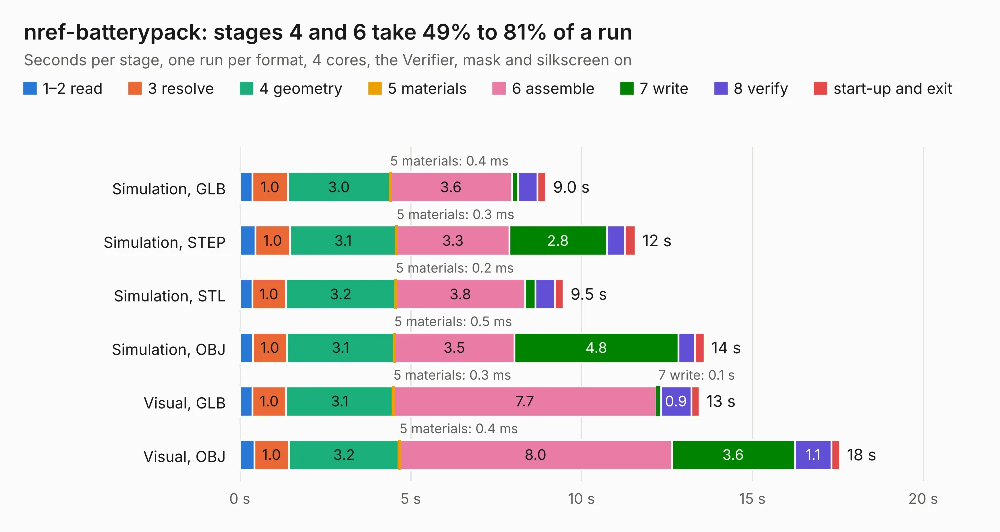

# 697. nref-batterypack

Board 697 of the 3,106 of [Corpus Testing](../Corpus-Testing.md), on [Corpus Page 7](../CorpusTestingPages/Corpus-Testing-07.md#697-nref-batterypack).

| Mode and format | 1–2 read | 3 resolve | 4 geometry | 5 materials | 6 assemble | 7 write | 8 verify | start-up and exit | Total |
|---|---:|---:|---:|---:|---:|---:|---:|---:|---:|
| Simulation, GLB | 0.4 | 1.0 | 3.0 | 0.4&nbsp;ms | 3.6 | 0.2 | 0.6 | 0.2 | 9.0 |
| Simulation, STEP | 0.5 | 1.0 | 3.1 | 0.3&nbsp;ms | 3.3 | 2.8 | 0.5 | 0.3 | 11.6 |
| Simulation, STL | 0.4 | 1.0 | 3.2 | 0.2&nbsp;ms | 3.8 | 0.3 | 0.6 | 0.3 | 9.5 |
| Simulation, OBJ | 0.4 | 1.0 | 3.1 | 0.5&nbsp;ms | 3.5 | 4.8 | 0.5 | 0.3 | 13.6 |
| Visual, GLB | 0.4 | 1.0 | 3.1 | 0.3&nbsp;ms | 7.7 | 0.1 | 0.9 | 0.2 | 13.4 |
| Visual, OBJ | 0.4 | 1.0 | 3.2 | 0.4&nbsp;ms | 8.0 | 3.6 | 1.1 | 0.2 | 17.6 |

<table align="center"><tr><td valign="top">

| Board | Repo: [cetola/reform-next-mirror](https://github.com/cetola/reform-next-mirror) Board: `nref-batterypack.kicad_pcb` |
|---|---|
| Folder | nref-batterypack-v3 |
| Complexity | 355&nbsp;/&nbsp;1000 (size&nbsp;240, features&nbsp;115) |
| KESE&nbsp;features | through vias, rounded, trapezoid or chamfered pads, filled zones, curved board outline, knockout text, TrueType text, stack-up, dielectric εr and tanδ |
| Tested | 9th November 2026 |
| Copper&nbsp;layers | 4 |
| File&nbsp;format | KiCad 10 (20260206) |
| Parts,&nbsp;tracks,&nbsp;vias | 85, 776, 191 |
| Triangles,&nbsp;simulation | 978,200 in 77 parts |
| Verifier | PASS in all six runs |

</td><td valign="top">

<table>
<tr><th>File type</th><th>File size</th><th>Peak memory used</th></tr>
<tr><th colspan="3" align="left">Simulation</th></tr>
<tr><td>GLB</td><td align="right">33&nbsp;MB</td><td align="right">421&nbsp;MB</td></tr>
<tr><td>STEP</td><td align="right">142&nbsp;MB</td><td align="right">545&nbsp;MB</td></tr>
<tr><td>STL</td><td align="right">49&nbsp;MB</td><td align="right">418&nbsp;MB</td></tr>
<tr><td>OBJ</td><td align="right">98&nbsp;MB</td><td align="right">700&nbsp;MB</td></tr>
<tr><th colspan="3" align="left">Visual</th></tr>
<tr><td>GLB</td><td align="right">24&nbsp;MB</td><td align="right">617&nbsp;MB</td></tr>
<tr><td>OBJ</td><td align="right">72&nbsp;MB</td><td align="right">599&nbsp;MB</td></tr>
</table>

</td></tr></table>

| Previous | Next |
|:---|---:|
| [696. nref-batterypack-backside](b0696b_reform-next-mirror_nref-batterypack-v3_nref-batterypack-backside.md) | [698. nref-batterypack-backside](b0698b_reform-next-mirror_nref-batterypack_nref-batterypack-backside.md) |
