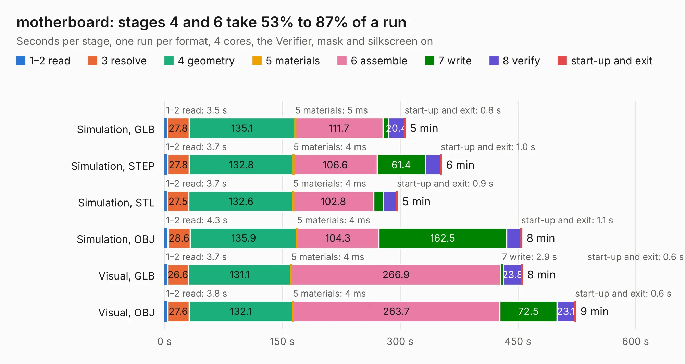

# 698. motherboard

Board 698 of the 3,125 of [Corpus Testing](../Corpus-Testing.md), on [Corpus Page 7](../CorpusTestingPages/Corpus-Testing-07.md#698-motherboard).

| Mode and format | 1–2 read | 3 resolve | 4 geometry | 5 materials | 6 assemble | 7 write | 8 verify | start-up and exit | Total |
|---|---:|---:|---:|---:|---:|---:|---:|---:|---:|
| Simulation, GLB | 3.5 | 27.8 | 135.1 | 5&nbsp;ms | 111.7 | 7.1 | 20.4 | 0.8 | 306.4 |
| Simulation, STEP | 3.7 | 27.8 | 132.8 | 4&nbsp;ms | 106.6 | 61.4 | 19.2 | 1.0 | 352.4 |
| Simulation, STL | 3.7 | 27.5 | 132.6 | 4&nbsp;ms | 102.8 | 11.9 | 17.2 | 0.9 | 296.6 |
| Simulation, OBJ | 4.3 | 28.6 | 135.9 | 4&nbsp;ms | 104.3 | 162.5 | 18.3 | 1.1 | 455.0 |
| Visual, GLB | 3.7 | 26.6 | 131.1 | 4&nbsp;ms | 266.9 | 2.9 | 23.8 | 0.6 | 455.7 |
| Visual, OBJ | 3.8 | 27.6 | 132.1 | 4&nbsp;ms | 263.7 | 72.5 | 23.1 | 0.6 | 523.4 |

<table align="center"><tr><td valign="top">

| Board | Repo: [c4puter/motherboard](https://github.com/c4puter/motherboard) Board: `motherboard.kicad_pcb` |
|---|---|
| Complexity | 402&nbsp;/&nbsp;1000 (size&nbsp;327, features&nbsp;75) |
| KESE&nbsp;features | through vias, slotted holes, drill offsets, filled zones, copper text, curved board outline |
| Tested | 9th November 2026 to 10th November 2026 |
| Copper&nbsp;layers | 6 |
| File&nbsp;format | KiCad 5 (20160815) |
| Parts,&nbsp;tracks,&nbsp;vias | 591, 22,267, 2,074 |
| Triangles,&nbsp;simulation | 22,500,734 in 1157 parts |
| Verifier | PASS in all six runs |
| Run&nbsp;again | Simulation, OBJ: failed in the corpus run, run again with the memory cap raised from 11 GB to 14.5 GB, and passed |

</td><td valign="top">

<table>
<tr><th>File type</th><th>File size</th><th>Peak memory used</th></tr>
<tr><th colspan="3" align="left">Simulation</th></tr>
<tr><td>GLB</td><td align="right">775&nbsp;MB</td><td align="right">4.5&nbsp;GB</td></tr>
<tr><td>STEP</td><td align="right">3.1&nbsp;GB</td><td align="right">6.1&nbsp;GB</td></tr>
<tr><td>STL</td><td align="right">1.1&nbsp;GB</td><td align="right">4.6&nbsp;GB</td></tr>
<tr><td>OBJ</td><td align="right">2.5&nbsp;GB</td><td align="right">14&nbsp;GB</td></tr>
<tr><th colspan="3" align="left">Visual</th></tr>
<tr><td>GLB</td><td align="right">389&nbsp;MB</td><td align="right">6.3&nbsp;GB</td></tr>
<tr><td>OBJ</td><td align="right">1.3&nbsp;GB</td><td align="right">7.9&nbsp;GB</td></tr>
</table>

</td></tr></table>

| Previous | Next |
|:---|---:|
| [697. motherboard-stable](b0697b_motherboard_motherboard-stable.md) | [699. OBC Development Board](b0699b_cts-sat-2-obc-pcb_OBC-Development-Board.md) |
