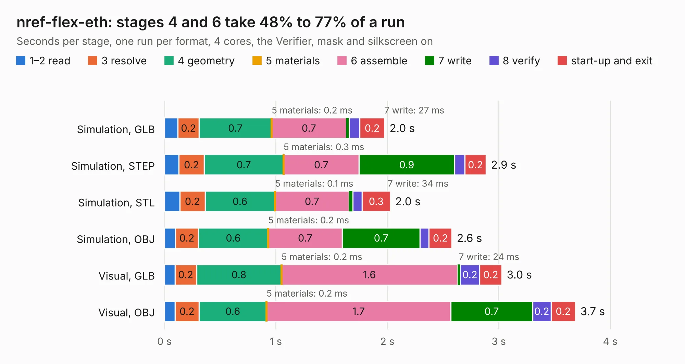

# 698. nref-flex-eth

Board 698 of the 3,100 of [Corpus Testing](../Corpus-Testing.md), on [Corpus Page 7](../CorpusTestingPages/Corpus-Testing-07.md#698-nref-flex-eth).

| Mode and format | 1–2 read | 3 resolve | 4 geometry | 5 materials | 6 assemble | 7 write | 8 verify | start-up and exit | Total |
|---|---:|---:|---:|---:|---:|---:|---:|---:|---:|
| Simulation, GLB | 0.1 | 0.2 | 0.7 | 0.2&nbsp;ms | 0.7 | 27&nbsp;ms | 95&nbsp;ms | 0.2 | 2.0 |
| Simulation, STEP | 0.1 | 0.2 | 0.7 | 0.3&nbsp;ms | 0.7 | 0.9 | 94&nbsp;ms | 0.2 | 2.9 |
| Simulation, STL | 0.1 | 0.2 | 0.6 | 0.1&nbsp;ms | 0.7 | 34&nbsp;ms | 84&nbsp;ms | 0.3 | 2.0 |
| Simulation, OBJ | 98&nbsp;ms | 0.2 | 0.6 | 0.2&nbsp;ms | 0.7 | 0.7 | 80&nbsp;ms | 0.2 | 2.6 |
| Visual, GLB | 94&nbsp;ms | 0.2 | 0.8 | 0.2&nbsp;ms | 1.6 | 24&nbsp;ms | 0.2 | 0.2 | 3.0 |
| Visual, OBJ | 94&nbsp;ms | 0.2 | 0.6 | 0.2&nbsp;ms | 1.7 | 0.7 | 0.2 | 0.2 | 3.7 |

<table align="center"><tr><td valign="top">

| Board | Repo: [cetola/reform-next-mirror](https://github.com/cetola/reform-next-mirror) Board: `nref-flex-eth.kicad_pcb` |
|---|---|
| Folder | nref-flex / nref-flex-eth |
| Complexity | 176&nbsp;/&nbsp;1000 (size&nbsp;126, features&nbsp;50) |
| KESE&nbsp;features | through vias, filled zones, TrueType text |
| Tested | 9th November 2026 |
| Copper&nbsp;layers | 2 |
| File&nbsp;format | KiCad 9 (20241229) |
| Parts,&nbsp;tracks,&nbsp;vias | 2, 88, 98 |
| Triangles,&nbsp;simulation | 147,362 in 22 parts |
| Verifier | PASS in all six runs |

</td><td valign="top">

<table>
<tr><th>File type</th><th>File size</th><th>Peak memory used</th></tr>
<tr><th colspan="3" align="left">Simulation</th></tr>
<tr><td>GLB</td><td align="right">5.2&nbsp;MB</td><td align="right">212&nbsp;MB</td></tr>
<tr><td>STEP</td><td align="right">18&nbsp;MB</td><td align="right">223&nbsp;MB</td></tr>
<tr><td>STL</td><td align="right">7.4&nbsp;MB</td><td align="right">211&nbsp;MB</td></tr>
<tr><td>OBJ</td><td align="right">15&nbsp;MB</td><td align="right">217&nbsp;MB</td></tr>
<tr><th colspan="3" align="left">Visual</th></tr>
<tr><td>GLB</td><td align="right">5.4&nbsp;MB</td><td align="right">205&nbsp;MB</td></tr>
<tr><td>OBJ</td><td align="right">15&nbsp;MB</td><td align="right">203&nbsp;MB</td></tr>
</table>

</td></tr></table>

| Previous | Next |
|:---|---:|
| [697. reform-camera](b0697b_reform-next-mirror_reform-camera.md) | [699. nref-flex-dp-140mm](b0699b_reform-next-mirror_nref-flex-dp-140mm.md) |
